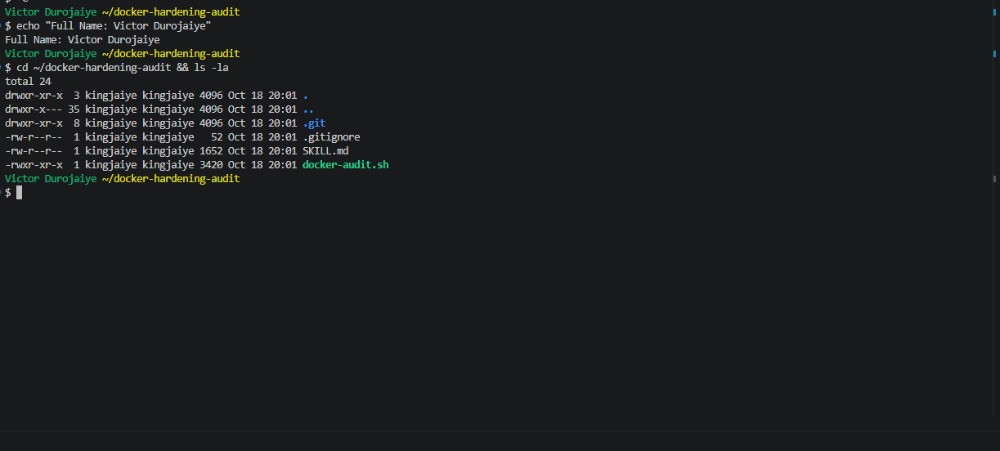
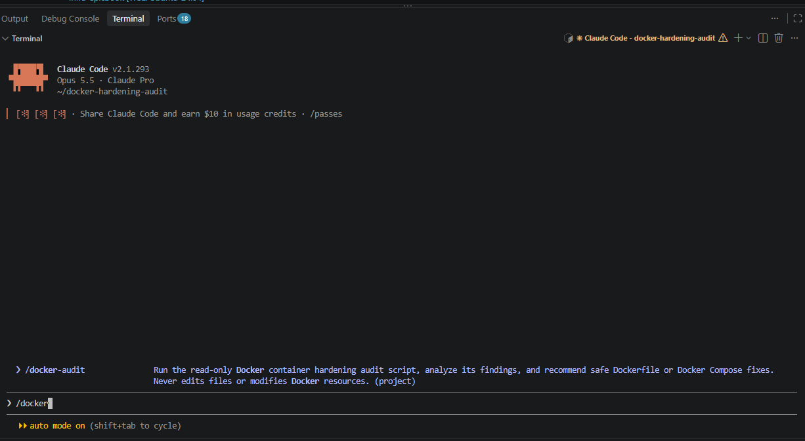
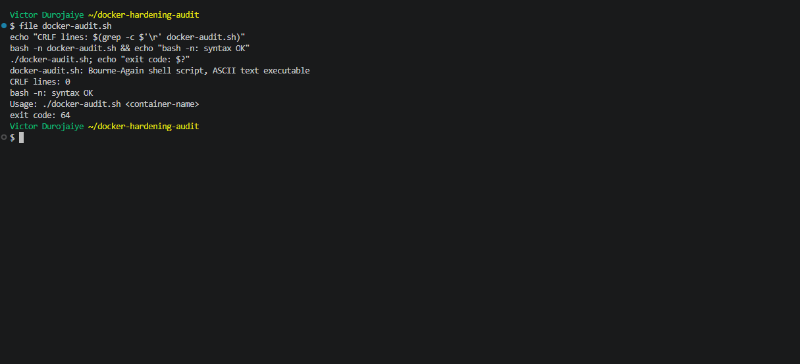
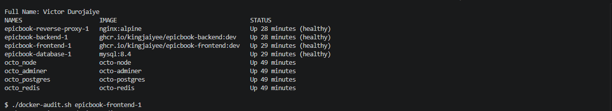
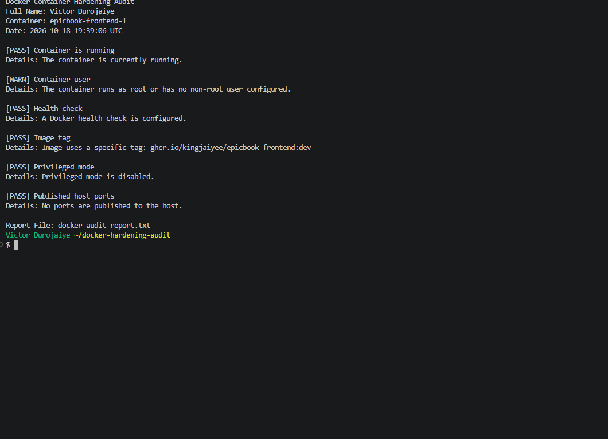
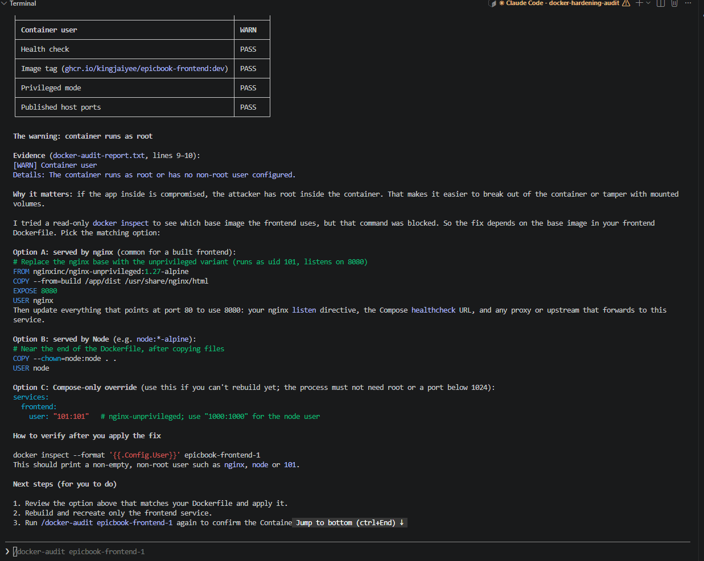
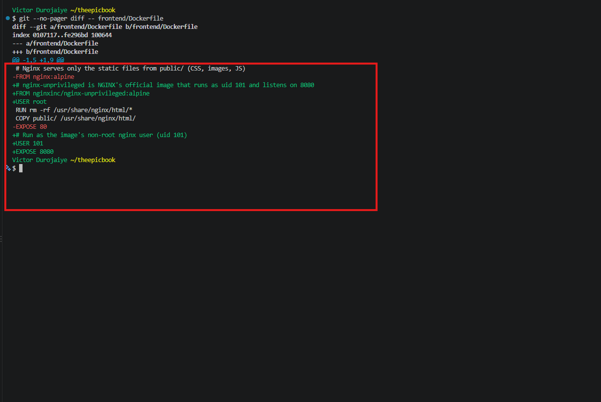
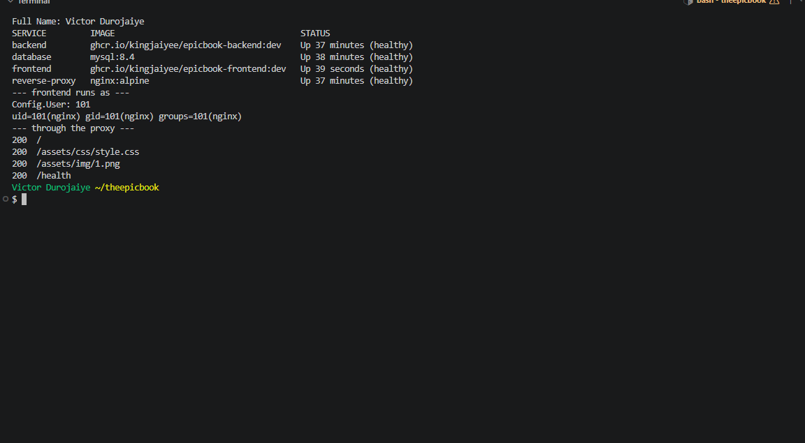
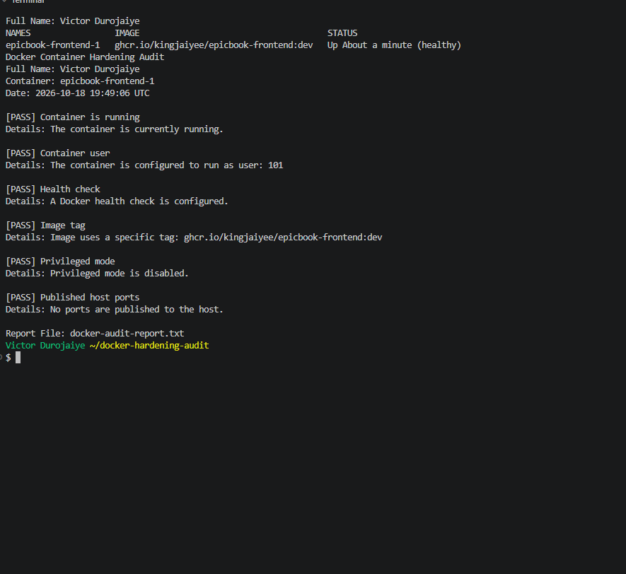
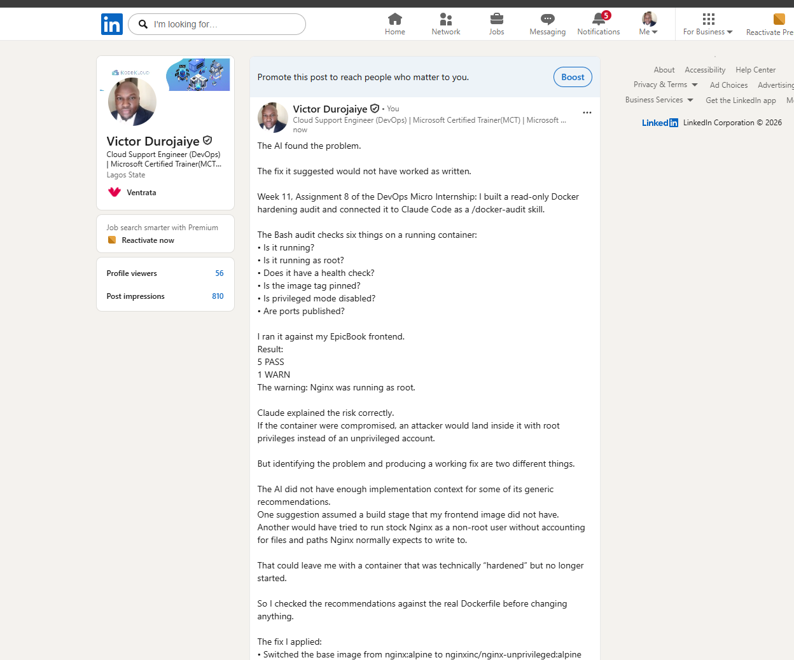

# Assignment 8 — AI-Assisted Docker Container Hardening Audit

Part of the DevOps Micro Internship (DMI) with Agentic AI

---

## Purpose

In this assignment, you will build a read-only Bash script that audits a running Docker container for common hardening gaps — running as root, missing health checks, unpinned image tags, privileged mode, and unnecessary exposed ports — then connect that script to Claude Code as a reusable `/docker-audit` skill. You will run the audit against your production-grade EpicBook stack, fix what it finds by editing the Dockerfile yourself, rebuild the image, and re-run the audit to prove the fix worked. Claude analyzes evidence and recommends a fix; it never edits your Dockerfile or rebuilds the image itself.

---

# Target Container

**Target Container Name:** `epicbook-frontend-1`

---

# Task 1 — Prepare the Audit Workspace

## Goal

Create an audit workspace and confirm that the supplied files are available.

### Evidence

#### Screenshot 1 — Audit Workspace Files

Add a terminal screenshot showing your full name and both supplied files:

```text
docker-audit.sh
SKILL.md
```



---

# Task 2 — Add the Docker Audit Skill to Claude Code

## Goal

Add the supplied `docker-audit` skill to Claude Code and confirm that it is available.

### Evidence

#### Screenshot 2 — Docker Audit Skill Available in Claude Code

Add a screenshot of Claude Code showing `docker-audit` in the available skill list.



---

# Task 3 — Validate the Audit Script

## Goal

Verify the audit script line endings, Bash syntax, and usage message.

### Evidence

#### Screenshot 3 — Script Validation

Add a terminal screenshot showing:

- LF line-ending check
- Successful `bash -n docker-audit.sh` validation
- Your full name
- The usage message displayed when the script runs without a container name



---

# Task 4 — Run the Initial Docker Security Audit

## Goal

Audit a running container and record the initial findings.

### Evidence

#### Screenshot 4 — Selected Target Container

Add a terminal screenshot showing:

- Your full name
- `docker ps`
- The audit command using the selected target container name



---

#### Screenshot 5 — Initial Audit Results

Add a terminal screenshot showing the initial Docker audit results.



---

# Task 5 — Use AI Assistance to Understand the Findings

## Goal

Use the supplied `docker-audit` skill to understand the initial audit results safely.

### Evidence

#### Screenshot 6 — Audit Explanation and Recommended Fix

Add a Claude Code screenshot showing:

- Audit finding
- Security risk
- Recommended manual fix
- Verification method



---

# Task 6 — Apply One Container-Hardening Fix

## Goal

Manually fix one WARN or FAIL finding from the initial audit.

### Evidence

#### Screenshot 7 — Hardening Configuration Change

Add a screenshot of the updated Dockerfile or `docker-compose.yml` showing the selected hardening fix.



---

#### Screenshot 8 — Updated Service Running

Add a terminal screenshot showing your full name and the rebuilt or recreated service/container running successfully.



---

# Task 7 — Re-Run the Audit and Compare Results

## Goal

Verify that the selected hardening fix improved the container configuration.

### Evidence

#### Screenshot 9 — Final Audit Results

Add a terminal screenshot showing:

- Your full name
- The updated running container
- The final audit report



---

### Before-and-After Comparison

Write a short comparison covering:

- Initial audit finding
- Dockerfile or Docker Compose change applied
- Final audit result
- Security benefit of the improvement

**Initial audit finding:** the first audit of `epicbook-frontend-1` returned 5 PASS and 1 WARN. The WARN was `Container user`: the container ran as root, because the `nginx:alpine` base image sets no `USER`.

**Change applied:** I edited `frontend/Dockerfile` by hand to build from `nginxinc/nginx-unprivileged:alpine`, NGINX's official non-root image, and to end with `USER 101`. That image listens on 8080, so I also pointed the Compose health check at `127.0.0.1:8080`, the proxy upstream at `frontend:8080`, and updated the docs. I rebuilt and recreated only the frontend, then reloaded the proxy. The change is on branch `hardening/frontend-non-root`, commit `3cf4328`.

**Final audit result:** 6 of 6 PASS. `Container user` now reads `configured to run as user: 101`, the service is healthy, and pages, assets and `/health` all return 200 through the proxy. A diff of the two reports shows exactly one line changed, WARN to PASS.

**Security benefit:** if nginx is ever exploited, the attacker lands as an unprivileged user instead of root. They can't change the server's own files, install packages or take over the container, which limits the damage and the options for escaping to the host.

Claude explained the risk well, but it could not read the Dockerfile, so its suggested fixes were generic: one copied from a build stage this image does not have, and another would have run stock nginx as non-root, which fails because nginx can't write its PID file and cache folders. I checked each suggestion against the real files before changing anything. Deny rules in `.claude/settings.json` blocked file edits and Docker changes, so every change was mine.

---

# LinkedIn Requirement

## Goal

Create a LinkedIn post about the container security checks you performed, one hardening improvement you applied, and why the improvement matters.

### Evidence

**LinkedIn Post URL:** `https://www.linkedin.com/posts/victor-jaiye_devopsmicrointernship-docker-containersecurity-share-7517675559154462720-oeFb/`

#### LinkedIn Post Screenshot

Add a screenshot of the published LinkedIn post, including the final audit result.



---

# Submission Instructions

- Include Screenshots 1–9 exactly as specified.
- Include the target container name and before-and-after comparison.
- Include the LinkedIn post URL and screenshot.
- Ensure that your full name is visible in all required terminal screenshots.
- Do not expose passwords, API keys, tokens, account IDs, or `.env` file contents.

---

# Completion Checklist

- [x] Audit workspace created and supplied files verified
- [x] `docker-audit` skill added to Claude Code
- [x] Audit script validated successfully
- [x] Running target container identified
- [x] Initial Docker audit completed
- [x] Claude Code explanation of findings captured
- [x] One hardening fix applied manually
- [x] Affected service or container rebuilt and recreated
- [x] Final Docker audit completed
- [x] Before-and-after comparison completed
- [x] Screenshots 1–9 included
- [x] LinkedIn post URL and screenshot included
- [x] No sensitive information exposed

---

## 📌 About DMI & CloudAdvisory

DevOps Micro Internship (DMI) is a project-based DevOps program run by Pravin Mishra (The CloudAdvisory) focused on real-world execution, systems thinking, and career readiness.

It helps learners build strong DevOps foundations with hands-on experience.

---

## 📌 Resources

- 🌐 DMI Official Website: https://dmi.pravinmishra.com?utm_source=github&utm_medium=readme  
- 🎓 University: https://university.pravinmishra.com?utm_source=github&utm_medium=readme  
- 💬 Discord Community: https://discord.pravinmishra.com?utm_source=github&utm_medium=readme  
- 📝 Blog: https://dmi.pravinmishra.com/blog?utm_source=github&utm_medium=readme  
- ▶️ YouTube Playlist: https://www.youtube.com/playlist?list=PLFeSNDtI4Cho  
- 🔗 Pravin Mishra (LinkedIn): https://www.linkedin.com/in/pravin-mishra-aws-trainer/  
- 🏢 CloudAdvisory (LinkedIn): https://www.linkedin.com/company/thecloudadvisory/

---

*This submission is part of DevOps Micro Internship (DMI) — Agentic AI Track.*
