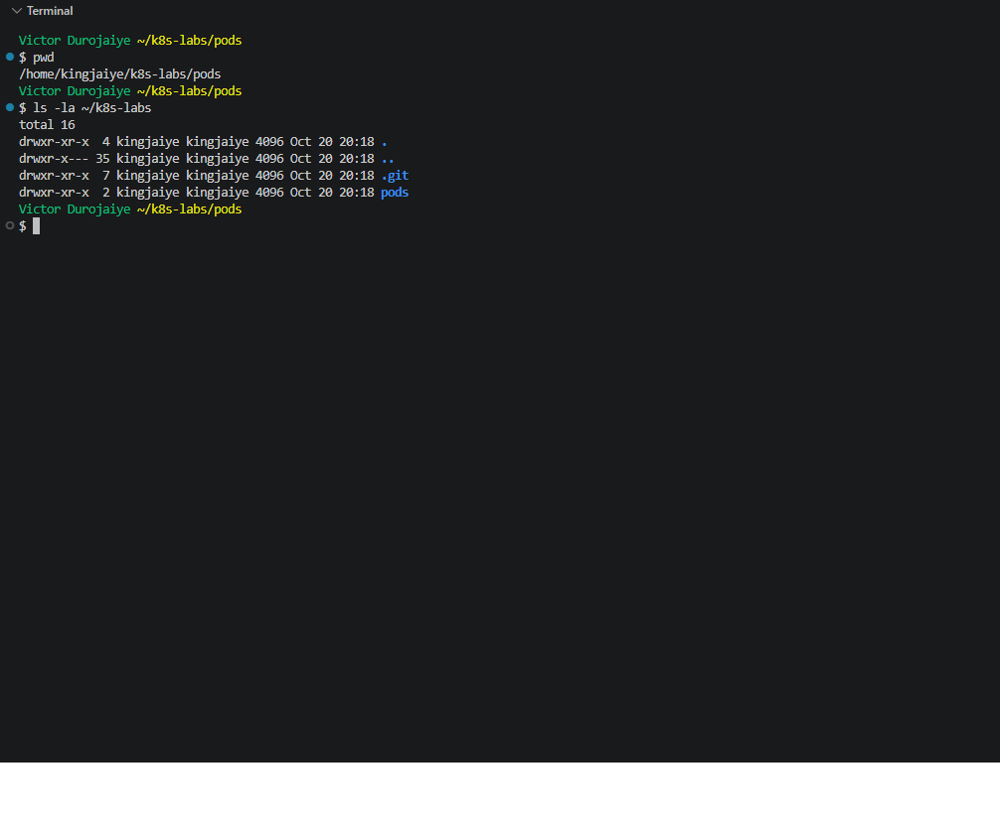
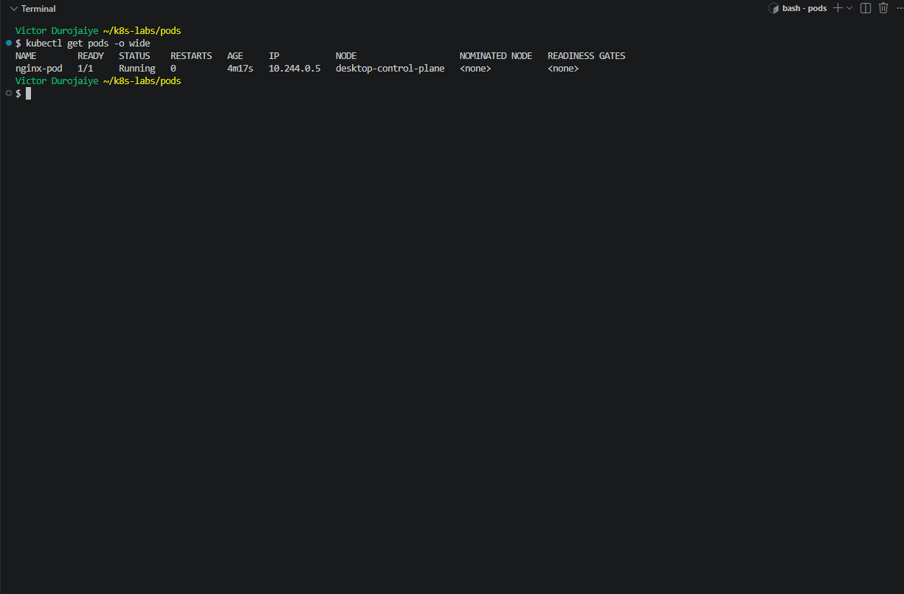
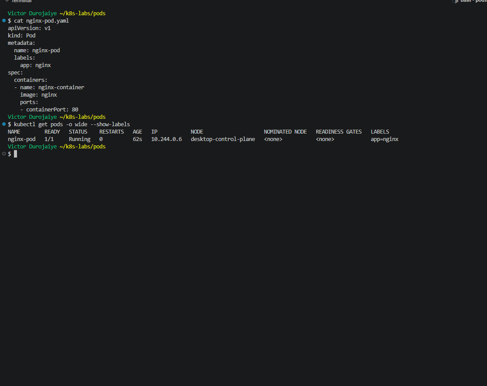
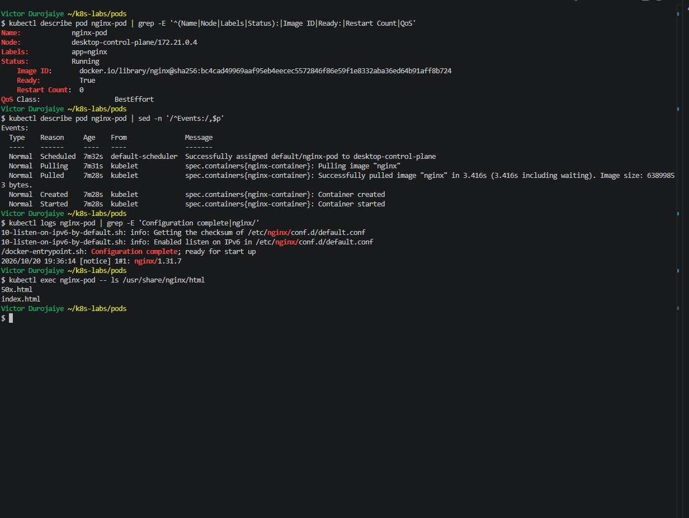

# Assignment 1 — Creating Your First Pod in Kubernetes

Part of the DevOps Micro Internship (DMI) with Agentic AI

---

## Purpose

In this guided lab, you will create an NGINX Pod first imperatively with `kubectl run`, then declaratively with a YAML manifest, and practice inspecting, logging into, and executing commands inside the Pod.

---

# Task 1 — Set Up Your Lab Folder

## Goal

Create the `~/k8s-labs/pods` working directory for all Pod-related files.

### Evidence

#### Screenshot 1 — Terminal showing the `~/k8s-labs/pods` working directory



**Notes:** I created `~/k8s-labs/pods` in my WSL home and made `~/k8s-labs` a git repo, so manifests are committed before they go into this fork. The cluster is Docker Desktop's built-in Kubernetes. It is a kind-type cluster with context `docker-desktop`, one node `desktop-control-plane`, and version v1.36.1. kubectl client is also v1.36.1. The solution doc installs kind v0.22.0 and creates a second cluster. The template does not ask for that, and I already had a kind cluster, so I skipped it.

---

# Task 2 — Create a Pod Imperatively

## Goal

Create `nginx-pod` with `kubectl run --image=nginx`, verify it reaches Running, then delete it so the name can be reused by the YAML manifest.

### Evidence

#### Screenshot 2 — Terminal showing `nginx-pod` in Running state before deletion



**Notes:** I ran `kubectl run nginx-pod --image=nginx`, then `kubectl wait --for=condition=Ready` instead of waiting a fixed two minutes. The Pod reached `1/1 Running` on `desktop-control-plane` with 0 restarts and IP `10.244.0.5`. I took the screenshot first, then ran `kubectl delete pod nginx-pod`, and `kubectl get pods` returned `No resources found in default namespace.` A Pod made this way has nothing managing it, so nothing brings it back once it is deleted.

---

# Task 3 — Create a Pod Declaratively

## Goal

Write `nginx-pod.yaml` (apiVersion `v1`, kind `Pod`, label `app: nginx`, container `nginx-container` using image `nginx`, port 80), apply it, and confirm it reaches Running.

### Evidence

#### Screenshot 3 — `nginx-pod.yaml` and terminal output showing `nginx-pod` in Running state



Manifest (also committed as [manifests/a1-nginx-pod.yaml](./manifests/a1-nginx-pod.yaml)):

```yaml
apiVersion: v1
kind: Pod
metadata:
  name: nginx-pod
  labels:
    app: nginx
spec:
  containers:
  - name: nginx-container
    image: nginx
    ports:
    - containerPort: 80
```

**Notes:** I checked the manifest with `kubectl apply --dry-run=server` first, committed it to my lab repo (`c12d3a2`), then applied it. The Pod reached `1/1 Running` with label `app=nginx`, container `nginx-container`, port 80 and 0 restarts. The new IP `10.244.0.6` shows this is a fresh Pod, not the one from Task 2. Imperative means I type the command and the cluster does it once, with no record left behind. Declarative means the desired state lives in a file I can commit, review and apply again. `image: nginx` has no tag, so it pulled `latest`. That resolved to nginx 1.31.7, digest `sha256:bc4cad49...`. The template specifies `nginx`, so I kept it, but in later work I will pin a tag or digest.

---

# Task 4 — Inspect and Access the Pod

## Goal

Run `kubectl describe`, `kubectl logs`, and `kubectl exec -it ... -- /bin/bash` to inspect the Pod and browse `/usr/share/nginx/html`.

### Evidence

#### Screenshot 4 — Terminal showing `kubectl describe`, `kubectl logs`, or the `/usr/share/nginx/html` directory



**Notes:**
- **describe:** shows the Pod on `desktop-control-plane`, with `app=nginx`, `nginx-container` on `80/TCP`, Running, Ready True and Restart Count 0.
  - There are five Conditions, and all are True. They include `PodReadyToStartContainers`, which the solution doc does not show.
  - QoS is `BestEffort` because I set no CPU or memory requests or limits.
  - The Events run Scheduled, Pulling, Pulled (3.4s), Created, Started, with no warnings.
- **logs:** show `Configuration complete; ready for start up`, nginx 1.31.7 and 16 worker processes, with no errors.
- **exec:** inside `kubectl exec -it nginx-pod -- /bin/bash`, `/usr/share/nginx/html` holds `50x.html` and `index.html`. `hostname` printed `nginx-pod`, `whoami` printed `root`, and `pwd` printed `/`.
  - The container runs as root. That is fine for a first lab, but not for production.
- **describe vs logs:** describe tells me what Kubernetes did. Logs tell me what the app did.
- **Cleanup:** after the evidence I deleted the Pod and confirmed `No resources found in default namespace.`

---

# Task 5 — Share Your First Kubernetes Pod on WhatsApp Status

## Goal

Share your Kubernetes learning progress on WhatsApp Status, including your generated DMI leaderboard progress link.

### Steps

1. Go to the DMI Leaderboard.
2. Find your name and select **Share your progress**.
3. Click the **WhatsApp icon**.
4. Copy the automatically generated leaderboard message containing your rank and progress link.
5. Open WhatsApp and go to **Updates**.
6. Create a new text Status.
7. Copy and paste the message below.
8. Add the generated leaderboard message in the indicated place.
9. Review and publish your Status.

### WhatsApp Status Message

I created my first Kubernetes Pod as part of my DevOps learning journey! 🚀

Today, I deployed an NGINX Pod using both imperative kubectl commands and a declarative YAML manifest.

I also checked its status, inspected its details, viewed its logs, and accessed the container shell.

[PASTE YOUR GENERATED LEADERBOARD MESSAGE AND LINK HERE]

#DMIByPravinMishra #DevOps #Kubernetes

### Evidence

#### Screenshot 5 — Published WhatsApp Status showing your Kubernetes Pod message and generated DMI leaderboard progress link

Add your screenshot here.

---

# Submission Instructions

- Add all required screenshots in your submission
- Include the completed `nginx-pod.yaml` manifest
- Ensure all screenshots are clear and readable.
- Explain the difference between imperative and declarative Pod creation in your own words.
- Do not expose passwords, access tokens, or private keys.

---

# Completion Checklist

- [x] Task 1: Lab directory created (Screenshot 1)
- [x] Task 2: Pod created imperatively, verified, and deleted (Screenshot 2)
- [x] Task 3: Pod created declaratively and verified Running (Screenshot 3)
- [x] Task 4: Pod inspected via describe/logs/exec (Screenshot 4)
- [x] Understood the difference between imperative and declarative methods
- [ ] Task 5: Published the WhatsApp Status (Screenshot 5)
- [ ] No sensitive data exposed

---

## 📌 About DMI & CloudAdvisory

DevOps Micro Internship (DMI) is a project-based DevOps program run by Pravin Mishra (The CloudAdvisory) focused on real-world execution, systems thinking, and career readiness.

It helps learners build strong DevOps foundations with hands-on experience.

---

## 📌 Resources

- 🌐 DMI Official Website: https://dmi.pravinmishra.com?utm_source=github&utm_medium=readme  
- 🎓 University: https://university.pravinmishra.com?utm_source=github&utm_medium=readme  
- 💬 Discord Community: https://discord.pravinmishra.com?utm_source=github&utm_medium=readme  
- 📝 Blog: https://dmi.pravinmishra.com/blog?utm_source=github&utm_medium=readme  
- ▶️ YouTube Playlist: https://www.youtube.com/playlist?list=PLFeSNDtI4Cho  
- 🔗 Pravin Mishra (LinkedIn): https://www.linkedin.com/in/pravin-mishra-aws-trainer/  
- 🏢 CloudAdvisory (LinkedIn): https://www.linkedin.com/company/thecloudadvisory/

---

*This submission is part of DevOps Micro Internship (DMI) — Agentic AI Track.*
