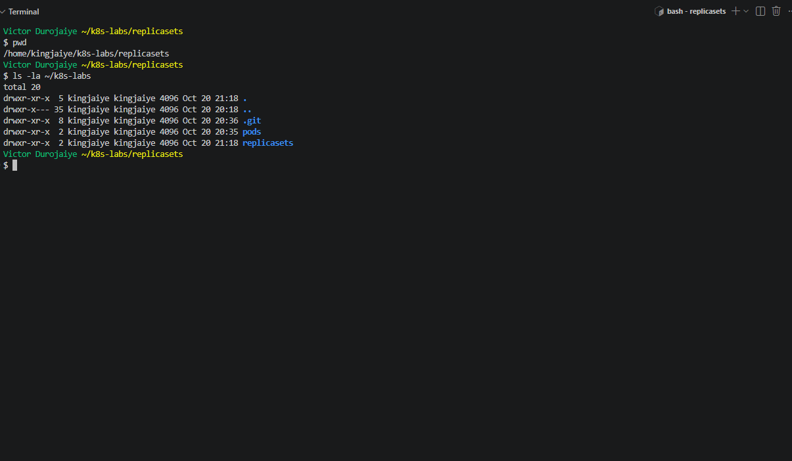
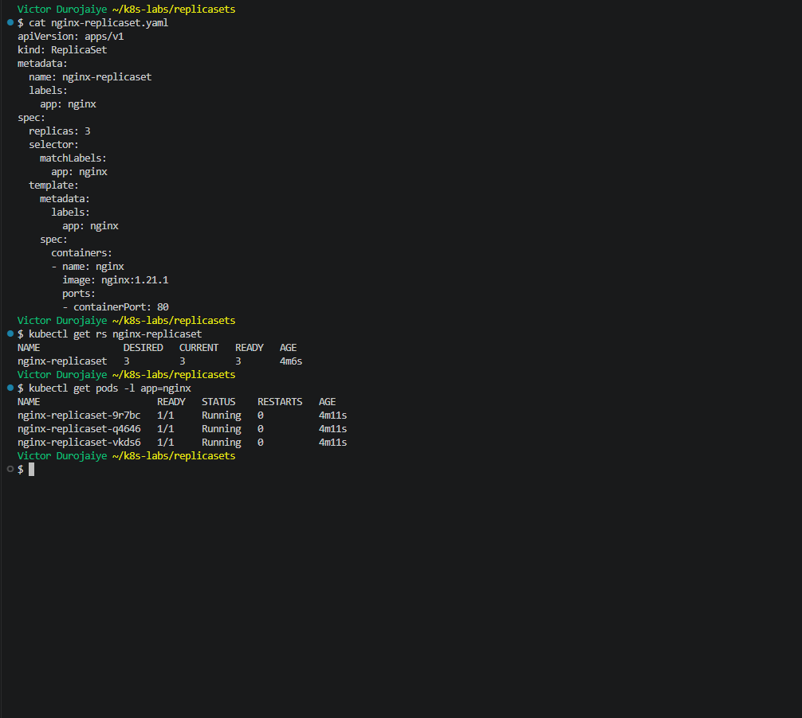
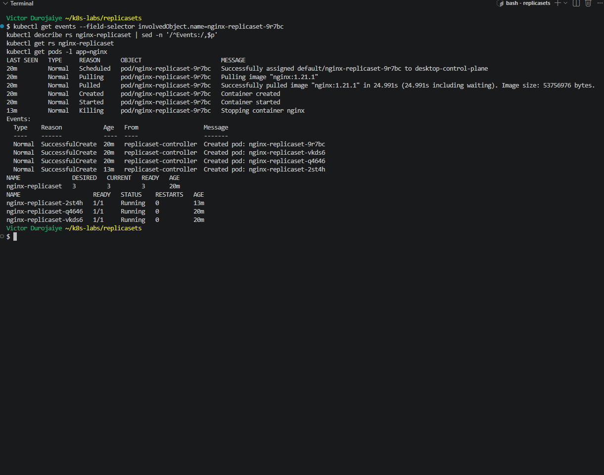
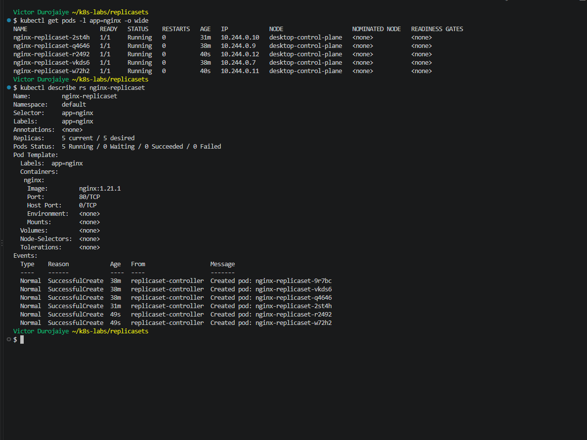
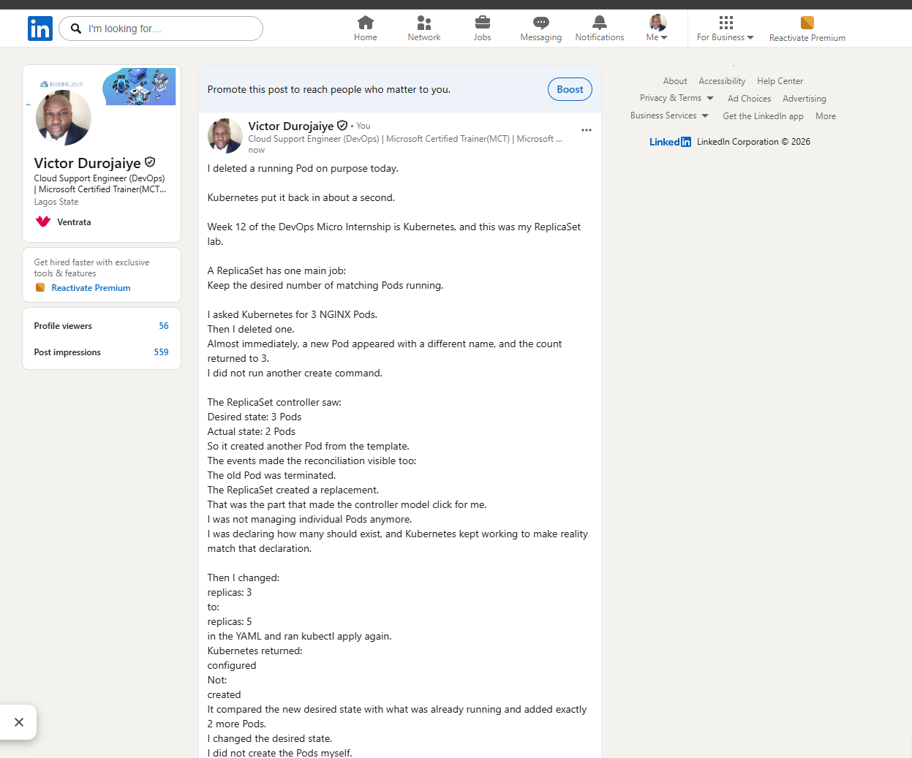

# Assignment 2 — ReplicaSets: Keeping Your Pods Alive

Part of the DevOps Micro Internship (DMI) with Agentic AI

---

## Purpose

In this guided lab, you will create an NGINX ReplicaSet, verify it maintains three Pods, test its auto-healing behavior by deleting a Pod, and scale it from three to five replicas.

---

# Task 0 — Pre-check: Remove the Pod from Assignment 01

## Goal

Confirm that you are connected to your learning cluster and remove the previous standalone Pod to prevent the ReplicaSet from adopting it.

### Evidence

No screenshots required.

---

# Task 1 — Set Up Your Working Directory

## Goal

Create the `~/k8s-labs/replicasets` working directory.

### Evidence

#### Screenshot 1 — Terminal showing the `~/k8s-labs/replicasets` working directory



**Notes:** I created `~/k8s-labs/replicasets` next to `pods/` in my lab git repo. Before starting, I checked that the context was `docker-desktop` and that no `app=nginx` Pods or ReplicaSets were left from Assignment 1. A leftover Pod with that label would be adopted by the new ReplicaSet and counted as one of its replicas. The solution doc's screenshots use `~/k8s-labs/pods/replicasets`, so I followed the template path instead.

---

### Notes — Template Questions

**1. Why is it useful to keep Kubernetes manifests in organized directories?**

Each lab gets its own folder, so files with similar names, like `nginx-pod.yaml` and `nginx-replicaset.yaml`, do not get mixed up. I can find a manifest and apply it again later. And because `~/k8s-labs` is a git repo, the history of each folder shows exactly what changed in that lab.

---

**2. What file will you create in this directory for this assignment?**

`nginx-replicaset.yaml`, the ReplicaSet manifest.

---

# Task 2 — Create and Apply the ReplicaSet

## Goal

Write `nginx-replicaset.yaml` (apiVersion `apps/v1`, kind `ReplicaSet`, 3 replicas, `selector.matchLabels` matching `template.metadata.labels` as `app: nginx`, image `nginx:1.21.1`), apply it, and confirm three Pods are created.

### Evidence

#### Screenshot 2 — `nginx-replicaset.yaml` and terminal output showing three running Pods



**Notes:** I checked the manifest with `kubectl apply --dry-run=server`, committed it (`03b3458`), applied it, and waited with `kubectl wait --for=condition=Ready pod -l app=nginx`. The ReplicaSet showed `DESIRED 3 CURRENT 3 READY 3`, with Pods `9r7bc`, `q4646` and `vkds6` all `1/1 Running`. Each Pod has an ownerReference to `nginx-replicaset`, which is how Kubernetes links a Pod to its controller. The selector `app: nginx` must match the template label, or the API rejects the ReplicaSet. `nginx:1.21.1` is pinned, which is better than `latest`, but it is a 2021 image with known CVEs. I kept it because the template specifies it.

---

### Notes — Template Questions

**1. What does `replicas: 3` mean in this manifest?**

It is the desired number of Pods. The ReplicaSet keeps exactly 3 identical NGINX Pods running. If there are fewer, it creates more. If there are more, it removes some.

---

**2. Why must `selector.matchLabels` match `template.metadata.labels`?**

The selector is how the ReplicaSet finds the Pods it owns. The template labels are what it puts on every Pod it creates. If they did not match, the ReplicaSet would never count its own Pods and would keep creating new ones. The API refuses that, so it rejects the manifest.

---

**3. What image and image tag are used for the NGINX container?**

Image `nginx` with tag `1.21.1`, so `nginx:1.21.1`.

---

# Task 3 — Test ReplicaSet Auto-Healing

## Goal

Delete one Pod managed by `nginx-replicaset` and confirm Kubernetes creates a replacement, restoring the desired count of three.

### Evidence

#### Screenshot 3 — Terminal showing the deleted Pod and the newly created replacement, with the desired count remaining three



**Notes:** I deleted `nginx-replicaset-9r7bc`. Its events end with `Killing`. Running `kubectl get pods` straight after the delete already showed the replacement `nginx-replicaset-2st4h` at `1/1 Running`, 1 second old. It started that fast because the image was already on the node. The ReplicaSet events show a fourth `SuccessfulCreate` for `2st4h`, and the count stayed `3 3 3`. I did not create anything by hand. The controller saw 2 Pods where it wanted 3 and made one more from the template.

---

### Notes — Template Questions

**1. What happened after you deleted one Pod?**

`nginx-replicaset-9r7bc` was stopped (a `Killing` event). Within about a second, a new Pod, `nginx-replicaset-2st4h`, was Running in its place, and the ReplicaSet was back at 3 Pods.

---

**2. How does the ReplicaSet know that a replacement Pod is needed?**

Its controller runs a loop. It keeps comparing the desired count (`replicas: 3`) with the number of Pods that match its selector `app=nginx`. After the delete it counted 2, so it created one Pod from its template to close the gap.

---

**3. What proves that auto-healing worked successfully?**

- The new Pod has a different name and a much younger age than the other two.
- The ReplicaSet events show a fourth `SuccessfulCreate` for `2st4h`.
- The new Pod's ownerReference is `nginx-replicaset`.
- `kubectl get rs` still showed `3 3 3`.

---

# Task 4 — Scale and Inspect the ReplicaSet

## Goal

Change `replicas` from 3 to 5, reapply the manifest, and confirm five Pods are managed, then inspect the ReplicaSet with `describe` and `get pods -o wide`.

### Evidence

#### Screenshot 4 — Terminal showing five Pods and the `nginx-replicaset` details



Completed manifest:

```yaml
apiVersion: apps/v1
kind: ReplicaSet
metadata:
  name: nginx-replicaset
  labels:
    app: nginx
spec:
  replicas: 5
  selector:
    matchLabels:
      app: nginx
  template:
    metadata:
      labels:
        app: nginx
    spec:
      containers:
      - name: nginx
        image: nginx:1.21.1
        ports:
        - containerPort: 80
```

**Notes:**
- **Scale-up:** I changed `replicas: 3` to `replicas: 5` in the file. The git diff was one line, committed as `2d8ad9e`. Reapplying printed `configured`, not `created`, because the ReplicaSet already existed.
- **describe:** it shows `Selector: app=nginx`, `Replicas: 5 current / 5 desired`, `Pods Status: 5 Running`, and the template image `nginx:1.21.1`.
- **`get pods -o wide`:** it shows five Pods on `desktop-control-plane`, each with its own IP. The two new ones are `r2492` and `w72h2`, 15 seconds old next to Pods 30 and 38 minutes old.
- **Events:** there are six `SuccessfulCreate` lines in total: 3 at the start, 1 replacement and 2 from the scale-up.
- **Why Deployments are preferred:** a ReplicaSet only keeps the Pod count right. If I changed the image in its template, the Pods already running would keep the old image. Only Pods created after the change would get the new one. There is no rolling update and no revision history to roll back to. A Deployment manages ReplicaSets for you. On a template change it creates a new ReplicaSet, moves Pods across a few at a time, and keeps the old ReplicaSet so it can roll back.
- **Cleanup:** I deleted the ReplicaSet, which also removed its five Pods, and confirmed `No resources found in default namespace.`

---

### Notes — Template Questions

**1. What change did you make to scale the ReplicaSet?**

I changed one line in `nginx-replicaset.yaml` from `replicas: 3` to `replicas: 5`, committed it, and ran `kubectl apply -f nginx-replicaset.yaml`. The output said `configured`.

---

**2. Did you manually create the additional Pods? Explain why or why not.**

No. I only changed the desired count. The ReplicaSet saw 3 Pods against a desired 5 and created `r2492` and `w72h2` from its template. Their events come from `replicaset-controller`, not from me.

---

**3. What would happen if you changed the replica count from five back to three?**

After I applied it, the ReplicaSet would see 5 Pods against a desired 3 and delete 2 of them until only 3 were left. It is the same reconcile loop, working in the other direction.

---

# LinkedIn Requirement

Create a LinkedIn post that includes:

- A short explanation of what a Kubernetes ReplicaSet does.
- What happened when you deleted one NGINX Pod.
- How Kubernetes automatically created a replacement Pod to maintain the desired replica count.
- What you learned by changing the replica count from three to five.
- One screenshot showing either:
  - Three Pods running after the auto-healing test, or
  - Five Pods running after scaling the ReplicaSet.

Do not share sensitive information, cluster credentials, tokens, or kubeconfig details in your post.

### Evidence

#### Screenshot 5 — Published LinkedIn post showing your name, the required explanation, and the attached Pod screenshot



*Victor Durojaiye*

---

### Post Link

https://www.linkedin.com/posts/victor-jaiye_devopsmicrointernship-kubernetes-devops-share-7518676494848667648-i2Q4/

---

# Submission Instructions

- Add all required screenshots in your submission
- Include the completed `nginx-replicaset.yaml` manifest
- Full Name must be visible in required screenshots.
- Ensure screenshots are clear and readable.
- Complete the Notes sections in Tasks 1–4 in your own words.
- Include the published LinkedIn post URL.
- Do not expose tokens, passwords, private keys, kubeconfig files, or account IDs.

---

# Completion Checklist

- [x] Completed Task 0 and confirmed that the previous `nginx-pod` is no longer listed
- [x] Task 1: Lab directory created (Screenshot 1)
- [x] Task 2: ReplicaSet created with three Pods (Screenshot 2)
- [x] Task 3: Auto-healing observed after deleting a Pod (Screenshot 3)
- [x] Task 4: Scaled to five Pods and inspected (Screenshot 4)
- [x] Understood why Deployments are preferred for rolling updates and rollbacks
- [x] Completed the Notes — Template Questions in Tasks 1–4
- [x] Published the LinkedIn post with the required explanation and Pod screenshot (Screenshot 5)
- [x] Included the published LinkedIn post URL
- [x] No sensitive data exposed

---

## 📌 About DMI & CloudAdvisory

DevOps Micro Internship (DMI) is a project-based DevOps program run by Pravin Mishra (The CloudAdvisory) focused on real-world execution, systems thinking, and career readiness.

It helps learners build strong DevOps foundations with hands-on experience.

---

## 📌 Resources

- 🌐 DMI Official Website: https://dmi.pravinmishra.com?utm_source=github&utm_medium=readme  
- 🎓 University: https://university.pravinmishra.com?utm_source=github&utm_medium=readme  
- 💬 Discord Community: https://discord.pravinmishra.com?utm_source=github&utm_medium=readme  
- 📝 Blog: https://dmi.pravinmishra.com/blog?utm_source=github&utm_medium=readme  
- ▶️ YouTube Playlist: https://www.youtube.com/playlist?list=PLFeSNDtI4Cho  
- 🔗 Pravin Mishra (LinkedIn): https://www.linkedin.com/in/pravin-mishra-aws-trainer/  
- 🏢 CloudAdvisory (LinkedIn): https://www.linkedin.com/company/thecloudadvisory/

---

*This submission is part of DevOps Micro Internship (DMI) — Agentic AI Track.*
