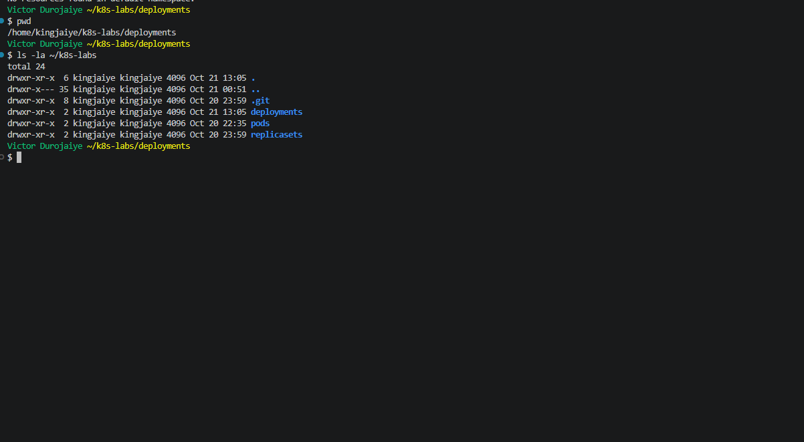
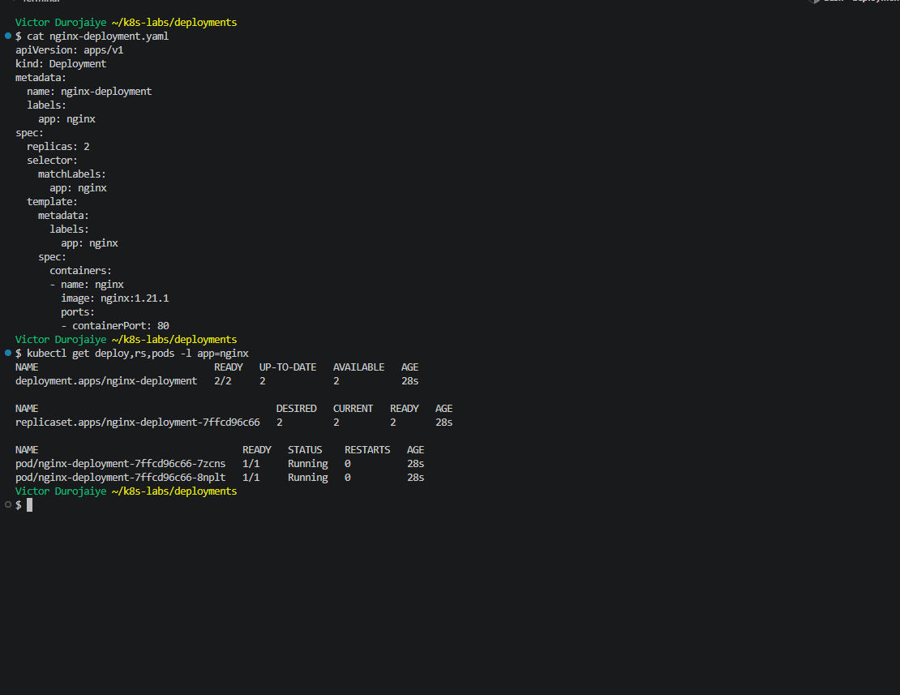
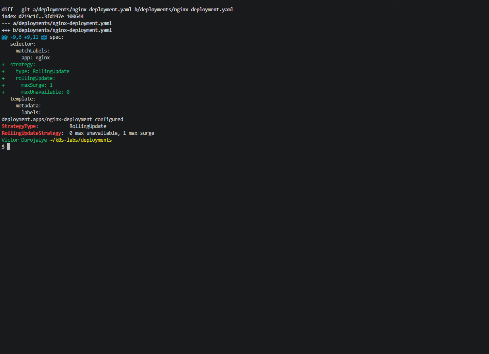
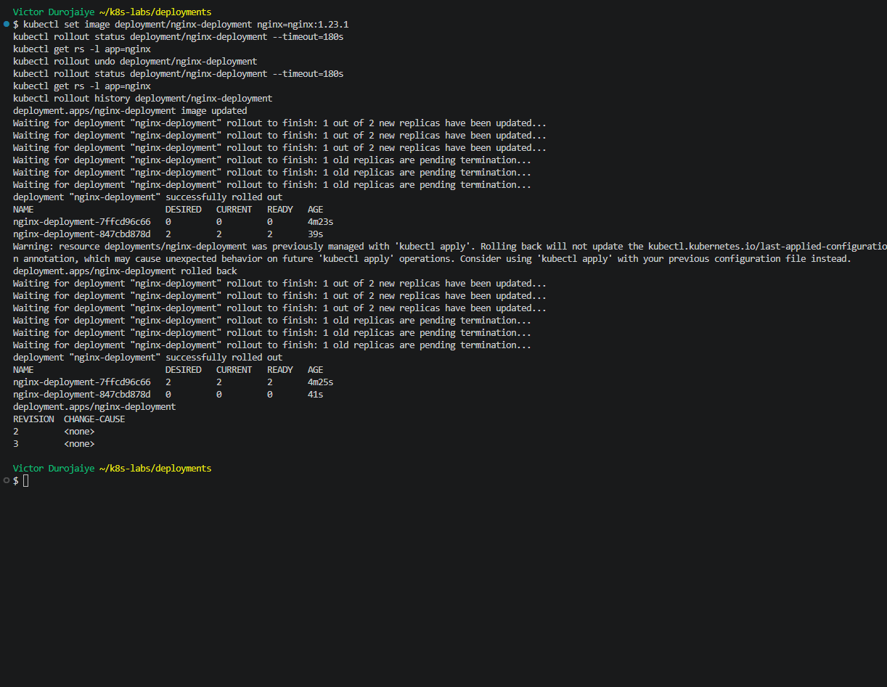
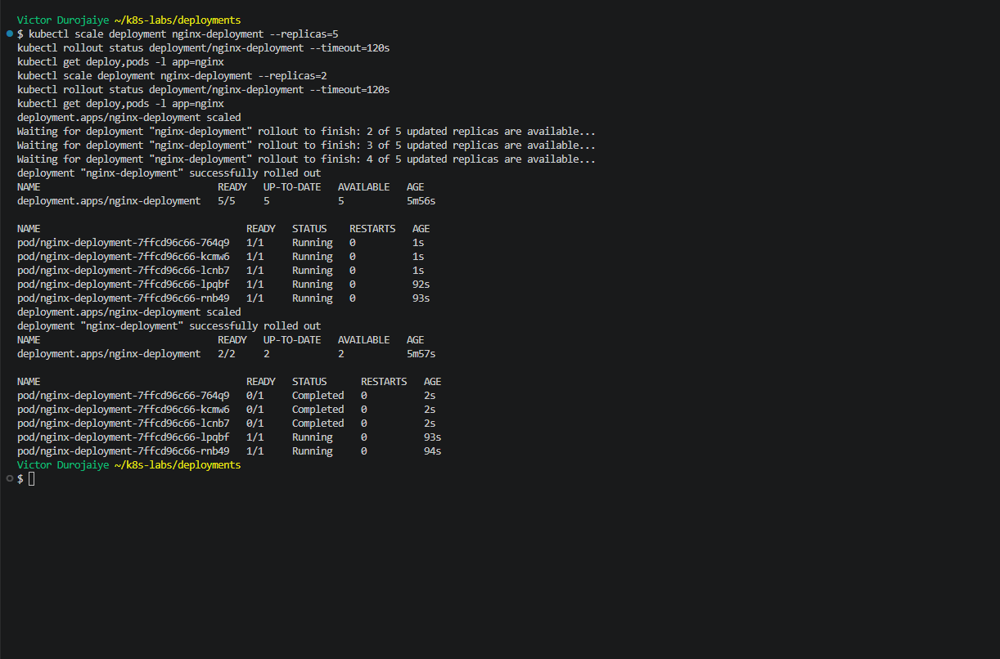
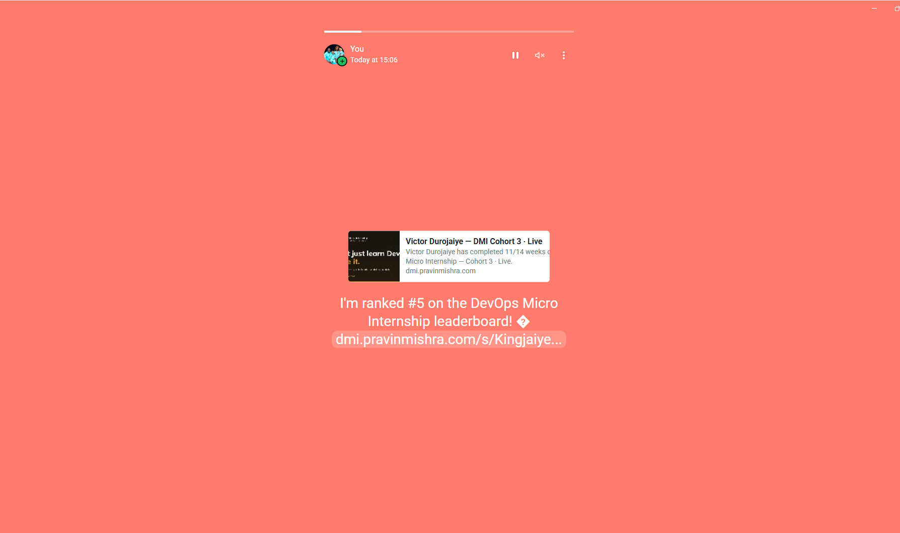

# Assignment 3 — Deployments: From Basics to Rolling Updates

Part of the DevOps Micro Internship (DMI) with Agentic AI

---

## Purpose

In this guided lab, you will create an NGINX Deployment, add a zero-downtime RollingUpdate strategy, perform an image update, roll it back, and scale the workload.

---

# Task 0 — Pre-check: Remove the Assignment 02 ReplicaSet

## Goal

Confirm that you are connected to your learning cluster and remove the previous ReplicaSet and its managed Pods before starting this lab.

### Evidence

No screenshots required.

---

# Task 1 — Set Up the Working Directory

## Goal

Create the `~/k8s-labs/deployments` working directory.

### Evidence

#### Screenshot 1 — Terminal showing the `~/k8s-labs/deployments` working directory



**Notes:** I created `~/k8s-labs/deployments` in my lab git repo. Before starting, I confirmed the context was `docker-desktop`, the node was Ready, and no Deployments, ReplicaSets or Pods were left over from Assignment 2.

---

# Task 2 — Create the Basic Deployment

## Goal

Create `nginx-deployment.yaml` with two replicas and image `nginx:1.21.1`, apply it, and verify the Deployment, ReplicaSet, and Pods.

### Evidence

#### Screenshot 2 — Manifest plus `kubectl` output showing the Deployment, ReplicaSet, and two Pods



Task 2 manifest:

```yaml
apiVersion: apps/v1
kind: Deployment
metadata:
  name: nginx-deployment
  labels:
    app: nginx
spec:
  replicas: 2
  selector:
    matchLabels:
      app: nginx
  template:
    metadata:
      labels:
        app: nginx
    spec:
      containers:
      - name: nginx
        image: nginx:1.21.1
        ports:
        - containerPort: 80
```

**Notes:** I checked the manifest with a server dry run, committed it (`3889eab`), applied it and waited for `rollout status`. The Deployment showed `2/2`, it created ReplicaSet `nginx-deployment-7ffcd96c66`, and that created two Pods. The ownerReferences confirm the chain: each Pod is owned by `ReplicaSet/nginx-deployment-7ffcd96c66`, which is owned by `Deployment/nginx-deployment`. I only created the Deployment. The hash in the ReplicaSet name stands for this version of the Pod template.

---

# Task 3 — Configure the RollingUpdate Strategy

## Goal

Add `strategy.rollingUpdate` with `maxSurge: 1` and `maxUnavailable: 0` to the Deployment and reapply it.

### Evidence

#### Screenshot 3 — Deployment YAML showing the RollingUpdate strategy and successful apply output



Completed manifest (Task 2 manifest plus the strategy block):

```yaml
apiVersion: apps/v1
kind: Deployment
metadata:
  name: nginx-deployment
  labels:
    app: nginx
spec:
  replicas: 2
  selector:
    matchLabels:
      app: nginx
  strategy:
    type: RollingUpdate
    rollingUpdate:
      maxSurge: 1
      maxUnavailable: 0
  template:
    metadata:
      labels:
        app: nginx
    spec:
      containers:
      - name: nginx
        image: nginx:1.21.1
        ports:
        - containerPort: 80
```

**Notes:** The git diff added only the five strategy lines (`e91234e`). Apply printed `configured`, and describe showed `RollingUpdateStrategy: 0 max unavailable, 1 max surge`. The ReplicaSet stayed `7ffcd96c66` and the history stayed at revision 1. The strategy is not part of the Pod template, so changing it does not start a rollout.

---

# Task 4 — Perform and Roll Back an Image Update

## Goal

Update the image to `nginx:1.23.1` with `kubectl set image`, watch the rollout, then roll it back with `kubectl rollout undo` and check rollout history.

### Evidence

#### Screenshot 4 — Rolling-update status, multiple ReplicaSets, and successful rollback/history output



**Notes:**
- **Update:** `kubectl set image` to `nginx:1.23.1` created ReplicaSet `847cbd878d`. The events show it moving one Pod at a time. The new ReplicaSet went up by 1, then the old one went down by 1, then that repeated. With `maxUnavailable: 0`, there were always 2 ready Pods. Afterwards `7ffcd96c66` sat at 0 but was kept.
- **Rollback:** `kubectl rollout undo` scaled `7ffcd96c66` back to 2 and `847cbd878d` to 0, the same way, one Pod at a time. The Pods came back on `nginx:1.21.1` with new names, because they were recreated from the old template.
- **History:** it shows revisions 2 (`nginx:1.23.1`) and 3 (`nginx:1.21.1`). Revision 1 disappears because a rollback re-records the old template as the newest revision. CHANGE-CAUSE is `<none>` because I did not attach a change note.
- **Warning:** the undo printed a warning that `last-applied-configuration` was not updated. That is because `set image` and `undo` change the live object without touching the file. After the rollback, `kubectl diff -f nginx-deployment.yaml` returned nothing (exit 0), so the cluster matched the file again.

---

# Task 5 — Scale the Deployment

## Goal

Scale to five replicas, verify, then scale back to two.

### Evidence

#### Screenshot 5 — Terminal showing the scale-up and scale-down results



**Notes:** `kubectl scale --replicas=5` added three Pods to the same ReplicaSet `7ffcd96c66` and reached `5/5`. Scaling back to 2 removed the three newest Pods and kept the two older ones. Those showed `Completed`, because nginx exited cleanly when stopped. The history stayed at revisions 2 and 3, and no new ReplicaSet appeared, because scaling does not change the Pod template. `kubectl diff` still returned exit 0, since the file says `replicas: 2`. If I had left it at 5, the next `kubectl apply` would have reset it to 2. In a real project the replica count should change in the manifest.

---

# Task 6 — Share Your Kubernetes Deployment Progress on WhatsApp Status

## Goal

Share your Kubernetes Deployment learning progress on WhatsApp Status, including your generated DMI leaderboard progress link.

### Steps

1. Go to the DMI Leaderboard.
2. Find your name and select **Share your progress**.
3. Click the **WhatsApp icon**.
4. Copy the automatically generated leaderboard message containing your rank and progress link.
5. Open WhatsApp and go to **Updates**.
6. Create a new text Status.
7. Copy and paste the message below.
8. Insert the generated leaderboard message in the indicated place.
9. Review and publish your Status.

### WhatsApp Status Message

I practiced Kubernetes Deployments as part of my DevOps learning journey! 🚀

Today, I deployed NGINX, configured rolling updates, updated the container image, and rolled back to the previous version.

I also scaled my Deployment from two Pods to five and back to two!

[PASTE YOUR GENERATED LEADERBOARD MESSAGE AND LINK HERE]

#DMIByPravinMishra #DevOps #Kubernetes

### Evidence

#### Screenshot 6 — Published WhatsApp Status showing your Kubernetes Deployment message and generated DMI leaderboard progress link



*Victor Durojaiye*

A draft or editing screen is not sufficient.

---

### Notes

Write a short note describing what the lab demonstrated.

A Deployment sits on top of a ReplicaSet. I created only the Deployment, and it created and owned the ReplicaSet, which created the Pods. Every change to the Pod template, like a new image, gets a new ReplicaSet and a new revision. With `maxSurge: 1` and `maxUnavailable: 0`, the update to `nginx:1.23.1` and the rollback both replaced Pods one at a time, and two Pods were always ready. The old ReplicaSet is kept at 0 replicas, which is what makes `rollout undo` fast. Scaling only changes the Pod count, so it adds no revision. The lesson I will carry forward is that `kubectl set image`, `undo` and `scale` change the live cluster but not the file. I used `kubectl diff` to confirm the two matched again, and in real work I would make these changes in the manifest and apply them.

Cleanup: I deleted the Deployment, which removed both ReplicaSets and the Pods, and confirmed `No resources found in default namespace.`

---

# Submission Instructions

- Add all required screenshots in your submission
- Include the completed YAML manifests used in the lab
- Ensure screenshots are clear and readable.
- Include evidence of your published WhatsApp Status.
- Do not expose passwords, tokens, private keys, or kubeconfig credentials.

---

# Completion Checklist

- [x] Completed Task 0
- [x] Task 1: Lab directory created (Screenshot 1)
- [x] Task 2: Two-replica Deployment applied (Screenshot 2)
- [x] Task 3: RollingUpdate strategy configured (Screenshot 3)
- [x] Task 4: Image updated and rolled back (Screenshot 4)
- [x] Task 5: Scaled up and down (Screenshot 5)
- [x] Reflection notes written (Notes)
- [x] Task 6: Published the WhatsApp Status with the generated leaderboard progress link (Screenshot 6)
- [x] No sensitive data exposed

---

## 📌 About DMI & CloudAdvisory

DevOps Micro Internship (DMI) is a project-based DevOps program run by Pravin Mishra (The CloudAdvisory) focused on real-world execution, systems thinking, and career readiness.

It helps learners build strong DevOps foundations with hands-on experience.

---

## 📌 Resources

- 🌐 DMI Official Website: https://dmi.pravinmishra.com?utm_source=github&utm_medium=readme  
- 🎓 University: https://university.pravinmishra.com?utm_source=github&utm_medium=readme  
- 💬 Discord Community: https://discord.pravinmishra.com?utm_source=github&utm_medium=readme  
- 📝 Blog: https://dmi.pravinmishra.com/blog?utm_source=github&utm_medium=readme  
- ▶️ YouTube Playlist: https://www.youtube.com/playlist?list=PLFeSNDtI4Cho  
- 🔗 Pravin Mishra (LinkedIn): https://www.linkedin.com/in/pravin-mishra-aws-trainer/  
- 🏢 CloudAdvisory (LinkedIn): https://www.linkedin.com/company/thecloudadvisory/

---

*This submission is part of DevOps Micro Internship (DMI) — Agentic AI Track.*
