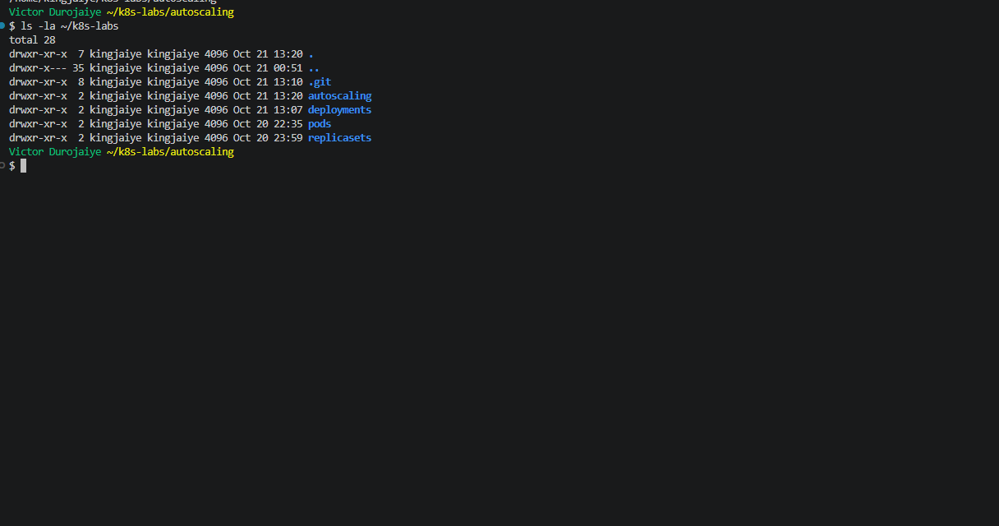
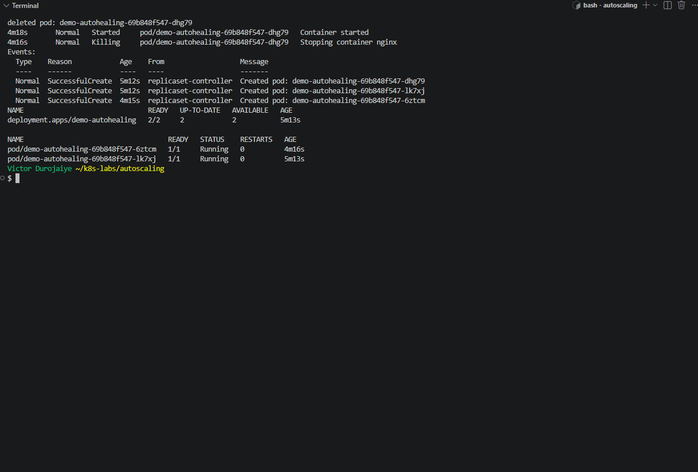
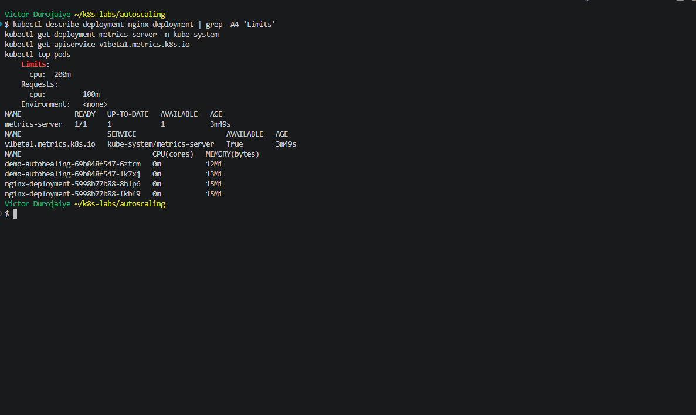
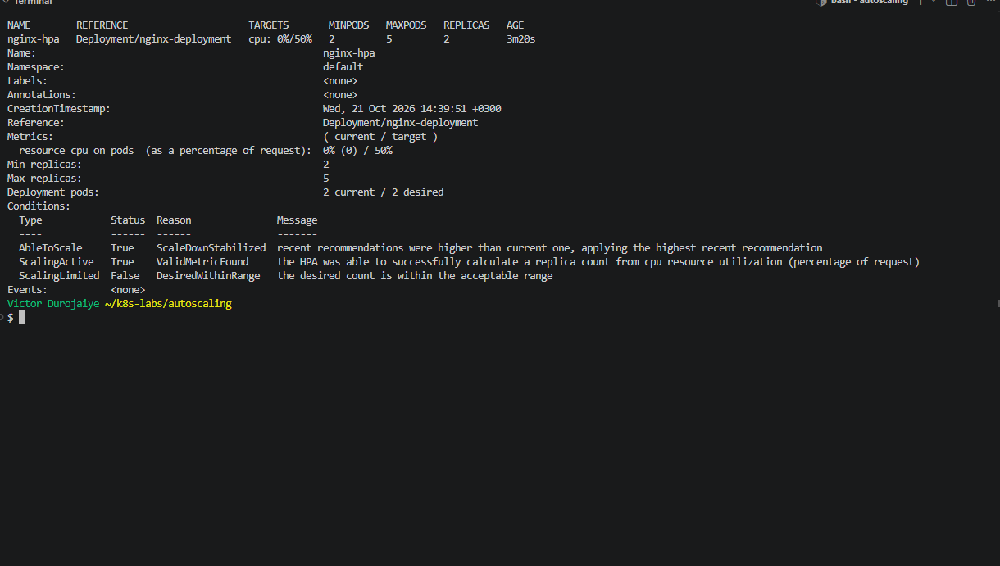
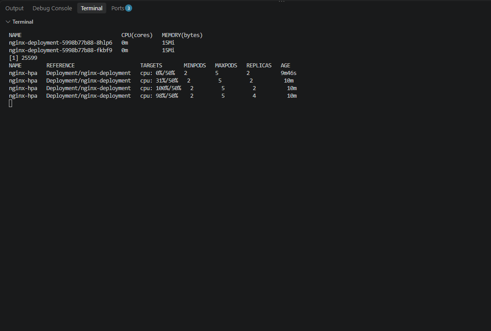
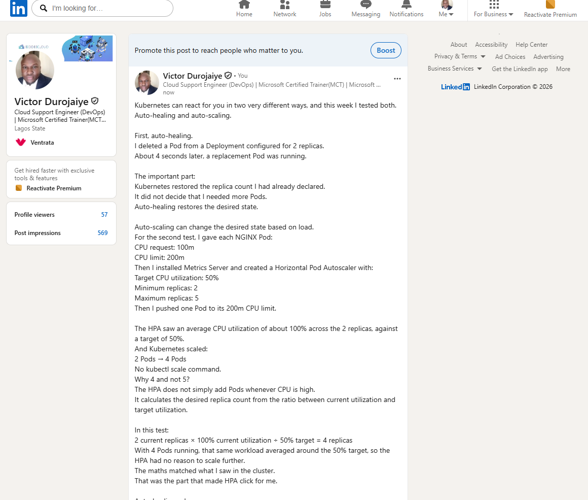

# Assignment 4 — Auto-Scaling & Auto-Healing: Let Kubernetes React for You

Part of the DevOps Micro Internship (DMI) with Agentic AI

---

## Purpose

In this guided lab, you will prove Deployment auto-healing by deleting a Pod, then configure a CPU-based Horizontal Pod Autoscaler that maintains between two and five NGINX Pods.

---

# Task 0 — Check the Existing Cluster Resources

## Goal

Confirm that you are connected to your learning cluster and inspect existing Deployments and HPAs.

### Evidence

No screenshots required.

---

# Task 1 — Set Up the Lab Directory

## Goal

Create the `~/k8s-labs/autoscaling` working directory.

### Evidence

#### Screenshot 1 — Terminal showing the `autoscaling` directory



**Notes:** I created `~/k8s-labs/autoscaling` in my lab git repo. Before starting, I checked that the context was `docker-desktop`, that `default` had no Deployments, HPAs or Pods, and that Metrics Server was not installed yet. The `v1beta1.metrics.k8s.io` APIService was `NotFound` and `kubectl top nodes` returned `Metrics API not available`.

---

### Notes — Template Questions

**1. What is the difference between auto-healing and auto-scaling?**

Auto-healing puts back the number of Pods I asked for when one dies or is deleted. It never changes that number. Auto-scaling changes the number itself, up or down, based on load such as CPU use.

---

**2. Which Kubernetes feature will you use for CPU-based auto-scaling?**

The HorizontalPodAutoscaler (HPA), `autoscaling/v2`, reading CPU usage from Metrics Server.

---

# Task 2 — Prove Deployment Auto-Healing

## Goal

Create `demo-autohealing` (two replicas), delete one Pod, and confirm the desired count of two is restored automatically.

### Evidence

#### Screenshot 2 — Deleted Pod and replacement Pod with the replica count restored



Manifest:

```yaml
apiVersion: apps/v1
kind: Deployment
metadata:
  name: demo-autohealing
  labels:
    app: autoheal
spec:
  replicas: 2
  selector:
    matchLabels:
      app: autoheal
  template:
    metadata:
      labels:
        app: autoheal
    spec:
      containers:
      - name: nginx
        image: nginx
```

**Notes:** I applied the Deployment and waited for `rollout status`, then deleted `demo-autohealing-69b848f547-dhg79`. Its events end with `Killing`. Within 4 seconds the ReplicaSet created `demo-autohealing-69b848f547-6ztcm`. That is the third `SuccessfulCreate` in its events, and the Deployment went back to `2/2`. Auto-healing only puts back the count I asked for. It never changes that count. Changing it in response to load is the HPA's job. `image: nginx` has no tag, so this pulls `latest`. I kept it as the lab gives it.

---

### Notes — Template Questions

**1. What happened after you deleted one Pod?**

`demo-autohealing-69b848f547-dhg79` was stopped. Within 4 seconds a new Pod, `demo-autohealing-69b848f547-6ztcm`, was created, and the Deployment was back at `2/2`.

---

**2. What Kubernetes resource maintains the desired replica count for this Deployment?**

The ReplicaSet `demo-autohealing-69b848f547`, which the Deployment created and owns. The ReplicaSet controller is what noticed 1 Pod where it wanted 2 and created the replacement.

---

**3. What proves that auto-healing worked?**

- The replacement has a new name and a later `creationTimestamp` than the surviving Pod.
- The ReplicaSet events show a third `SuccessfulCreate` for `6ztcm`, right after the `Killing` event for `dhg79`.
- `kubectl get deploy` showed `2/2` again.

---

# Task 3 — Create the HPA-Ready Deployment and Enable Metrics

## Goal

Deploy `nginx-deployment` with CPU `requests: 100m` / `limits: 200m`, then enable Metrics Server (Minikube addon or manifest + kubelet TLS patch for kind) and confirm it reports `READY 1/1`.

### Evidence

#### Screenshot 3 — Deployment resources plus successful Metrics Server status



Manifest:

```yaml
apiVersion: apps/v1
kind: Deployment
metadata:
  name: nginx-deployment
  labels:
    app: nginx
spec:
  replicas: 2
  selector:
    matchLabels:
      app: nginx
  strategy:
    type: RollingUpdate
    rollingUpdate:
      maxSurge: 1
      maxUnavailable: 0
  template:
    metadata:
      labels:
        app: nginx
    spec:
      containers:
      - name: nginx
        image: nginx:1.21.1
        ports:
        - containerPort: 80
        resources:
          requests:
            cpu: "100m"
          limits:
            cpu: "200m"
```

**Notes:**
- **Requests and limits:** `nginx-deployment` has `requests.cpu: 100m` and `limits.cpu: 200m`. The HPA measures utilization against the request, so 50m of use is 50%. Without a CPU request, the HPA cannot calculate a percentage.
- **Metrics Server source:** my cluster is Docker Desktop's kind-type cluster, so I used the manifest and the patch instead of the Minikube addon. I did not apply `releases/latest` straight from the internet. I downloaded `components.yaml` first and checked it: Metrics Server `v0.9.0`, sha256 `1cec29a5...`. I committed that file to my lab repo and applied that exact file.
- **TLS patch:** I then patched in `--kubelet-insecure-tls`. That turns off certificate checks between Metrics Server and the kubelet. It is acceptable on a local cluster but not in production, where the kubelet should have certificates Metrics Server can verify.
- **Result:** `metrics-server` showed `READY 1/1`, the `v1beta1.metrics.k8s.io` APIService was `AVAILABLE True`, and `kubectl top pods` returned CPU and memory for all four Pods.
- **Kept for later:** I left Metrics Server installed for the rest of Week 12.

---

### Notes — Template Questions

**1. What does `cpu: "100m"` mean?**

100 millicores, which is 0.1 of one CPU core.

---

**2. What is the difference between a CPU request and a CPU limit?**

The request is the amount of CPU the Pod is guaranteed. The scheduler uses it to decide which node has room, and the HPA uses it as the 100% mark. The limit is the most CPU the container may use. Above it, the container is throttled. In my load test, the busy Pod sat at 183m to 200m and never went past its 200m limit.

---

**3. Why does CPU-based HPA require CPU requests?**

The HPA works in percent of request: utilization = CPU used / CPU requested. With no request there is nothing to divide by, so the HPA cannot produce a percentage and cannot decide whether to scale.

---

**4. Why does HPA need Metrics Server?**

The HPA does not measure anything itself. It reads current CPU use from the `metrics.k8s.io` API, and Metrics Server provides that API by collecting usage from each kubelet.

---

**5. What issue can occur if Metrics Server is not working?**

The HPA shows `<unknown>` in TARGETS and reports that it failed to get metrics, so it never scales. `kubectl top` also fails. Before I installed it, I saw exactly that: `Metrics API not available`.

---

**6. What does `kubectl top pods` help you check?**

The live CPU and memory use of each Pod. It confirmed the metrics pipeline worked, and during the load test it showed which Pod was busy (one at 183m to 200m, the rest near 0m).

---

# Task 4 — Create and Inspect the HPA

## Goal

Create an HPA (imperatively via `kubectl autoscale` or declaratively via `autoscaling/v2`) targeting `nginx-deployment` with min 2, max 5, and 50% target CPU utilization.

### Evidence

#### Screenshot 4 — `kubectl get hpa` and `kubectl describe hpa nginx-hpa` output



Manifest:

```yaml
apiVersion: autoscaling/v2
kind: HorizontalPodAutoscaler
metadata:
  name: nginx-hpa
spec:
  scaleTargetRef:
    apiVersion: apps/v1
    kind: Deployment
    name: nginx-deployment
  minReplicas: 2
  maxReplicas: 5
  metrics:
  - type: Resource
    resource:
      name: cpu
      target:
        type: Utilization
        averageUtilization: 50
```

**Notes:** I used only the declarative `autoscaling/v2` method. Two HPAs on one Deployment would fight each other, and `kubectl autoscale --cpu-percent` is deprecated. After about 45 seconds, `kubectl get hpa` showed `cpu: 0%/50%` with min 2, max 5 and 2 replicas. Describe showed `AbleToScale True`, `ScalingActive True (ValidMetricFound)` and `ScalingLimited False (DesiredWithinRange)`. The Pods were idle, so the HPA stayed at the minimum of 2.

---

### Notes — Template Questions

**1. What does `minReplicas: 2` mean?**

The HPA never goes below 2 Pods, even when they are idle. My Deployment stayed at 2 while CPU was at 0%.

---

**2. What does `maxReplicas: 5` mean?**

The HPA never goes above 5 Pods, however high the CPU gets. That caps how much of the cluster this app can take.

---

**3. What does `averageUtilization: 50` mean?**

The HPA aims to keep the average CPU across all the Pods at 50% of their request, which is 50m each here. Above that, it adds Pods. Below it, after a wait, it removes Pods.

---

**4. Why should only one HPA manage a Deployment at a time?**

Each HPA works out its own replica count and writes it to the Deployment. Two HPAs would keep overwriting each other, and the Pod count would jump around. For example, the solution doc's imperative HPA (named `nginx-deployment`) would fight `nginx-hpa`. That is why I created only the declarative one.

---

# Task 5 — Optionally Generate CPU Load

## Goal

Generate CPU load inside an NGINX Pod (`yes > /dev/null`) and monitor whether the HPA increases replicas.

### Evidence

#### Screenshot 5 — HPA output showing current metrics and any replica increase



**Notes:**
- **Load:** I ran `kubectl exec deploy/nginx-deployment -- timeout 240 sh -c 'yes > /dev/null'` in the background, so the load stopped on its own after 4 minutes. Then I watched with `kubectl get hpa nginx-hpa -w`.
- **Scale-up:** TARGETS went from `0%` to `31%` to `100%/50%`, and REPLICAS went from 2 to 4. `kubectl top` showed the loaded Pod at 183m to 200m, its limit, while the others sat near 0m. The HPA event was `SuccessfulRescale New size: 4; reason: cpu resource utilization (percentage of request) above target`. I never ran `kubectl scale`.
- **Why 4 and not 5:** one Pod at its 200m limit, averaged over 2 Pods with 100m requests, is 100%. The HPA's formula, ceil(2 × 100 / 50), gives 4. At 4 Pods the average settled at `50%/50%`, exactly on target, so it had no reason to go to 5.
- **Scale-down:** I ran cleanup before the 5-minute stabilization window ended, so I did not observe the scale-down back to 2.

---

### Notes — Template Questions

**1. Did the HPA change the number of Pods? Explain what you observed.**

Yes. With one Pod pushed to its 200m limit, the HPA reported `100%/50%` and scaled `nginx-deployment` from 2 to 4 Pods. As the two new Pods joined, the average dropped to `61%`, then `48%`, and settled at `50%/50%` with 4 replicas. The event says `New size: 4; reason: cpu resource utilization (percentage of request) above target`.

---

**2. If scaling did not happen, what are two possible reasons?**

Not applicable. Scaling occurred, from 2 to 4 Pods.

---

**3. Why is automatic scale-down useful after traffic decreases?**

Idle Pods still hold their CPU and memory requests on the nodes. Removing them frees that room for other work, and in the cloud it cuts cost. The 5-minute stabilization window means the HPA waits before removing Pods, so a short dip in traffic does not make it scale down and then straight back up.

---

### Notes

Write a short note describing what the lab demonstrated.

The lab showed two different behaviours. Auto-healing keeps the count I set: when I deleted a `demo-autohealing` Pod, the ReplicaSet replaced it within seconds and stayed at 2. Autoscaling changes the count itself: the HPA read CPU from Metrics Server, compared it with 50% of each Pod's 100m request, and raised `nginx-deployment` from 2 to 4 when one Pod was pushed to its 200m limit. Three parts have to be in place for that. The Pods need a CPU request to measure against, Metrics Server has to be running to report usage, and the HPA needs a target and min/max bounds. The numbers matched the HPA formula: 100% against a 50% target doubled the count, and at 4 Pods the average landed on 50%. Two things I would do differently in production. I would keep pinning what I install, as I did with Metrics Server v0.9.0, instead of using a `latest` URL. And I would not use `--kubelet-insecure-tls`.

Cleanup: I deleted the HPA and both Deployments with `kubectl delete -f` and confirmed `No resources found in default namespace.` Metrics Server stays in `kube-system` until the end of Week 12.

---

# LinkedIn Requirement

### Evidence

#### Screenshot 6 — Published LinkedIn post showing your name, the required explanation, and the attached Kubernetes screenshot



*Victor Durojaiye*

#### Linkedin Post Link

https://www.linkedin.com/posts/victor-jaiye_devopsmicrointernship-kubernetes-devops-share-7518681703553409024-x7N4/

---

# Submission Instructions

- Add all required screenshots in your submission
- Include the completed YAML manifests used in the lab
- Full Name must be visible in required screenshots.
- Ensure screenshots are clear and readable.
- Complete the Notes sections for Tasks 1–4 in your own words.
- Complete Task 5 notes only if you perform the optional test.
- Do not expose passwords, tokens, private keys, kubeconfig files, or account IDs.

---

# Completion Checklist

- [x] Task 0: Checked the active context and existing cluster resources
- [x] Task 1: Lab directory created (Screenshot 1)
- [x] Task 2: Auto-healing observed (Screenshot 2)
- [x] Task 3: HPA-ready Deployment applied and Metrics Server verified (Screenshot 3)
- [x] Task 4: HPA created and inspected (Screenshot 4)
- [x] Task 5: CPU load generated and scaling observed (Screenshot 5, optional)
- [x] Reflection notes written (Notes)
- [x] Completed the Notes — Template Questions for Tasks 1–5
- [x] Published the LinkedIn post with the required explanation and attached screenshot (Screenshot 6)
- [x] No sensitive data exposed

---

## 📌 About DMI & CloudAdvisory

DevOps Micro Internship (DMI) is a project-based DevOps program run by Pravin Mishra (The CloudAdvisory) focused on real-world execution, systems thinking, and career readiness.

It helps learners build strong DevOps foundations with hands-on experience.

---

## 📌 Resources

- 🌐 DMI Official Website: https://dmi.pravinmishra.com?utm_source=github&utm_medium=readme  
- 🎓 University: https://university.pravinmishra.com?utm_source=github&utm_medium=readme  
- 💬 Discord Community: https://discord.pravinmishra.com?utm_source=github&utm_medium=readme  
- 📝 Blog: https://dmi.pravinmishra.com/blog?utm_source=github&utm_medium=readme  
- ▶️ YouTube Playlist: https://www.youtube.com/playlist?list=PLFeSNDtI4Cho  
- 🔗 Pravin Mishra (LinkedIn): https://www.linkedin.com/in/pravin-mishra-aws-trainer/  
- 🏢 CloudAdvisory (LinkedIn): https://www.linkedin.com/company/thecloudadvisory/

---

*This submission is part of DevOps Micro Internship (DMI) — Agentic AI Track.*
