# Assignment 5 — Kubernetes Health Probes (Readiness)

Part of the DevOps Micro Internship (DMI) with Agentic AI

---

## Purpose

In this assignment, you will configure and test a Kubernetes readiness probe. You will create a baseline NGINX Deployment, add an HTTP readiness probe, intentionally break it, observe a stalled rollout, and restore the working configuration.

You will also demonstrate how readiness probes protect rolling updates.

---

# Task 0 — Prepare the Lab Environment

## Goal

Confirm that you are connected to your learning cluster and remove the previous assignment’s HPA and NGINX Deployment before starting this lab.

No screenshot or written notes are required for this pre-check.

---

# Task 1 — Set Up Your Lab Directory

## Goal

Create and enter a dedicated directory for the readiness-probe lab.

### Evidence

#### Screenshot 1 — Terminal showing that you are working inside `~/k8s-labs/health-probes-readiness`

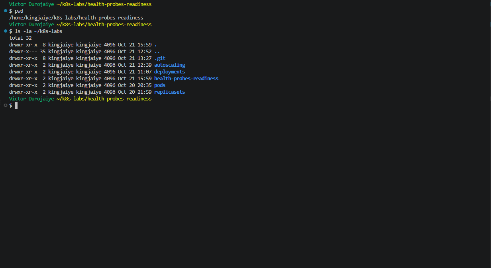

---

### Notes

**1. What is the purpose of a readiness probe?**

It tells Kubernetes whether a container can take requests right now. Until the probe passes, the Pod is marked NotReady. A NotReady Pod is not counted as available during a rollout, and once Services are in use it gets no traffic. In Task 0 I confirmed the context was `docker-desktop` and that the Assignment 4 HPA and Deployment were already gone (`No resources found in default namespace.`).

**2. Why is a Pod being Running not always enough to confirm it can serve traffic?**

Running only means the container process started. The app inside may still be loading config, warming a cache, or waiting for a database, or it may be serving errors. I saw this in Task 4: Pod `cmc7w` was `Running` the whole time but stayed `0/1` Ready, because its readiness check kept getting a 404.

---

# Task 2 — Create a Baseline Deployment Without Probes

## Goal

Create a baseline NGINX Deployment with two replicas and no readiness probe.

### Evidence

#### Screenshot 2 — Completed `00-nginx-deploy-baseline.yaml` manifest

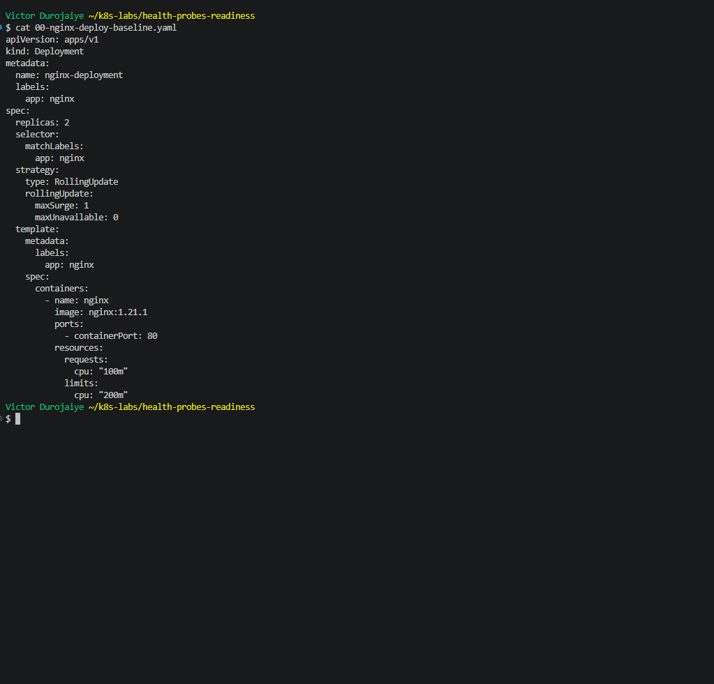

```yaml
apiVersion: apps/v1
kind: Deployment
metadata:
  name: nginx-deployment
  labels:
    app: nginx
spec:
  replicas: 2
  selector:
    matchLabels:
      app: nginx
  strategy:
    type: RollingUpdate
    rollingUpdate:
      maxSurge: 1
      maxUnavailable: 0
  template:
    metadata:
      labels:
        app: nginx
    spec:
      containers:
        - name: nginx
          image: nginx:1.21.1
          ports:
            - containerPort: 80
          resources:
            requests:
              cpu: "100m"
            limits:
              cpu: "200m"
```

---

#### Screenshot 3 — Output showing a successful rollout and two running NGINX Pods

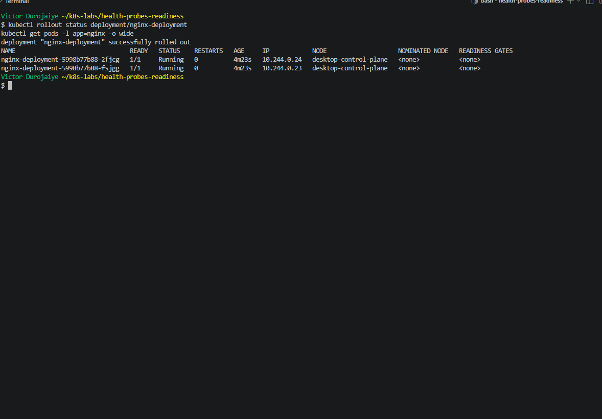

---

#### Screenshot 4 — Relevant output from `kubectl describe deployment nginx-deployment`

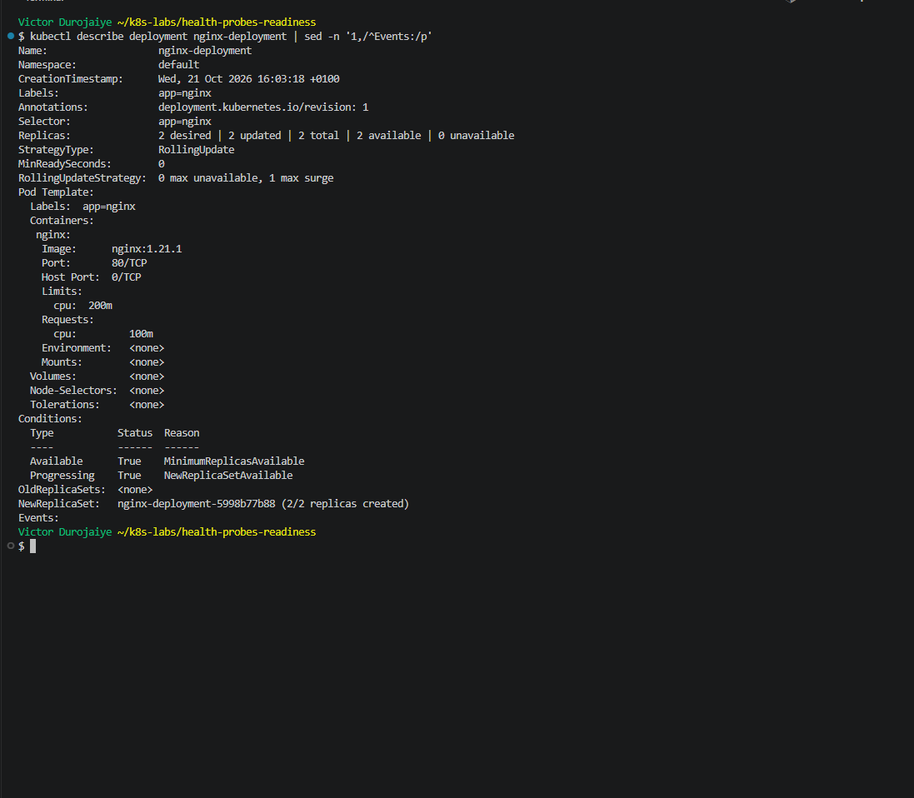

---

### Notes

**1. How many replicas does this Deployment maintain?**

Two. Describe showed `2 desired | 2 updated | 2 total | 2 available | 0 unavailable`, with Pods `2fjcg` and `fsjgg` on ReplicaSet `5998b77b88`. For the image I used `nginx:1.21.1`, which was already on the node from earlier labs. I checked the manifest with a server dry run and committed it (`a2a6e03`) before applying it.

**2. What does `maxUnavailable: 0` mean during a rolling update?**

Kubernetes may not take any old Pod away until a new one is Ready, so the number of available Pods never drops below 2. Together with `maxSurge: 1`, it adds one new Pod, waits for it to be Ready, then removes one old Pod, and repeats.

**3. Is a readiness probe configured in this baseline Deployment?**

No. The Pod Template in describe has no `Readiness:` line, and `readinessProbe` in the Deployment spec came back empty. Without a probe, a Pod counts as Ready as soon as its container starts.

---

# Task 3 — Add a Readiness Probe

## Goal

Add an HTTP readiness probe so Kubernetes checks whether each NGINX container is ready to accept requests.

### Evidence

#### Screenshot 5 — Completed `01-nginx-deploy-readiness.yaml` manifest showing the readiness probe

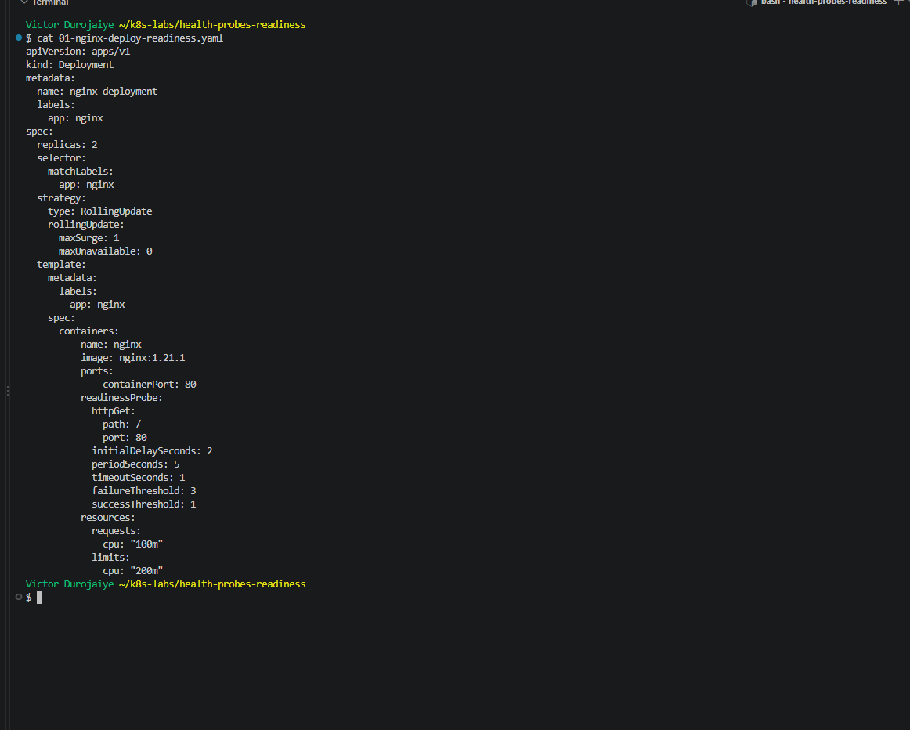

```yaml
apiVersion: apps/v1
kind: Deployment
metadata:
  name: nginx-deployment
  labels:
    app: nginx
spec:
  replicas: 2
  selector:
    matchLabels:
      app: nginx
  strategy:
    type: RollingUpdate
    rollingUpdate:
      maxSurge: 1
      maxUnavailable: 0
  template:
    metadata:
      labels:
        app: nginx
    spec:
      containers:
        - name: nginx
          image: nginx:1.21.1
          ports:
            - containerPort: 80
          readinessProbe:
            httpGet:
              path: /
              port: 80
            initialDelaySeconds: 2
            periodSeconds: 5
            timeoutSeconds: 1
            failureThreshold: 3
            successThreshold: 1
          resources:
            requests:
              cpu: "100m"
            limits:
              cpu: "200m"
```

---

#### Screenshot 6 — Output of the successful rollout and ready Pods

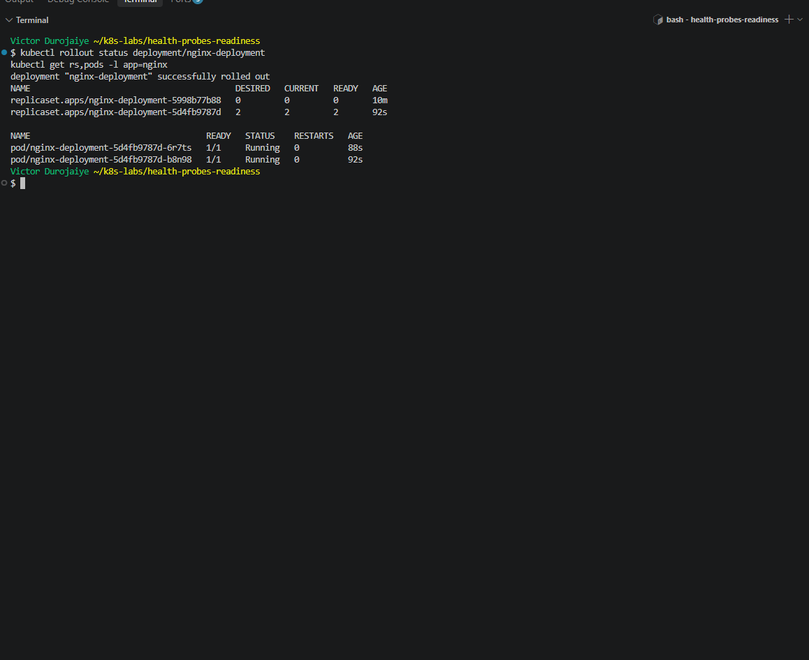

---

#### Screenshot 7 — Pod description showing readiness conditions and readiness probe details

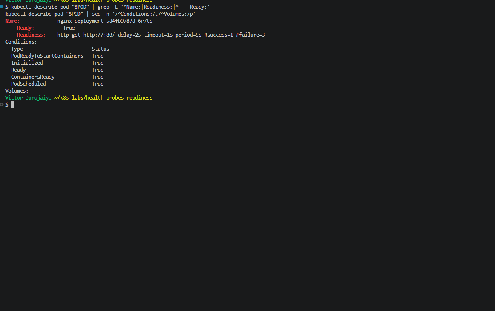

---

### Notes

**1. What path and port does the readiness probe check?**

`GET /` on port `80`. Describe shows `Readiness: http-get http://:80/ delay=2s timeout=1s period=5s #success=1 #failure=3`. `diff` against the baseline showed only the 9 probe lines were added (commit `6c58500`).

**2. What does `initialDelaySeconds: 2` do?**

The kubelet waits 2 seconds after the container starts before it sends the first readiness check, which gives NGINX time to start listening.

**3. What does `periodSeconds: 5` do?**

After that first check, the kubelet runs the probe every 5 seconds for as long as the container runs. Each check has `timeoutSeconds: 1` to answer.

**4. What must happen before Kubernetes considers this Pod ready?**

`GET /` on port 80 has to return a success status (200 to 399) once (`successThreshold: 1`). Then the Pod's `Ready` and `ContainersReady` conditions turn True. Pod `6r7ts` showed all five conditions True. Adding the probe changed the Pod template, so it rolled out as a new ReplicaSet `5d4fb9787d`, one Pod at a time.

---

# Task 4 — Break and Restore Readiness

## Goal

Intentionally fail the readiness probe, observe the NotReady behavior, and then restore the working probe configuration.

### Evidence

#### Screenshot 8 — `02-nginx-readiness-broken.yaml` showing `/does-not-exist`

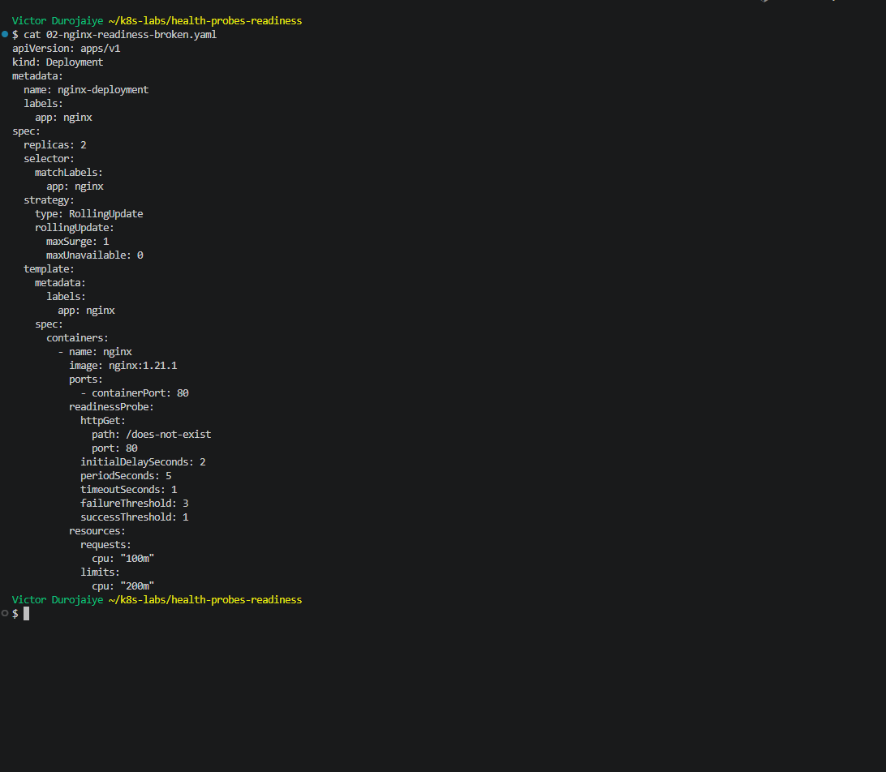

`02-nginx-readiness-broken.yaml` is a copy of `01` with one line changed. `diff` confirms it:

```text
29c29
<               path: /
---
>               path: /does-not-exist
```

---

#### Screenshot 9 — Output showing the rollout timeout or incomplete rollout

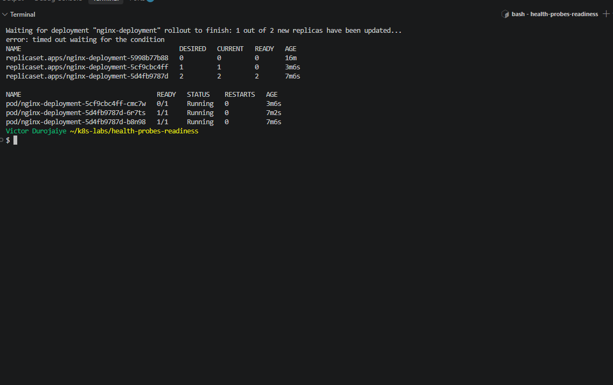

---

#### Screenshot 10 — Pod details showing `Ready: False` or readiness-probe failure events

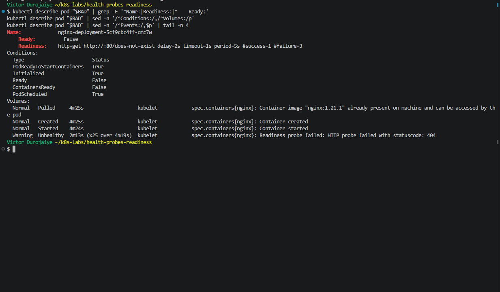

---

#### Screenshot 11 — Output showing successful rollout and ready Pods after the fix

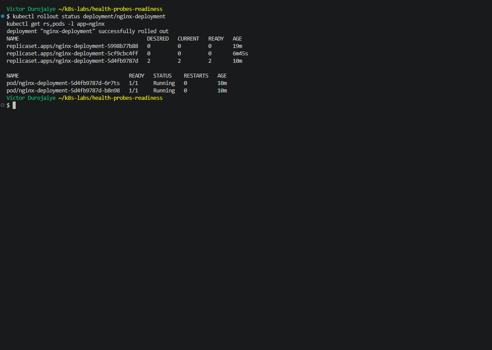

---

### Notes

**1. Why did the readiness probe fail?**

`/does-not-exist` is not a page NGINX has, so it answered `404`. The events show `Readiness probe failed: HTTP probe failed with statuscode: 404`, repeated x25. NGINX itself was fine. Only the check was pointed at the wrong path.

**2. What happened to the Pod readiness status?**

The new Pod `cmc7w` (ReplicaSet `5cf9cbc4ff`) stayed `0/1 Running`. It showed `Ready: False` and `ContainersReady False`, while `PodScheduled` and `Initialized` were True. It never became Ready.

**3. Why did the rollout fail to complete?**

With `maxUnavailable: 0`, the Deployment needs a new Pod to be Ready before it removes an old one. The new Pod never became Ready, so the rollout stopped at `1 out of 2 new replicas have been updated` and `rollout status --timeout=60s` returned `timed out waiting for the condition`. The two old Pods on `5d4fb9787d` stayed `1/1`, and the Deployment kept `2/2 AVAILABLE`.

**4. How did you restore the Deployment successfully?**

I copied the working file to `03-nginx-readiness-fixed.yaml` (`cmp` showed it identical to `01`, commit `d3af570`) and applied it. The template matched the existing ReplicaSet `5d4fb9787d`, so the Deployment went back to it and scaled `5cf9cbc4ff` to 0. The two healthy Pods `6r7ts` and `b8n98` were never replaced. The rollout finished at once, the broken Pod was gone, and `kubectl diff -f 03-nginx-readiness-fixed.yaml` returned exit 0.

---

# Task 5 — See How Readiness Protects Rolling Updates

## Goal

Observe how readiness prevents a bad new Pod from replacing healthy Pods during a rolling update.

### Evidence

#### Screenshot 12 — Successful update command and rollout status

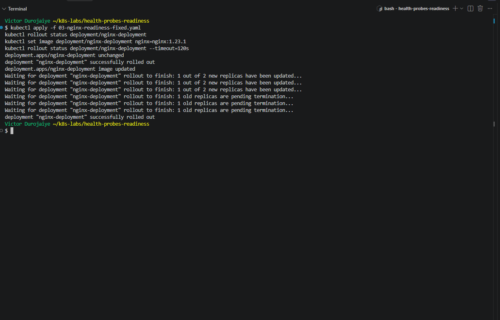

---

#### Screenshot 13 — ReplicaSets and Pods after the successful rolling update

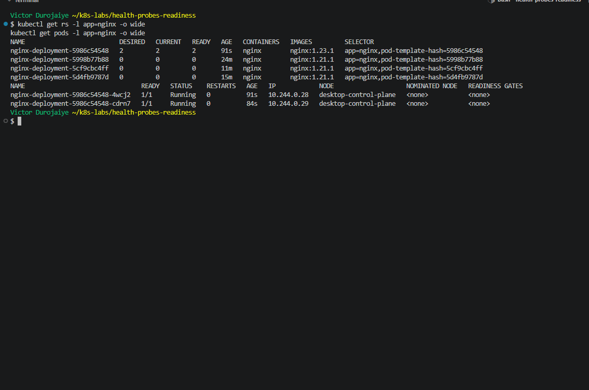

---

#### Screenshot 14 — Completed `04-readiness-broken-patch.yaml`

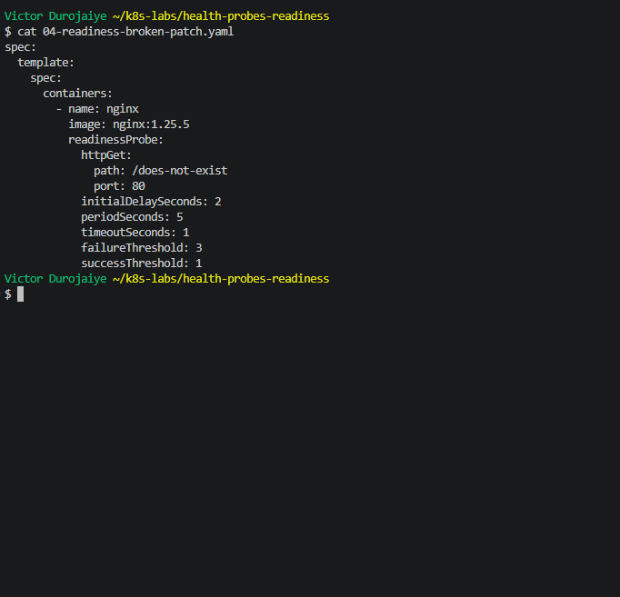

```yaml
spec:
  template:
    spec:
      containers:
        - name: nginx
          image: nginx:1.25.5
          readinessProbe:
            httpGet:
              path: /does-not-exist
              port: 80
            initialDelaySeconds: 2
            periodSeconds: 5
            timeoutSeconds: 1
            failureThreshold: 3
            successThreshold: 1
```

---

#### Screenshot 15 — Output showing the expected stalled rollout or timeout

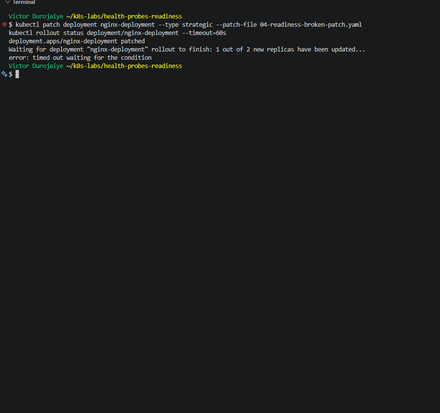

---

#### Screenshot 16 — Deployment or Pod output showing the effect of the broken readiness probe

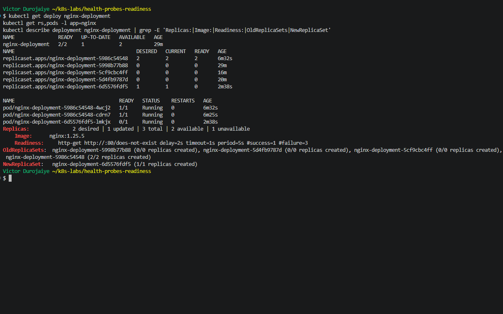

---

#### Screenshot 17 — Successful rollout status after restoring the fixed configuration

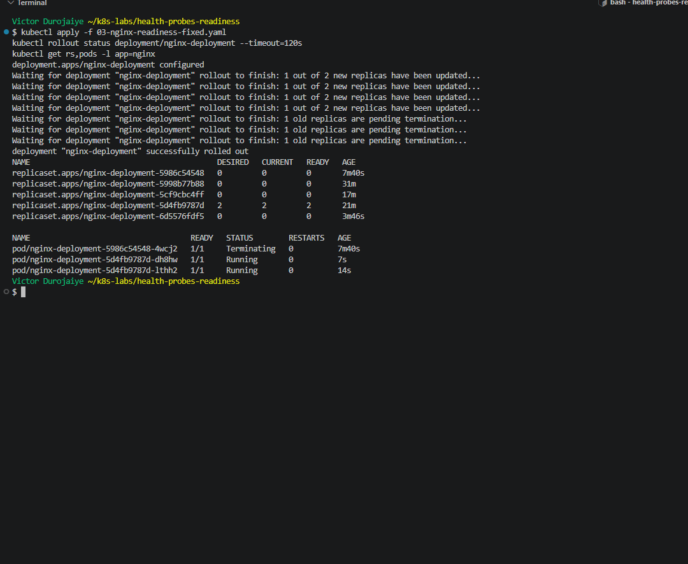

---

### Notes

**1. What happened during the successful rolling update?**

`kubectl set image deployment/nginx-deployment nginx=nginx:1.23.1` created ReplicaSet `5986c54548`. With the working probe, each new Pod passed readiness before an old one was removed. The rollout went `1 out of 2 new replicas have been updated`, then `1 old replicas are pending termination`, then `successfully rolled out`. Both new Pods, `4wcj2` and `cdrn7`, were `nginx:1.23.1 ready=true`.

**2. Why did Kubernetes create a new ReplicaSet?**

The image is part of the Pod template, and every distinct template gets its own ReplicaSet, named with a hash of that template. `1.21.1` to `1.23.1` changed the template, so `5986c54548` was created and `5d4fb9787d` was scaled to 0 but kept for rollback.

**3. Why were the new Pods unable to replace the existing healthy Pods after readiness was broken?**

The strategic patch changed the image to `nginx:1.25.5` and the probe path to `/does-not-exist` in one go. Before applying it, I checked it with `--dry-run=server`. The patch created ReplicaSet `6d5576fdf5`, and its Pod `lmkjx` stayed `ready=false` because the probe got 404. A Pod that is not Ready does not count as available, so the Deployment never got permission to remove an old Pod. The rollout timed out with `2 desired | 1 updated | 3 total | 2 available | 1 unavailable`.

**4. How does `maxUnavailable: 0` protect availability during this rollout?**

It forbids removing an old Pod until a new one is Ready. Because the new Pod never became Ready, both `5986c54548` Pods on `1.23.1` kept running at `2/2`, and the Deployment stayed `Available True` the whole time. The bad version got stuck at one extra Pod (allowed by `maxSurge: 1`) instead of replacing the good one. When I applied `03-nginx-readiness-fixed.yaml`, the Deployment rolled to `5d4fb9787d` (`nginx:1.21.1`, the image in the file) and ended with two Ready Pods. `kubectl diff` returned exit 0, so the cluster matched the file again. Cleanup: I deleted the Deployment and confirmed `No resources found in default namespace.`

---

# Task 6 — Share Your Readiness-Probe Learning on LinkedIn

## Goal

Share what you learned about Kubernetes readiness probes and how they protect rolling updates.

### Evidence

#### Screenshot 18 — Published LinkedIn post

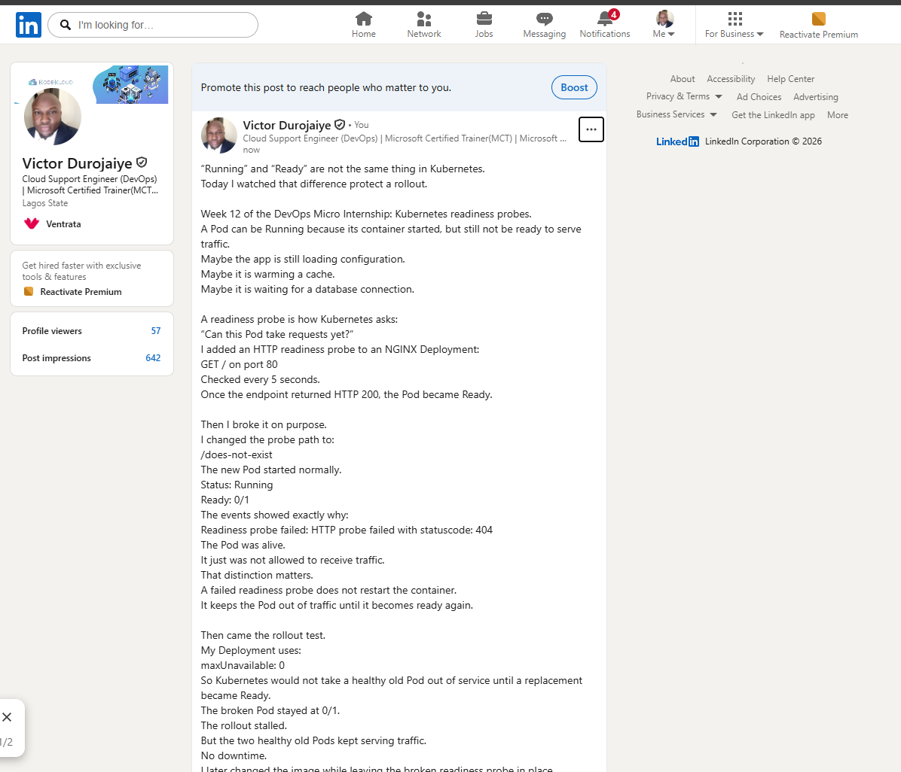

*Victor Durojaiye*

#### Linkedin post link

https://www.linkedin.com/posts/victor-jaiye_devopsmicrointernship-kubernetes-devops-share-7518698746239705088-c2Tj/

---

# Submission Instructions

- Add all required screenshots numbered 1–18.
- Ensure your full name is visible in required screenshots.
- Use clear, readable screenshots showing the relevant manifest or output.
- Include the completed baseline and readiness-probe manifests in your repository.
- Answer all Notes questions for Tasks 1–5 in your own words.
- Include evidence of the intentional readiness failure and successful recovery.
- Do not expose tokens, passwords, kubeconfig files, account IDs, or other sensitive information.

---

# Completion Checklist

- [x] Learning cluster confirmed and previous assignment resources removed where applicable
- [x] Readiness-probe lab directory created (Screenshot 1)
- [x] Baseline Deployment created successfully (Screenshot 2)
- [x] Two baseline Pods running and successful rollout verified (Screenshot 3)
- [x] Baseline Deployment details reviewed (Screenshot 4)
- [x] Readiness probe added successfully (Screenshot 5)
- [x] Successful readiness rollout verified (Screenshot 6)
- [x] Pod readiness conditions and probe details inspected (Screenshot 7)
- [x] Broken readiness configuration created (Screenshot 8)
- [x] Stalled rollout or timeout observed (Screenshot 9)
- [x] NotReady status or readiness-probe failure events captured (Screenshot 10)
- [x] Working readiness configuration restored (Screenshot 11)
- [x] Successful image update completed (Screenshot 12)
- [x] ReplicaSets and Pods inspected after the update (Screenshot 13)
- [x] Broken-readiness patch created (Screenshot 14)
- [x] Stalled rollout observed after the patch (Screenshot 15)
- [x] Effect of broken readiness captured (Screenshot 16)
- [x] Final recovery completed (Screenshot 17)
- [x] LinkedIn post published (Screenshot 18)
- [x] Notes for Tasks 1–5 completed
- [x] Required manifests included
- [x] All screenshots are clear and readable
- [x] No sensitive data exposed

---

## 📌 About DMI & CloudAdvisory

DevOps Micro Internship (DMI) is a project-based DevOps program run by Pravin Mishra (The CloudAdvisory) focused on real-world execution, systems thinking, and career readiness.

It helps learners build strong DevOps foundations with hands-on experience.

---

## 📌 Resources

- 🌐 DMI Official Website: https://dmi.pravinmishra.com?utm_source=github&utm_medium=readme  
- 🎓 University: https://university.pravinmishra.com?utm_source=github&utm_medium=readme  
- 💬 Discord Community: https://discord.pravinmishra.com?utm_source=github&utm_medium=readme  
- 📝 Blog: https://dmi.pravinmishra.com/blog?utm_source=github&utm_medium=readme  
- ▶️ YouTube Playlist: https://www.youtube.com/playlist?list=PLFeSNDtI4Cho  
- 🔗 Pravin Mishra (LinkedIn): https://www.linkedin.com/in/pravin-mishra-aws-trainer/  
- 🏢 CloudAdvisory (LinkedIn): https://www.linkedin.com/company/thecloudadvisory/

---

*This submission is part of DevOps Micro Internship (DMI) — Agentic AI Track.*
