# Assignment 6 — Kubernetes Health Probes (Liveness)

Part of the DevOps Micro Internship (DMI) with Agentic AI

---

## Purpose

In this assignment, you will configure and test a Kubernetes liveness probe. You will create a baseline NGINX Deployment, add an HTTP liveness probe, intentionally make it fail, observe container restarts, and restore the working configuration.

---

# Task 0 — Prepare the Lab Environment

## Goal

Confirm that you are connected to your learning cluster and remove the previous HPA and NGINX Deployment before starting this lab.

No screenshot or written notes are required for this pre-check.

---

# Task 1 — Set Up Your Lab Directory

## Goal

Create and enter a dedicated directory for the liveness-probe lab.

### Evidence

#### Screenshot 1 — Terminal showing that you are working inside `~/k8s-labs/health-probes-liveness`

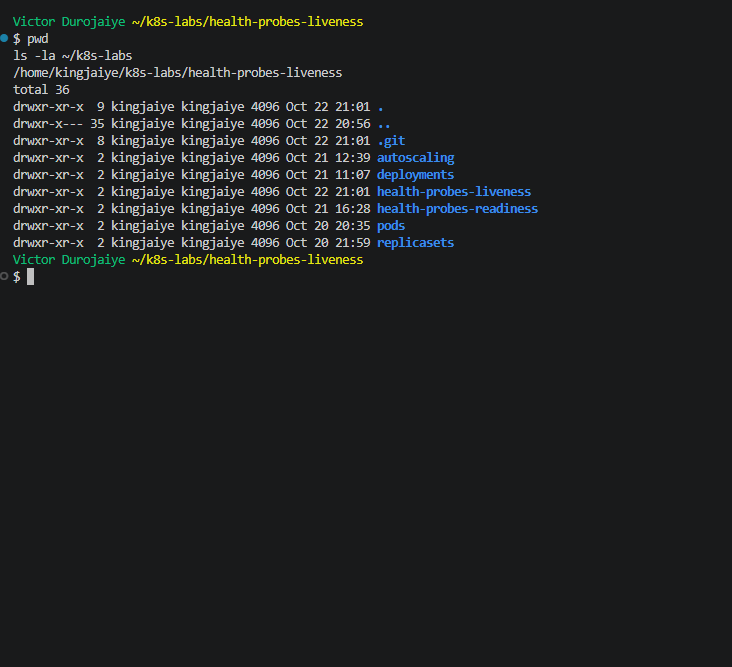

---

### Notes

**1. What problem does a liveness probe solve?**

A process can stay running but stop doing its job, for example by hanging, deadlocking or getting stuck in a loop. Kubernetes cannot tell that from the outside, because the container is still "Running". A liveness probe checks the app regularly, and when it fails enough times in a row, the kubelet kills the container and starts it again, so the app recovers without anyone stepping in. In Task 0 I confirmed the context was `docker-desktop`, there was no HPA or `nginx-deployment` left, and Metrics Server was still `1/1`.

**2. What is the key difference between a readiness probe and a liveness probe?**

What Kubernetes does when the probe fails. A failed readiness probe marks the Pod NotReady, so it gets no traffic and does not count as available in a rollout, but the container keeps running. A failed liveness probe gets the container killed and restarted. Readiness asks "should this Pod get traffic?" and liveness asks "should this container be restarted?"

---

# Task 2 — Create a Baseline Deployment Without Probes

## Goal

Create a baseline NGINX Deployment with two replicas and no health probes.

### Evidence

#### Screenshot 2 — Completed `00-nginx-deploy-baseline.yaml` manifest

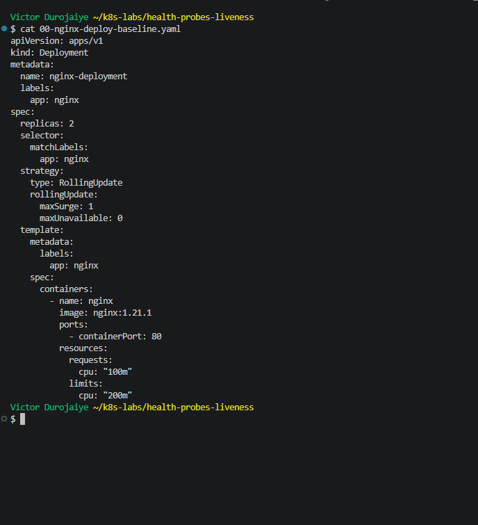

```yaml
apiVersion: apps/v1
kind: Deployment
metadata:
  name: nginx-deployment
  labels:
    app: nginx
spec:
  replicas: 2
  selector:
    matchLabels:
      app: nginx
  strategy:
    type: RollingUpdate
    rollingUpdate:
      maxSurge: 1
      maxUnavailable: 0
  template:
    metadata:
      labels:
        app: nginx
    spec:
      containers:
        - name: nginx
          image: nginx:1.21.1
          ports:
            - containerPort: 80
          resources:
            requests:
              cpu: "100m"
            limits:
              cpu: "200m"
```

---

#### Screenshot 3 — Output showing a successful rollout and two running NGINX Pods

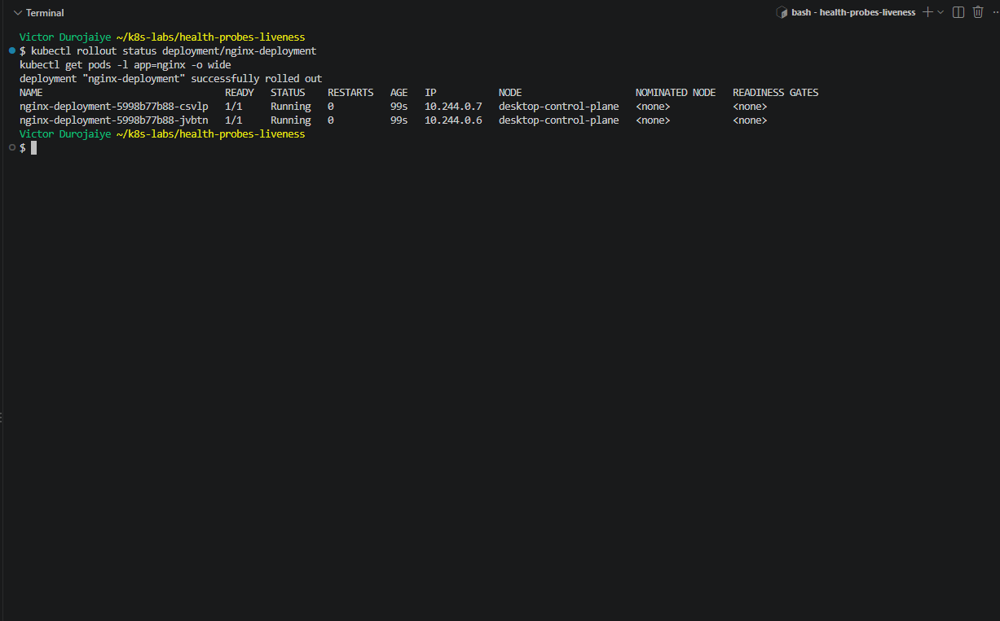

---

#### Screenshot 4 — Relevant output from `kubectl describe deployment nginx-deployment`

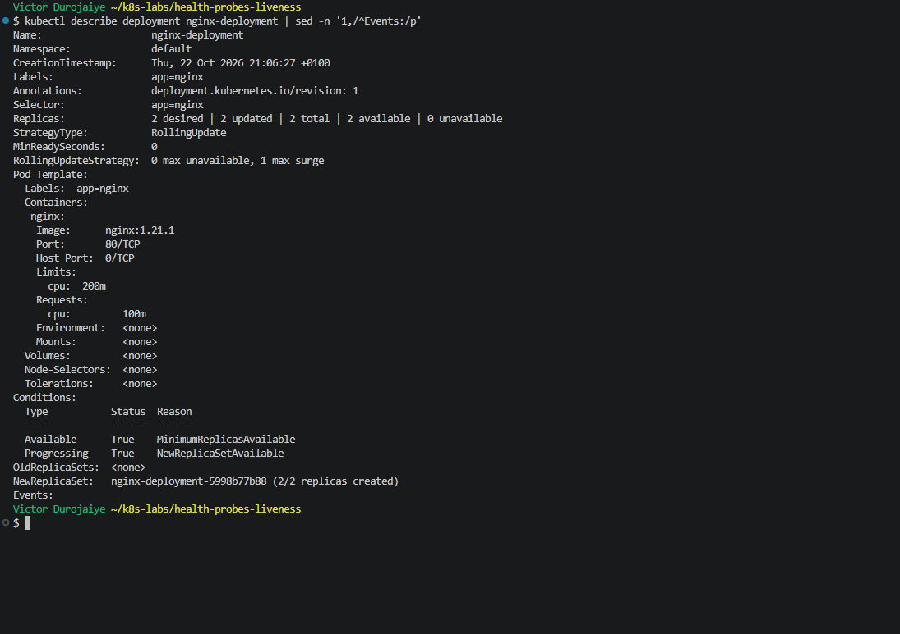

---

### Notes

**1. How many replicas does this Deployment maintain?**

Two. Describe showed `2 desired | 2 updated | 2 total | 2 available | 0 unavailable`, with Pods `csvlp` and `jvbtn` on ReplicaSet `5998b77b88`, both with 0 restarts. The file is identical to my Assignment 5 baseline (`cmp` confirmed it), so it got the same ReplicaSet hash. The hash comes from the Pod template. I committed it as `83b51e4` before applying it.

**2. Are any health probes configured in the baseline Deployment?**

No. `grep` found no `probe` in the file, and the Pod Template in describe has no `Liveness:` or `Readiness:` line.

**3. Why is a baseline useful before adding a liveness probe?**

It proves NGINX runs fine on its own with 0 restarts. So when restarts appear later, I know the probe caused them and not the image or the resources. It also gives me a known-good file to compare with: `diff` against the baseline showed the probe was the only change.

---

# Task 3 — Add a Liveness Probe

## Goal

Add an HTTP liveness probe so Kubernetes can periodically check whether the NGINX container is still responsive.

### Evidence

#### Screenshot 5 — Completed `01-nginx-deploy-liveness.yaml` manifest showing the liveness probe

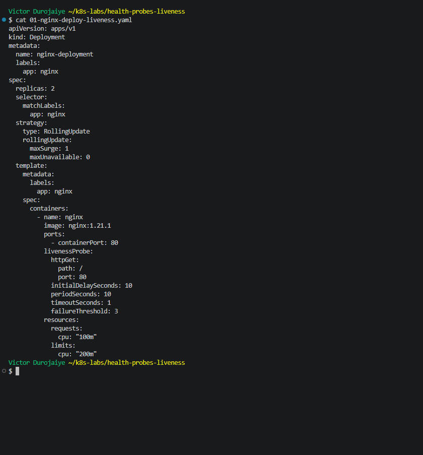

```yaml
apiVersion: apps/v1
kind: Deployment
metadata:
  name: nginx-deployment
  labels:
    app: nginx
spec:
  replicas: 2
  selector:
    matchLabels:
      app: nginx
  strategy:
    type: RollingUpdate
    rollingUpdate:
      maxSurge: 1
      maxUnavailable: 0
  template:
    metadata:
      labels:
        app: nginx
    spec:
      containers:
        - name: nginx
          image: nginx:1.21.1
          ports:
            - containerPort: 80
          livenessProbe:
            httpGet:
              path: /
              port: 80
            initialDelaySeconds: 10
            periodSeconds: 10
            timeoutSeconds: 1
            failureThreshold: 3
          resources:
            requests:
              cpu: "100m"
            limits:
              cpu: "200m"
```

---

#### Screenshot 6 — Output showing successful rollout and running Pods

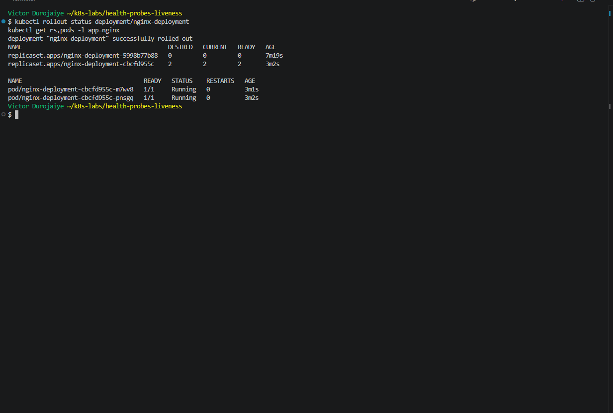

---

#### Screenshot 7 — Pod description showing liveness-probe details

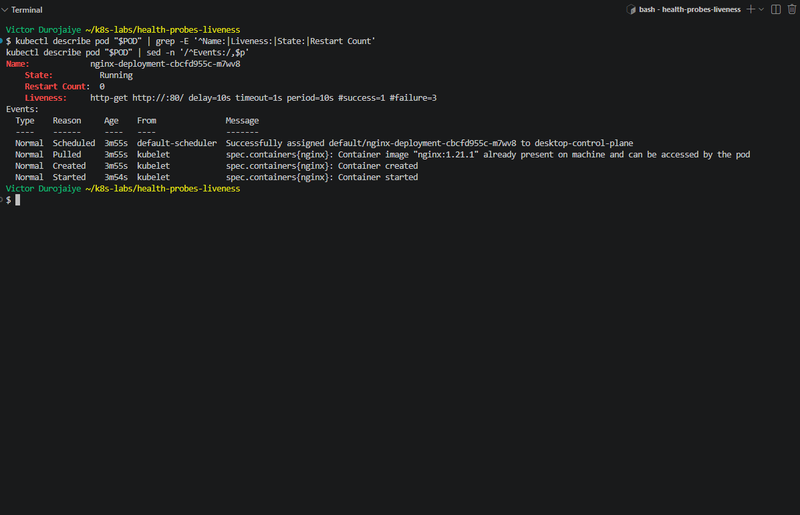

---

### Notes

**1. What path and port does the liveness probe check?**

`GET /` on port `80`. Describe shows `Liveness: http-get http://:80/ delay=10s timeout=1s period=10s #success=1 #failure=3`. `diff` against the baseline showed only the 8 probe lines were added (commit `8c50241`).

**2. What does `initialDelaySeconds: 10` do?**

The kubelet waits 10 seconds after the container starts before it sends the first liveness check. That gives the app time to start, so it is not killed while it is still booting.

**3. What does `failureThreshold: 3` mean?**

The probe has to fail 3 times in a row before Kubernetes acts. With `periodSeconds: 10`, a container must be failing for about 30 seconds before it is restarted, so one slow answer does not trigger a restart.

**4. Does a successful liveness probe control whether a Pod receives traffic? Explain briefly.**

No. Traffic and rollout availability depend on readiness. Liveness only decides whether the container should be restarted. This Deployment has no readiness probe, so describe showed no `Readiness:` line, and the Pods counted as Ready as soon as their containers started. Pod `m7wv8` stayed at `Restart Count: 0` with no `Unhealthy` events after about 4 minutes, so the probe was passing.

---

# Task 4 — Trigger and Observe a Liveness Restart

## Goal

Intentionally make the liveness probe fail and observe Kubernetes restart the unhealthy container.

### Evidence

#### Screenshot 8 — `02-nginx-liveness-broken.yaml` showing `/does-not-exist`

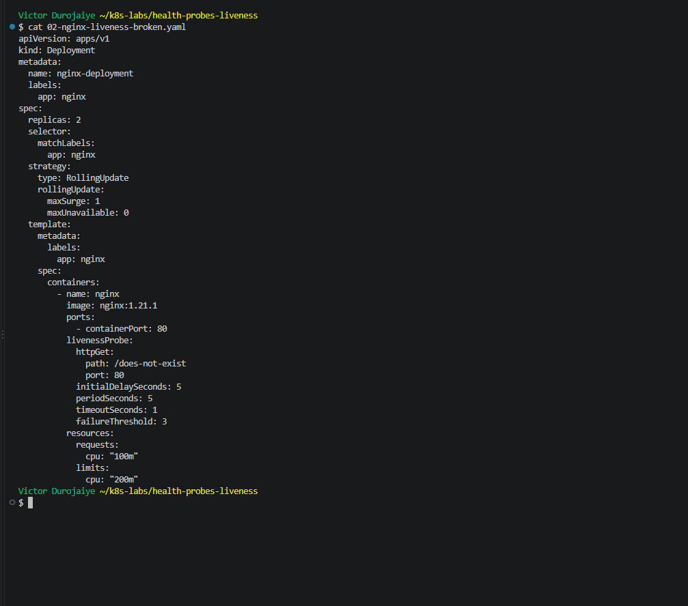

`02-nginx-liveness-broken.yaml` is a copy of `01` with three lines changed. `diff` confirms it:

```text
29c29
<               path: /
---
>               path: /does-not-exist
31,32c31,32
<             initialDelaySeconds: 10
<             periodSeconds: 10
---
>             initialDelaySeconds: 5
>             periodSeconds: 5
```

---

#### Screenshot 9 — Pod output showing an increased RESTARTS count

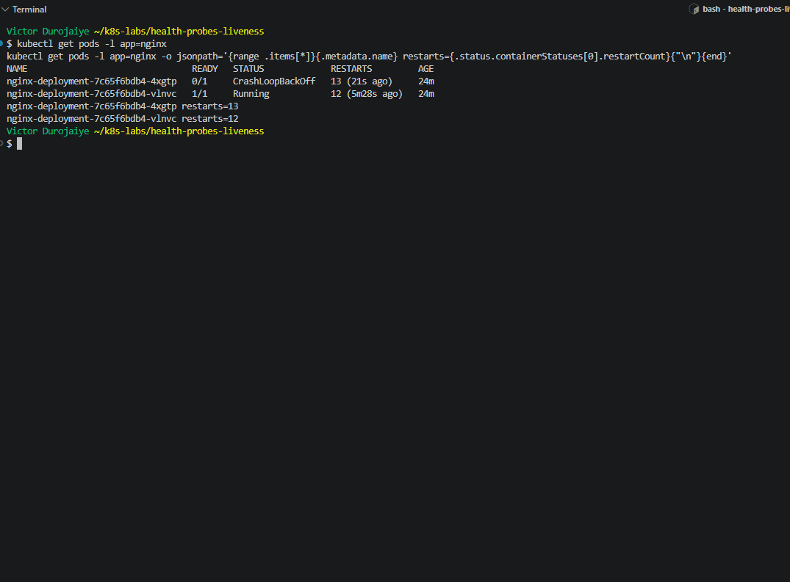

---

#### Screenshot 10 — Pod description showing liveness-probe failure events or restart details

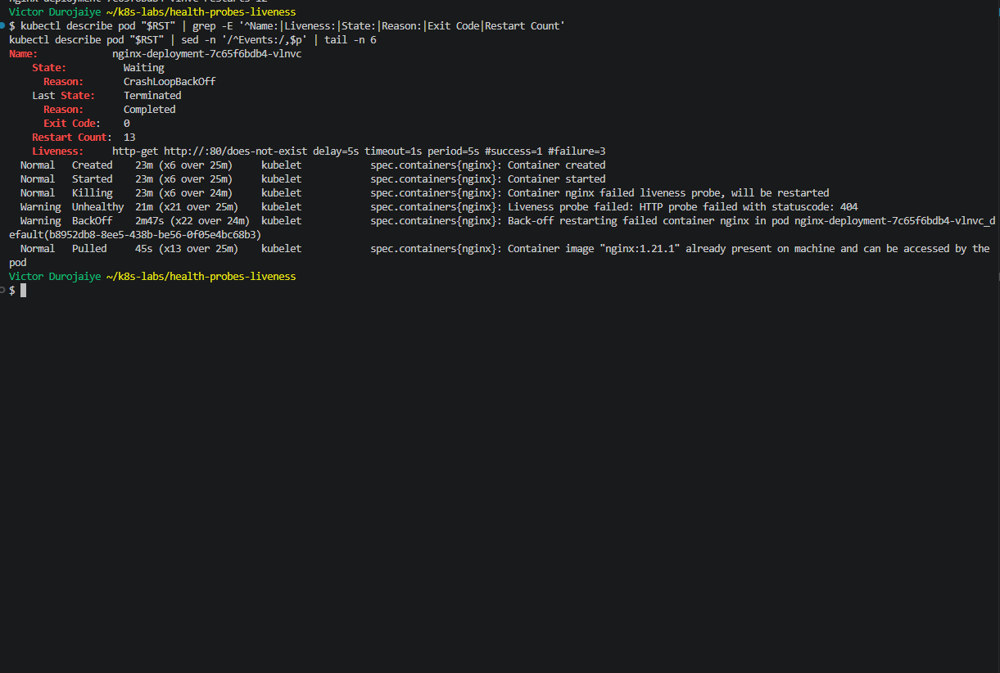

---

#### Screenshot 11 — Output showing stable running Pods after applying the fixed configuration

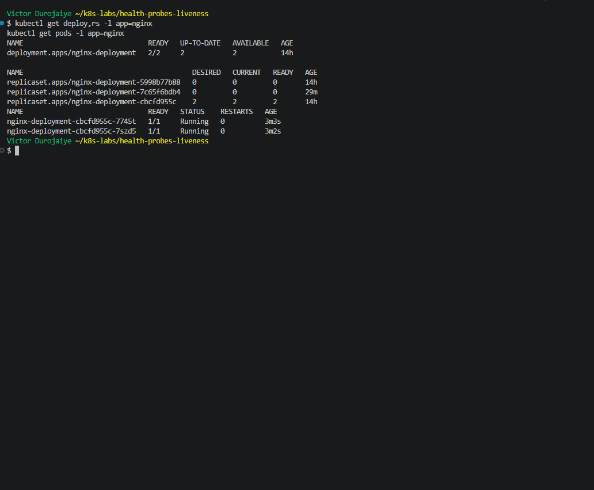

---

### Notes

**1. Why did the liveness probe fail?**

NGINX has no page at `/does-not-exist`, so every check got a `404`. The events show `Liveness probe failed: HTTP probe failed with statuscode: 404` (x21). NGINX itself was healthy. Each time it was killed it shut down cleanly (`Last State: Terminated, Reason: Completed, Exit Code: 0`). Only the check was wrong.

**2. What happened after Kubernetes detected repeated liveness-probe failures?**

After 3 failures in a row, the kubelet logged `Container nginx failed liveness probe, will be restarted` (`Killing`), stopped the container and started a new one in the same Pod. The watch shows a restart about every 15 to 20 seconds at first (`1 (0s ago)`, `2`, `3`). After a few restarts, the kubelet started waiting longer between them (`BackOff`, status `CrashLoopBackOff`). The two Pods reached 12 and 13 restarts. At one point both were in backoff at the same time, and the Deployment showed `0/2` available. A wrong liveness probe caused an outage on an app that was fine.

The rollout itself said `successfully rolled out`. That is because the Deployment has no readiness probe, so each new Pod counted as Ready the moment it started. Liveness does not protect rollouts. Readiness does.

**3. What does the RESTARTS column prove?**

It counts how many times the kubelet restarted a container inside the same Pod. The Pod names `4xgtp` and `vlnvc` stayed the same while RESTARTS went up to 13, so the Pods were never replaced. The kubelet restarted their containers in place because the liveness probe failed. The ReplicaSet did not get involved.

**4. How did you restore the Deployment to a stable state?**

I copied the working file to `03-nginx-liveness-fixed.yaml` (`cmp` showed it identical to `01`, commit `161a5ea`) and applied it. The template matched Task 3's, so the Deployment went back to ReplicaSet `cbcfd955c` and replaced the broken Pods with two new ones, `7745t` and `7szd5`. A 90-second watch showed them at `1/1 Running` with RESTARTS staying at `0`, and they were still at 0 three minutes later. `kubectl diff -f 03-nginx-liveness-fixed.yaml` returned exit 0.

---

# Task 5 — Optional: Observe a Restart Loop

## Goal

Observe why overly aggressive or incorrectly configured liveness probes can create restart loops.

Complete this section only if you attempt Task 5. Otherwise, mark it as “Not attempted.”

**Task status:** Completed

### Evidence

#### Optional Screenshot — Pod output showing the RESTARTS count increasing during the restart-loop observation

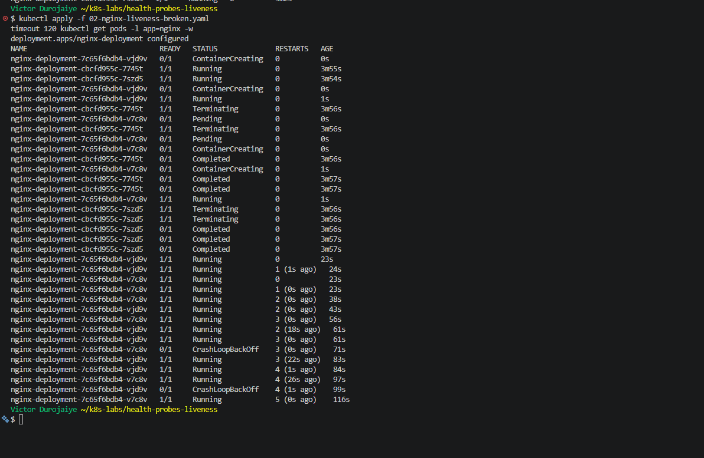

No specific restart count or CrashLoopBackOff status is required.

---

### Notes — Answer Only If Attempted

**1. What is a restart loop?**

A container keeps getting restarted over and over without ever settling. When I applied the broken manifest again, both new Pods (`vjd9v` and `v7c8v`) were killed every 15 to 20 seconds and reached 4 and 5 restarts in 2 minutes. The kubelet then added growing waits between attempts, shown as `CrashLoopBackOff`. The container keeps going round the same cycle until the cause is fixed.

**2. Why can an aggressive liveness probe be harmful?**

It can kill a container that is working fine. Short delays, short periods or a wrong path make it fail on a healthy app or one that is just slow to start. Every kill drops connections and throws away work. Once the Pods are in backoff, none of them may be running, which happened to me when the Deployment hit `0/2` available. A probe meant to help the app recover ended up causing the outage.

**3. Why should liveness checks be lightweight and carefully tuned?**

The check runs every few seconds for the life of the container, so it must be cheap and answer fast. It should only test whether this process is alive, and never depend on a database or another service. If that service blips, every Pod would fail liveness and restart together, which makes things worse. The delay and thresholds should give the app enough time to start and allow for a slow answer. A startup probe can cover apps that are slow to boot. After the test I applied `03-nginx-liveness-fixed.yaml` again and got two new Pods (`5blgn`, `pnhfp`) at `restarts=0 ready=true`, with `kubectl diff` exit 0. Then I deleted the Deployment and confirmed `No resources found in default namespace.`

---

# Task 6 — Share Your Liveness-Probe Learning on LinkedIn

## Goal

Share what you learned about Kubernetes liveness probes, container restarts, and the difference between readiness and liveness.

### Evidence

#### Screenshot 12 — Published LinkedIn post

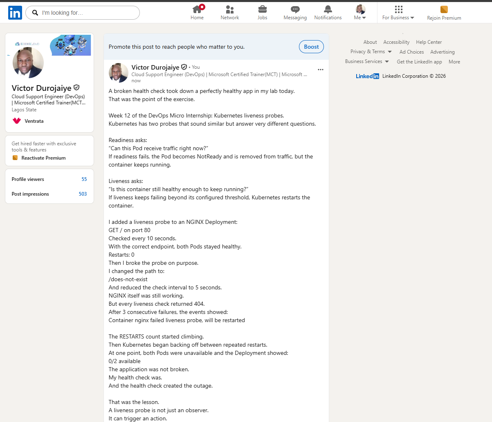

*Victor Durojaiye*

#### Linkedin post URL

https://www.linkedin.com/posts/victor-jaiye_devopsmicrointernship-kubernetes-devops-share-7519354055929004032-w75y/

---

# Submission Instructions

- Add all required screenshots numbered 1–12.
- Include the optional Task 5 screenshot only if you attempt that task.
- Ensure your full name is visible in required screenshots.
- Use clear, readable screenshots showing the relevant manifest or output.
- Include the completed baseline and liveness-probe manifests in your repository.
- Answer all Notes questions for Tasks 1–4 in your own words.
- If you attempt Task 5, complete its Notes and restore the working configuration afterward.
- Do not expose tokens, passwords, kubeconfig files, account IDs, or other sensitive information.

---

# Completion Checklist

- [x] Learning cluster confirmed and previous assignment resources removed where applicable
- [x] Liveness-probe lab directory created (Screenshot 1)
- [x] Baseline Deployment manifest completed (Screenshot 2)
- [x] Successful rollout and two baseline Pods verified (Screenshot 3)
- [x] Baseline Deployment details reviewed (Screenshot 4)
- [x] Liveness probe added successfully (Screenshot 5)
- [x] Successful liveness-probe rollout verified (Screenshot 6)
- [x] Liveness-probe details inspected (Screenshot 7)
- [x] Broken liveness configuration created (Screenshot 8)
- [x] Increased container restart count observed (Screenshot 9)
- [x] Liveness-probe failure events or restart details captured (Screenshot 10)
- [x] Working liveness configuration restored and stable Pods verified (Screenshot 11)
- [x] Optional Task 5 evidence and Notes completed, if attempted
- [x] Working configuration restored after Task 5, if attempted
- [x] LinkedIn post published (Screenshot 12)
- [x] Notes for Tasks 1–4 completed
- [x] Required manifests included
- [x] All required screenshots are clear and readable
- [x] No sensitive data exposed

---

## 📌 About DMI & CloudAdvisory

DevOps Micro Internship (DMI) is a project-based DevOps program run by Pravin Mishra (The CloudAdvisory) focused on real-world execution, systems thinking, and career readiness.

It helps learners build strong DevOps foundations with hands-on experience.

---

## 📌 Resources

- 🌐 DMI Official Website: https://dmi.pravinmishra.com?utm_source=github&utm_medium=readme  
- 🎓 University: https://university.pravinmishra.com?utm_source=github&utm_medium=readme  
- 💬 Discord Community: https://discord.pravinmishra.com?utm_source=github&utm_medium=readme  
- 📝 Blog: https://dmi.pravinmishra.com/blog?utm_source=github&utm_medium=readme  
- ▶️ YouTube Playlist: https://www.youtube.com/playlist?list=PLFeSNDtI4Cho  
- 🔗 Pravin Mishra (LinkedIn): https://www.linkedin.com/in/pravin-mishra-aws-trainer/  
- 🏢 CloudAdvisory (LinkedIn): https://www.linkedin.com/company/thecloudadvisory/

---

*This submission is part of DevOps Micro Internship (DMI) — Agentic AI Track.*
