# Assignment 7 — Kubernetes Services (ClusterIP)

Part of the DevOps Micro Internship (DMI) with Agentic AI

---

## Purpose

In this assignment, you will create and test a Kubernetes ClusterIP Service. You will connect it to a healthy NGINX Deployment, access it using DNS and its ClusterIP, break and restore its selector, and observe how readiness affects Service routing.

---

# Task 0 — Prepare the Lab Environment

## Goal

Confirm your learning-cluster context and remove previous lab resources where applicable before starting this assignment.

No screenshot or written notes are required for this pre-check.

---

# Task 1 — Set Up Your Lab Directory

## Goal

Create and enter a dedicated directory for the ClusterIP Service lab.

### Evidence

#### Screenshot 1 — Terminal showing that you are working inside `~/k8s-labs/services/clusterip`

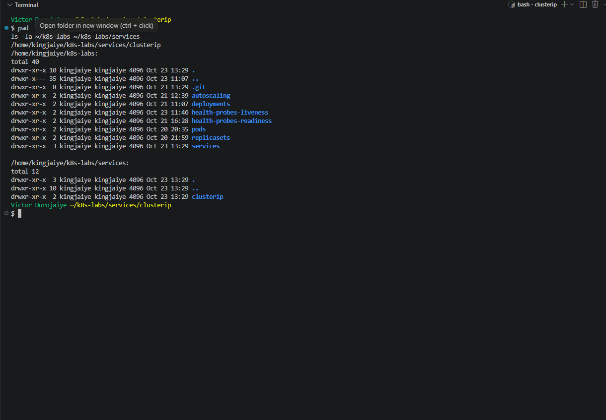

---

### Notes

**1. Why is it not reliable to communicate with an application using a Pod IP address?**

Pod IPs are temporary. Every time a Pod is replaced, whether by a rollout, a scale event, a crash or auto-healing, the new Pod gets a new IP. I saw this in Task 6: the new Pod came up at `10.244.0.21`, and after the restore a replacement got `10.244.0.22`. A client that saved an old Pod IP would start failing, and one Pod IP only ever reaches one Pod, so there is no load spreading either. In Task 0 I confirmed the context was `docker-desktop` and that only `service/kubernetes` existed, with no Deployments, `nginx-svc` or `tester` left over.

**2. What Kubernetes resource provides a stable internal address for a group of Pods?**

A Service. The default type, ClusterIP, gives the group one fixed virtual IP and a DNS name inside the cluster.

---

# Task 2 — Create a Healthy NGINX Deployment

## Goal

Create an NGINX Deployment with labels, readiness probes, and liveness probes that can act as the backend for a Service.

### Evidence

#### Screenshot 2 — Completed `00-nginx-deploy.yaml` manifest

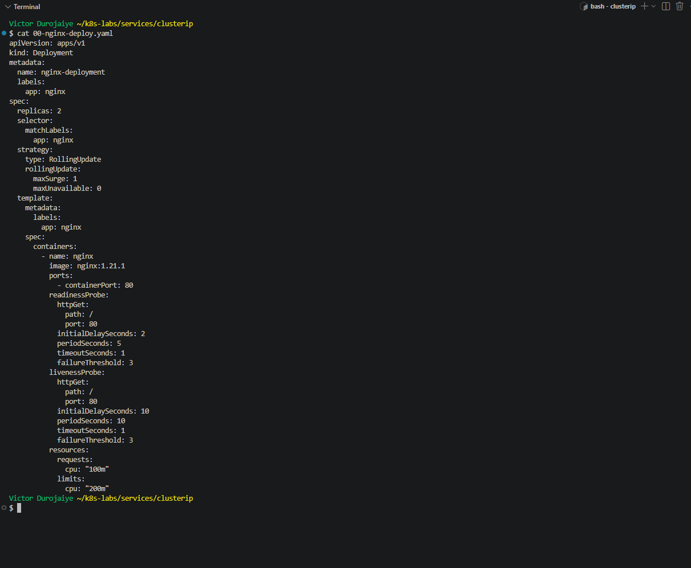

```yaml
apiVersion: apps/v1
kind: Deployment
metadata:
  name: nginx-deployment
  labels:
    app: nginx
spec:
  replicas: 2
  selector:
    matchLabels:
      app: nginx
  strategy:
    type: RollingUpdate
    rollingUpdate:
      maxSurge: 1
      maxUnavailable: 0
  template:
    metadata:
      labels:
        app: nginx
    spec:
      containers:
        - name: nginx
          image: nginx:1.21.1
          ports:
            - containerPort: 80
          readinessProbe:
            httpGet:
              path: /
              port: 80
            initialDelaySeconds: 2
            periodSeconds: 5
            timeoutSeconds: 1
            failureThreshold: 3
          livenessProbe:
            httpGet:
              path: /
              port: 80
            initialDelaySeconds: 10
            periodSeconds: 10
            timeoutSeconds: 1
            failureThreshold: 3
          resources:
            requests:
              cpu: "100m"
            limits:
              cpu: "200m"
```

---

#### Screenshot 3 — Output showing successful rollout and two ready NGINX Pods

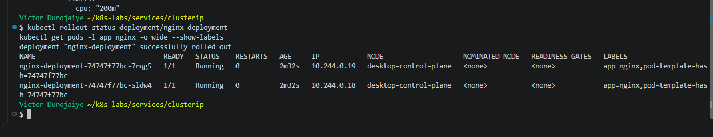

---

### Notes

**1. Which label will the Service use to find these Pods?**

`app: nginx`. It is set in the Pod template, and `--show-labels` showed `app=nginx` on both Pods, `7rqg5` (`10.244.0.19`) and `sldw4` (`10.244.0.18`).

**2. Why is readiness important before connecting Pods to a Service?**

A Service only sends traffic to endpoints that are ready. Without a readiness probe, a Pod counts as ready the moment its container starts, even if the app inside cannot answer yet, so the Service could send users to it. With the probe, a Pod is only added as a ready backend after `GET /` on port 80 succeeds. Both Pods showed `Ready: True`, with the readiness probe checking every 5s and the liveness probe every 10s.

**3. What port does the NGINX container listen on?**

Port `80` (`containerPort: 80`).

---

# Task 3 — Create a ClusterIP Service

## Goal

Create a stable internal Service that routes traffic to the NGINX Pods.

### Evidence

#### Screenshot 4 — Completed `01-nginx-svc-clusterip.yaml` manifest

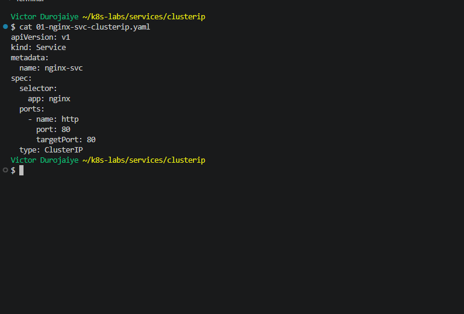

```yaml
apiVersion: v1
kind: Service
metadata:
  name: nginx-svc
spec:
  selector:
    app: nginx
  ports:
    - name: http
      port: 80
      targetPort: 80
  type: ClusterIP
```

---

#### Screenshot 5 — Output showing the ClusterIP Service, endpoints, or EndpointSlices

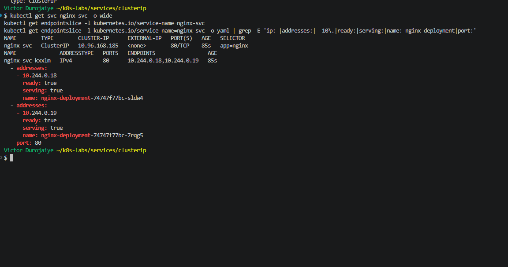

---

### Notes

**1. What is the purpose of a ClusterIP Service?**

It gives a set of Pods one stable virtual IP and DNS name that only works inside the cluster, and it spreads requests across the ready Pods behind it. `nginx-svc` got ClusterIP `10.96.168.185` on `80/TCP`. That address stays the same however many times the Pods behind it change.

**2. What is the difference between `port` and `targetPort`?**

`port` is the port clients call on the Service (`10.96.168.185:80`). `targetPort` is the port on the Pod that the traffic is forwarded to (the container's port `80`). They are both 80 here, but they can differ. For example, a Service could expose port 80 and forward to an app listening on 8080.

**3. Why must the Service selector match the Pod labels?**

The Service does not store a list of Pods. Kubernetes keeps finding the Pods whose labels match the selector and writes their IPs into the EndpointSlice. If the selector does not match, the Service has no backends. Task 5 proved this.

**4. What information do EndpointSlices contain?**

The current backends of the Service: each Pod's IP address, the port and protocol, which Pod it is (`targetRef`), the node, and its conditions `ready`, `serving` and `terminating`. My slice `nginx-svc-kxxlm` listed `10.244.0.18` (`sldw4`) and `10.244.0.19` (`7rqg5`) on port 80, both `ready=true serving=true terminating=false`. I used EndpointSlices because `kubectl get endpoints` now prints `Warning: v1 Endpoints is deprecated in v1.33+; use discovery.k8s.io/v1 EndpointSlice`.

---

# Task 4 — Access the Service from Inside the Cluster

## Goal

Create a client Pod and access the NGINX Service using DNS and its ClusterIP.

### Evidence

#### Screenshot 6 — Output showing the `tester` Pod running

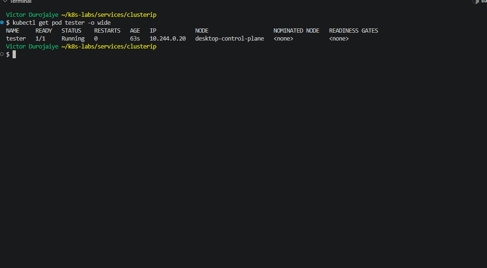

---

#### Screenshot 7 — Successful Service request using DNS name and ClusterIP

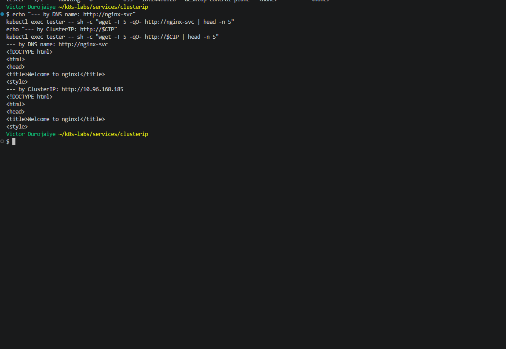

---

#### Screenshot 8 — Successful DNS lookup for the Service

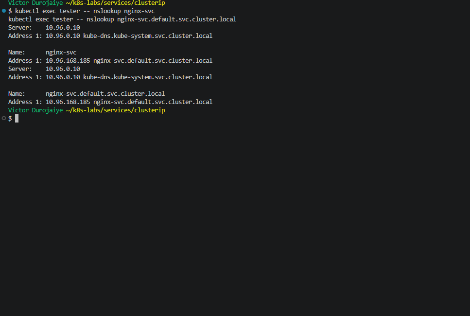

---

### Notes

**1. Why should an application use `nginx-svc` instead of a Pod IP address?**

The name stays the same and always points to whichever Pods are ready right now, with requests spread across them. A Pod IP points at one Pod that may be gone tomorrow. From the `tester` Pod (`busybox:1.28`, `10.244.0.20`), `wget http://nginx-svc` returned the NGINX welcome page without the client knowing any Pod IP. I used `busybox:1.28` as the lab says, because newer BusyBox builds have a known `nslookup` problem in Kubernetes.

**2. What does the DNS name `nginx-svc.default.svc.cluster.local` represent?**

The full DNS name of the Service: `<service>.<namespace>.svc.<cluster domain>`. That is Service `nginx-svc` in namespace `default`, in the cluster domain `cluster.local`. CoreDNS (`10.96.0.10`, `kube-dns.kube-system`) resolved it to `10.96.168.185`, the ClusterIP, not a Pod IP. The short name `nginx-svc` works because the Pod's `/etc/resolv.conf` has `search default.svc.cluster.local svc.cluster.local cluster.local`.

**3. Why can the client access the Service even if the backend Pod IPs change?**

The client only ever uses the Service name or ClusterIP, and those do not change. When Pods are replaced, Kubernetes updates the EndpointSlice with the new Pod IPs, and kube-proxy updates the routing rules on the node. The request to `10.96.168.185:80` is then forwarded to whichever ready Pod IP is current. I saw this in Task 6: the backend IPs changed (`.21` came and went, `.22` was added) and the Service address never changed.

---

# Task 5 — Break and Restore the Label-Selector Contract

## Goal

Break the Service selector, observe that usable endpoints disappear, and then restore the correct selector.

### Evidence

#### Screenshot 9 — `02-nginx-svc-selector-broken.yaml` showing the incorrect selector

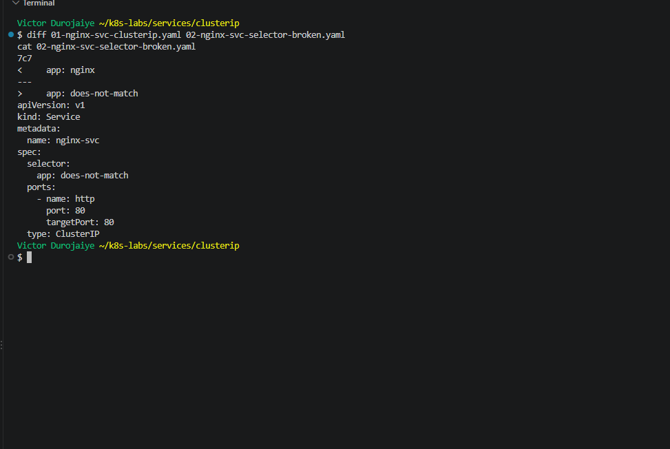

`02-nginx-svc-selector-broken.yaml` is a copy of `01` with one line changed:

```text
7c7
<     app: nginx
---
>     app: does-not-match
```

---

#### Screenshot 10 — Empty endpoints or EndpointSlice output after applying the broken selector

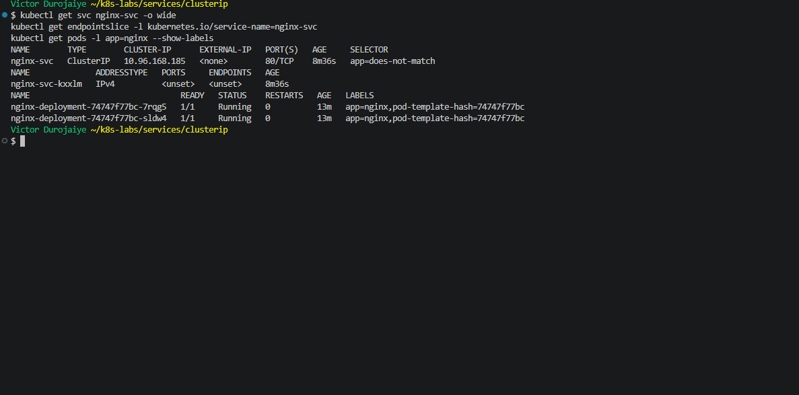

---

#### Screenshot 11 — Failed request output from the `tester` Pod

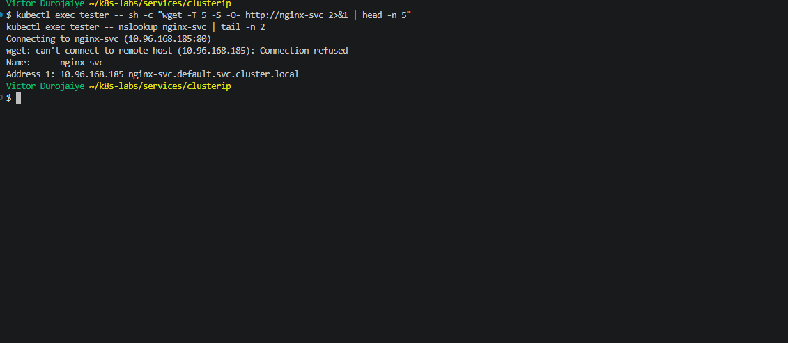

---

#### Screenshot 12 — Restored endpoints and successful Service request

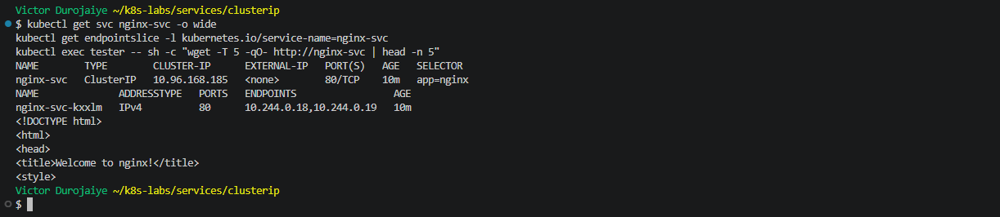

---

### Notes

**1. Why did the Service endpoints become empty?**

The selector changed to `app: does-not-match`, and no Pod carries that label. Both NGINX Pods still had `app=nginx` and stayed `1/1 Running`, but they no longer matched, so Kubernetes removed them from the EndpointSlice. `nginx-svc-kxxlm` showed `<unset>` for ports and endpoints (`endpoints=null`). The Service itself kept its ClusterIP `10.96.168.185`.

**2. What caused the request from the client Pod to fail?**

The Service had no backends. `nslookup` still resolved `nginx-svc` to `10.96.168.185`, because the Service existed, but with no endpoints the node had nowhere to forward the traffic and rejected the connection. `wget` printed `Connecting to nginx-svc (10.96.168.185:80)` and then `wget: can't connect to remote host (10.96.168.185): Connection refused`. DNS working does not mean the app is reachable.

**3. How did you restore connectivity to the NGINX Pods?**

I applied the original `01-nginx-svc-clusterip.yaml` again, which set the selector back to `app: nginx`. Within seconds the EndpointSlice listed `10.244.0.18,10.244.0.19` again, the same request returned the NGINX welcome page, and `kubectl diff -f 01-nginx-svc-clusterip.yaml` returned exit 0. I did not touch the Pods at all. The fix was only in the Service.

---

# Task 6 — Observe How Readiness Affects Service Routing

## Goal

Observe how a new Pod that fails readiness is excluded from ready Service backends while the existing healthy Pod continues serving traffic.

### Evidence

#### Screenshot 13 — Output showing the Deployment scaled to one ready Pod

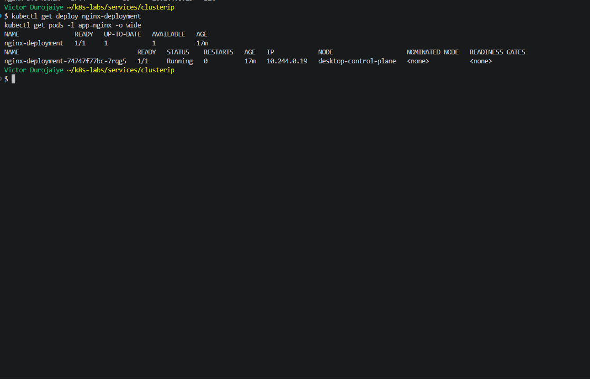

---

#### Screenshot 14 — Completed `03-readiness-broken.yaml` patch file

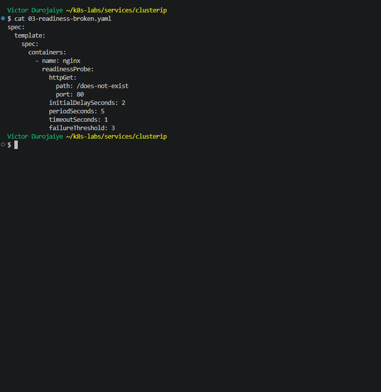

```yaml
spec:
  template:
    spec:
      containers:
        - name: nginx
          readinessProbe:
            httpGet:
              path: /does-not-exist
              port: 80
            initialDelaySeconds: 2
            periodSeconds: 5
            timeoutSeconds: 1
            failureThreshold: 3
```

---

#### Screenshot 15 — Output showing the expected incomplete rollout or NotReady Pod

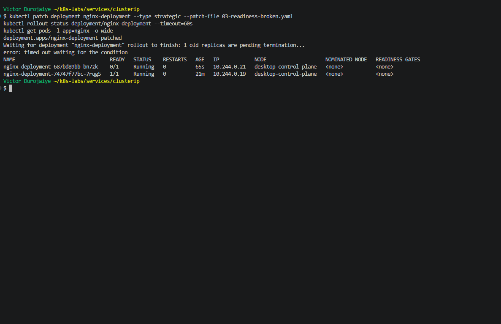

---

#### Screenshot 16 — EndpointSlice output showing the healthy Pod with `ready: true` and the new NotReady Pod with `ready: false`

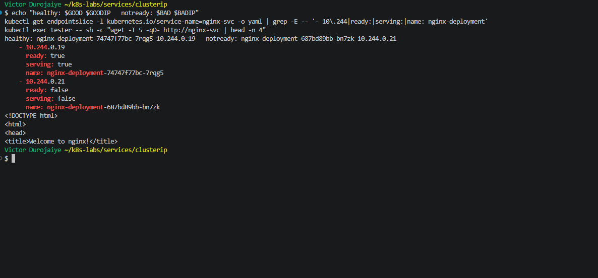

---

#### Screenshot 17 — Service EndpointSlice output showing ready backends after restoring the Deployment

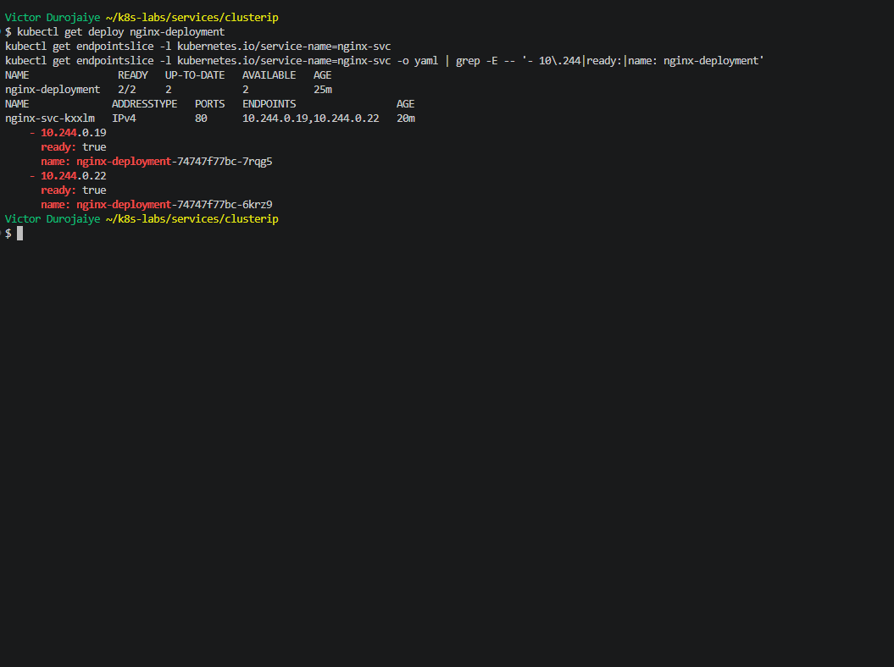

---

### Notes

**1. Why was the new NotReady Pod excluded from ready Service backends?**

Its readiness probe checked `/does-not-exist`, got `404` every time (`Readiness probe failed: HTTP probe failed with statuscode: 404`, x25), so the Pod never became Ready. I scaled to one Pod first (`7rqg5`, `10.244.0.19`), then applied the patch. A server dry run had confirmed it changed only readiness (`readiness=/does-not-exist liveness=/ image=nginx:1.21.1`). The new Pod `bn7zk` (`10.244.0.21`, ReplicaSet `687bd89bb`) still matched the selector, so it was listed in the EndpointSlice, but as `ready=false serving=false`. The healthy Pod stayed `ready=true serving=true`, and the Service only routes to ready endpoints.

**2. What is the relationship between readiness probes and Service routing?**

Readiness decides which matching Pods get traffic. The selector decides which Pods the Service can see. The readiness result decides which of those Pods are marked `ready` in the EndpointSlice, and only those receive requests. All 5 requests I sent from `tester` during the broken rollout returned the NGINX page from the healthy Pod. The rollout also stalled (`timed out waiting for the condition`), because `maxUnavailable: 0` would not remove the healthy Pod until the new one was Ready.

**3. Why does this behavior protect users from unhealthy application instances?**

A Pod that cannot serve properly gets no traffic, even though it is Running and matches the selector, so users never land on it. Meanwhile the healthy Pod keeps serving, and the bad version stops at one stuck Pod. When I applied `00-nginx-deploy.yaml` again, the Deployment went back to ReplicaSet `74747f77bc` with 2 replicas, kept `7rqg5` and added `6krz9` (`10.244.0.22`). Both showed `ready=true`, and `kubectl diff` returned exit 0, so the `scale` and the `patch` were both undone. Cleanup: I deleted `tester`, `nginx-svc` and `nginx-deployment` and confirmed only `service/kubernetes` was left.

---

# Task 7 — Share Your ClusterIP Service Learning on LinkedIn

## Goal

Share what you learned about ClusterIP Services, Kubernetes DNS, selectors, and readiness-aware Service routing.

### Evidence

#### Screenshot 18 — Published LinkedIn post


*Victor Durojaiye*

#### Linkedin post link

https://www.linkedin.com/posts/victor-jaiye_devopsmicrointernship-kubernetes-devops-share-7519384737774415872-oZkq/

---

# Submission Instructions

- Add all required screenshots numbered 1–18.
- Ensure your full name is visible in required screenshots.
- Use clear, readable screenshots showing the relevant manifest or output.
- Include the completed NGINX Deployment and ClusterIP Service manifests in your repository.
- Answer all Notes questions for Tasks 1–6 in your own words.
- Include evidence of the intentional failures and successful recovery.
- Do not expose tokens, passwords, kubeconfig files, account IDs, or other sensitive information.

---

# Completion Checklist

- [x] Learning-cluster context confirmed and previous lab resources removed where applicable
- [x] ClusterIP lab directory created (Screenshot 1)
- [x] Healthy NGINX Deployment manifest completed (Screenshot 2)
- [x] Successful rollout and two ready NGINX Pods verified (Screenshot 3)
- [x] ClusterIP Service manifest completed (Screenshot 4)
- [x] Service and backend endpoints or EndpointSlices verified (Screenshot 5)
- [x] Client Pod created and running (Screenshot 6)
- [x] Service accessed using DNS name and ClusterIP (Screenshot 7)
- [x] Service DNS resolution verified (Screenshot 8)
- [x] Broken selector manifest created (Screenshot 9)
- [x] Empty endpoints observed (Screenshot 10)
- [x] Failed Service request captured (Screenshot 11)
- [x] Original selector restored and connectivity verified (Screenshot 12)
- [x] Deployment scaled to one ready Pod (Screenshot 13)
- [x] Broken readiness patch created (Screenshot 14)
- [x] Incomplete rollout or NotReady Pod observed (Screenshot 15)
- [x] Readiness effect on Service backends verified (Screenshot 16)
- [x] Deployment restored and ready Service backends verified (Screenshot 17)
- [x] LinkedIn post published (Screenshot 18)
- [x] Notes for Tasks 1–6 completed
- [x] Required manifests included
- [x] All required screenshots are clear and readable
- [x] No sensitive data exposed

---

## 📌 About DMI & CloudAdvisory

DevOps Micro Internship (DMI) is a project-based DevOps program run by Pravin Mishra (The CloudAdvisory) focused on real-world execution, systems thinking, and career readiness.

It helps learners build strong DevOps foundations with hands-on experience.

---

## 📌 Resources

- 🌐 DMI Official Website: https://dmi.pravinmishra.com?utm_source=github&utm_medium=readme  
- 🎓 University: https://university.pravinmishra.com?utm_source=github&utm_medium=readme  
- 💬 Discord Community: https://discord.pravinmishra.com?utm_source=github&utm_medium=readme  
- 📝 Blog: https://dmi.pravinmishra.com/blog?utm_source=github&utm_medium=readme  
- ▶️ YouTube Playlist: https://www.youtube.com/playlist?list=PLFeSNDtI4Cho  
- 🔗 Pravin Mishra (LinkedIn): https://www.linkedin.com/in/pravin-mishra-aws-trainer/  
- 🏢 CloudAdvisory (LinkedIn): https://www.linkedin.com/company/thecloudadvisory/

---

*This submission is part of DevOps Micro Internship (DMI) — Agentic AI Track.*
