# Assignment 8 — Kubernetes Services (NodePort)

Part of the DevOps Micro Internship (DMI) with Agentic AI

---

## Purpose

Create a healthy NGINX Deployment, expose it through a NodePort Service, test access using a node IP and NodePort, and observe how the Service behaves when a backend Pod is replaced.

---

# Task 1 — Set Up Your Lab Directory

## Goal

Create and enter a dedicated directory for the NodePort Service lab.

### Evidence

#### Screenshot 1 — Terminal showing that you are working inside `~/k8s-labs/services/nodeport`

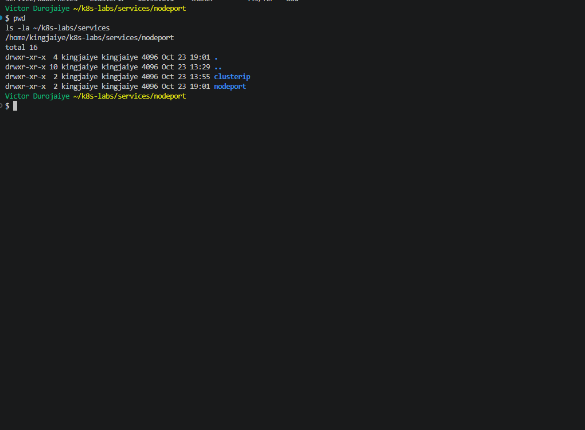

### Notes

**1. What is the difference between ClusterIP and NodePort?**

A ClusterIP Service gets a virtual IP that only works inside the cluster. A NodePort Service gets the same ClusterIP and also opens one port, from the range 30000 to 32767, on every node. Traffic sent to `<node IP>:<nodePort>` is forwarded to the Service and then to a ready Pod. In my lab, `nginx-svc-nodeport` had ClusterIP `10.96.83.24` and NodePort `32675`, so it could be reached either way. Before starting I checked that the context was `docker-desktop` and that only `service/kubernetes` was left from Assignment 7.

**2. What does a NodePort Service allow users to do?**

It lets clients outside the Pod network reach the app through a node's IP and a fixed port, without knowing any Pod IP. Whether a client can actually get there depends on the network path to the node. On my setup only clients inside the cluster could reach it (see Task 4).

---

# Task 2 — Create a Healthy NGINX Deployment

## Goal

Create a healthy NGINX Deployment that can act as the backend for the NodePort Service.

### Evidence

#### Screenshot 2 — Completed `00-nginx-deploy.yaml` manifest

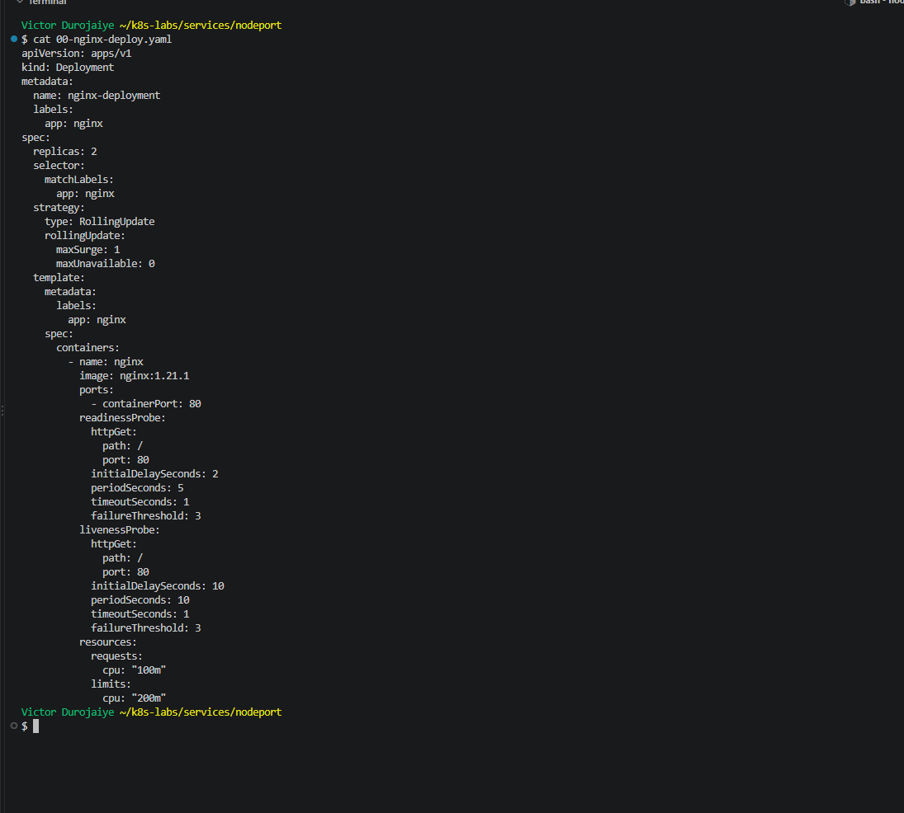

```yaml
apiVersion: apps/v1
kind: Deployment
metadata:
  name: nginx-deployment
  labels:
    app: nginx
spec:
  replicas: 2
  selector:
    matchLabels:
      app: nginx
  strategy:
    type: RollingUpdate
    rollingUpdate:
      maxSurge: 1
      maxUnavailable: 0
  template:
    metadata:
      labels:
        app: nginx
    spec:
      containers:
        - name: nginx
          image: nginx:1.21.1
          ports:
            - containerPort: 80
          readinessProbe:
            httpGet:
              path: /
              port: 80
            initialDelaySeconds: 2
            periodSeconds: 5
            timeoutSeconds: 1
            failureThreshold: 3
          livenessProbe:
            httpGet:
              path: /
              port: 80
            initialDelaySeconds: 10
            periodSeconds: 10
            timeoutSeconds: 1
            failureThreshold: 3
          resources:
            requests:
              cpu: "100m"
            limits:
              cpu: "200m"
```

---

#### Screenshot 3 — Output showing successful rollout and two ready NGINX Pods

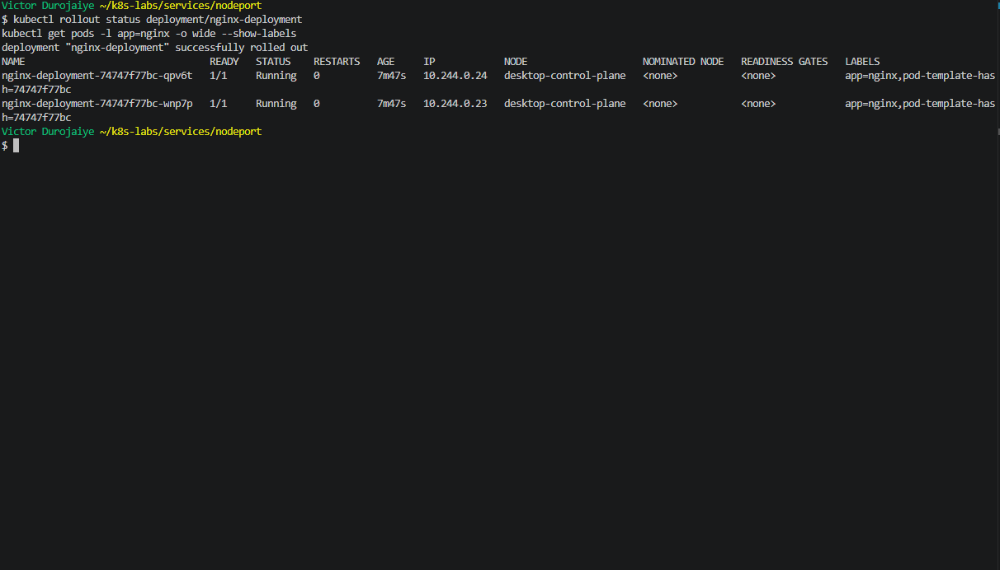

### Notes

**1. Which label will the NodePort Service use to find the NGINX Pods?**

`app: nginx`. Both Pods, `qpv6t` (`10.244.0.24`) and `wnp7p` (`10.244.0.23`), showed `app=nginx` in `--show-labels`. The manifest is identical to my Assignment 7 one (`cmp` confirmed it), so it produced the same ReplicaSet hash, `74747f77bc`.

**2. Why must the Pods be ready before they can receive Service traffic?**

The Service only sends traffic to endpoints marked `ready` in its EndpointSlice, and a Pod is only marked ready after its readiness probe (`GET /` on port 80) succeeds. Otherwise a NodePort request could land on a container that has started but cannot answer yet. Both Pods showed `Ready: True` with 0 restarts.

**3. What port does the NGINX container listen on?**

Port `80` (`containerPort: 80`).

---

# Task 3 — Create the NodePort Service

## Goal

Create a NodePort Service that exposes the NGINX application through a port on every cluster node.

### Evidence

#### Screenshot 4 — Completed `01-nginx-svc-nodeport.yaml` manifest

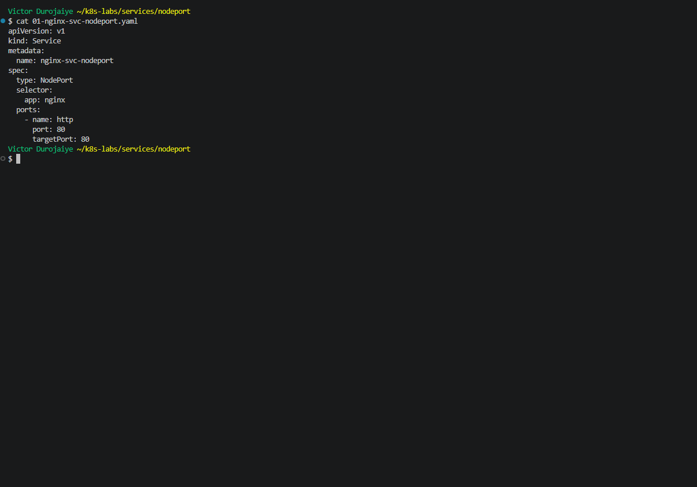

```yaml
apiVersion: v1
kind: Service
metadata:
  name: nginx-svc-nodeport
spec:
  type: NodePort
  selector:
    app: nginx
  ports:
    - name: http
      port: 80
      targetPort: 80
```

---

#### Screenshot 5 — Output showing the NodePort Service and its endpoints or EndpointSlices

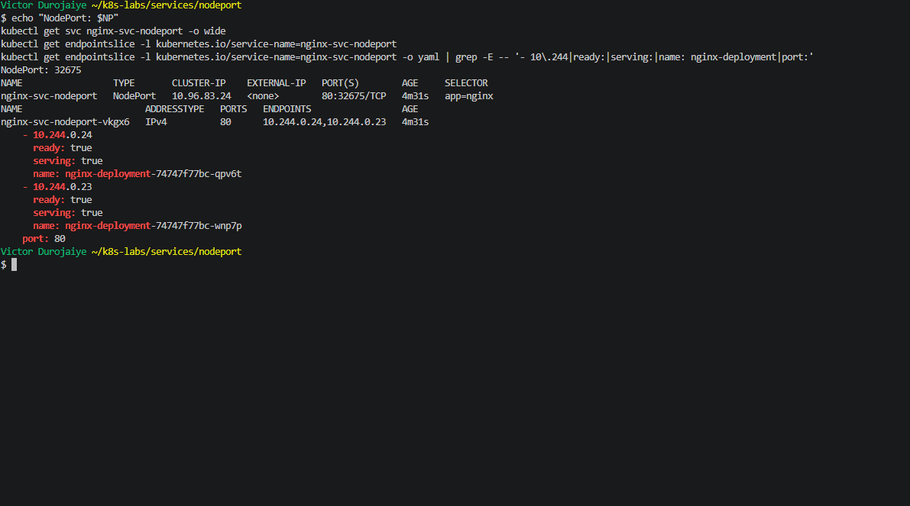

### Notes

**1. What is the purpose of `type: NodePort`?**

It tells Kubernetes to open a port on every node in addition to the ClusterIP, so the app can be reached at `<any node IP>:<nodePort>`. kube-proxy on each node forwards that port to the Service's ready endpoints.

**2. What is the difference between `port`, `targetPort`, and `nodePort`?**

- `port` (80): the port on the Service's ClusterIP, used from inside the cluster (`10.96.83.24:80`).
- `targetPort` (80): the port on the Pod that traffic is finally sent to, where NGINX listens.
- `nodePort` (32675): the port opened on every node, used with a node IP (`172.21.0.4:32675`).

The path is `nodeIP:32675` → Service → `PodIP:80`. `kubectl get svc` shows it as `80:32675/TCP`.

**3. What NodePort was assigned or selected in your environment?**

`32675`. I did not set `nodePort` in the manifest, so Kubernetes picked a free port from its default range, 30000 to 32767.

**4. Why do Service endpoints need ready Pods?**

Without ready endpoints, the Service has nowhere to forward traffic, and every request to the NodePort fails even though the port is open. Task 5 showed this: with no matching Pods, `172.21.0.4:32675` returned `Connection refused`. Here, the EndpointSlice `nginx-svc-nodeport-vkgx6` listed both Pods, `10.244.0.24` and `10.244.0.23`, as `ready=true serving=true`.

---

# Task 4 — Find a Node IP and Test the NodePort

## Goal

Find a reachable node IP and access the NodePort Service.

### Evidence

#### Screenshot 6 — Output of `kubectl get nodes -o wide`

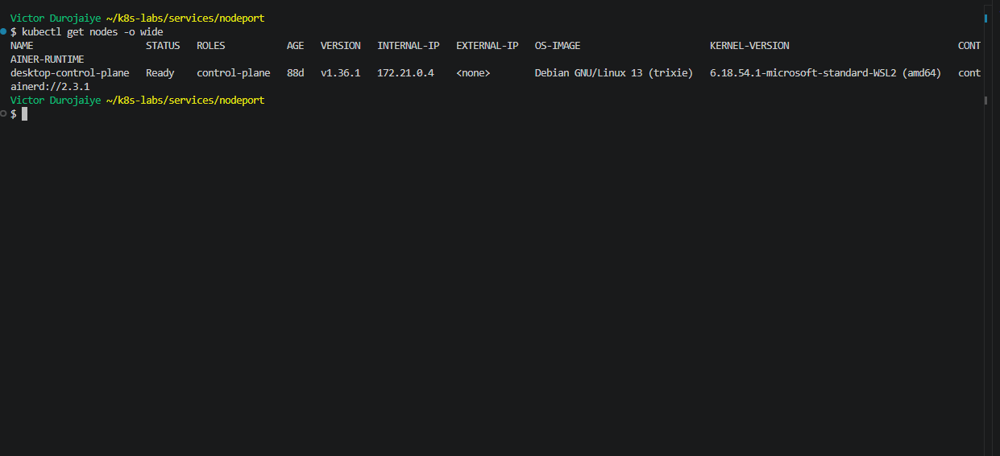

---

#### Screenshot 7 — Output showing the `tester` Pod running

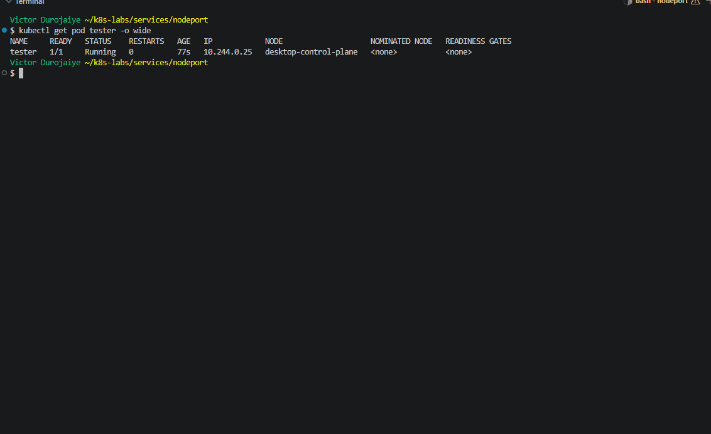

---

#### Screenshot 8 — Successful NodePort response from the laptop or the `tester` Pod

If neither route is supported by your environment, include the failed request output and ready endpoint evidence, and explain the limitation in your Notes.

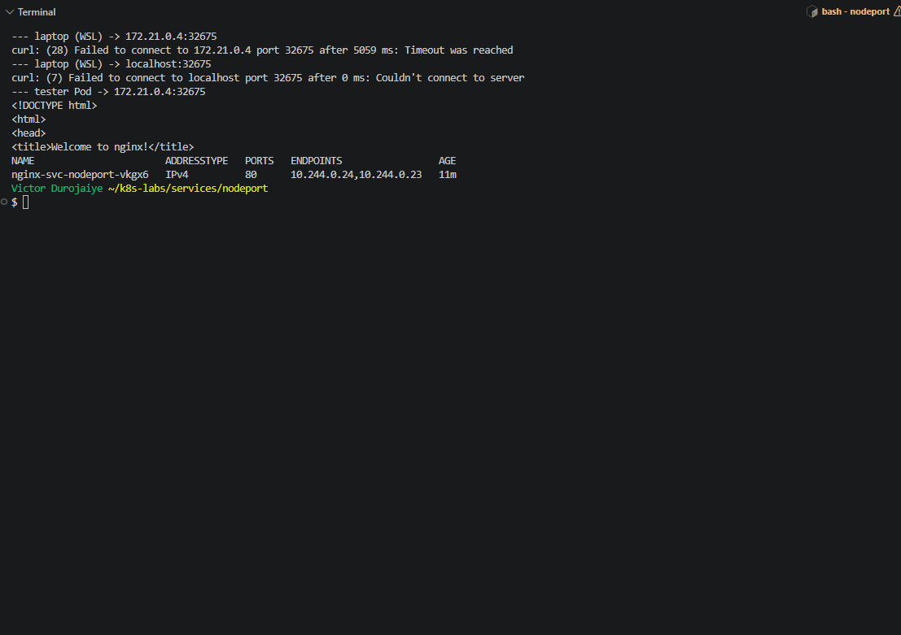

### Notes

**1. Which node IP and NodePort did you test?**

Node `desktop-control-plane`, INTERNAL-IP `172.21.0.4` (EXTERNAL-IP `<none>`), and NodePort `32675`. I read both into shell variables rather than typing them. From the `tester` Pod (`busybox:1.28`, `10.244.0.25`), `wget http://172.21.0.4:32675` returned the NGINX welcome page.

**2. Was your laptop able to reach the NodePort directly? Explain your result.**

No. I tried two routes from WSL, and both failed:
- `curl http://172.21.0.4:32675` timed out after 5 seconds (`curl: (28) ... Timeout was reached`). `172.21.0.4` is the node container's address on Docker Desktop's internal Docker network, and my WSL distro has no route into that network.
- `curl http://localhost:32675` failed at once (`curl: (7) ... Couldn't connect to server`). Docker Desktop's kind-type cluster does not forward NodePorts to `localhost`, so nothing was listening there.

The same address worked from the `tester` Pod, and the EndpointSlice had two ready endpoints, so the Service was working. The limit was the network path from my laptop to the node, not Kubernetes.

**3. Why can external NodePort access behave differently in Minikube, kind, Docker Desktop, and cloud clusters?**

The NodePort opens on the node, so access depends on where the node lives and how it is networked.
- **kind and Docker Desktop's kind mode:** each node is a Docker container on a private bridge network. Its IP is often unreachable from the host or WSL unless ports are published when the cluster is created.
- **Minikube:** the node is a VM or container with its own IP. `minikube ip` or `minikube service` may work, but with the Docker driver on Windows it often needs a tunnel.
- **Docker Desktop's older kubeadm mode:** used to forward to `localhost`, which my kind-based setup did not do.
- **Cloud clusters:** nodes have real VPC addresses. Access then depends on whether the node has a public IP and whether firewalls or security groups allow the 30000 to 32767 range.

---

# Task 5 — Optional: Test the Label-Selector Contract

## Goal

Break the Service selector, observe that usable endpoints disappear, and restore the correct selector.

Complete the Evidence and Notes below only if you attempted this optional task.

### Evidence

#### Screenshot 9 — `02-nginx-svc-selector-broken.yaml` showing the incorrect selector

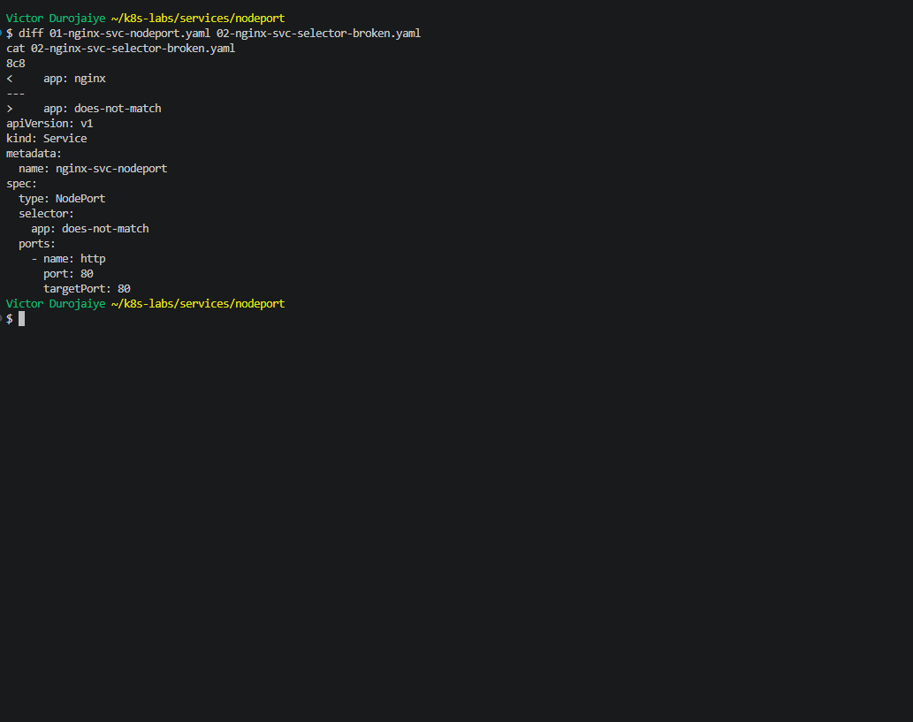

`02-nginx-svc-selector-broken.yaml` is a copy of `01` with one line changed:

```text
8c8
<     app: nginx
---
>     app: does-not-match
```

---

#### Screenshot 10 — Empty endpoints or EndpointSlice output after applying the broken selector

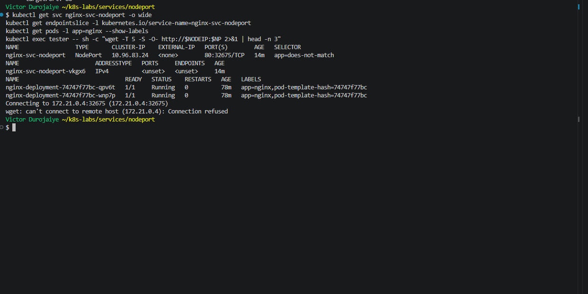

---

#### Screenshot 11 — Restored endpoints or EndpointSlices after applying the original Service manifest

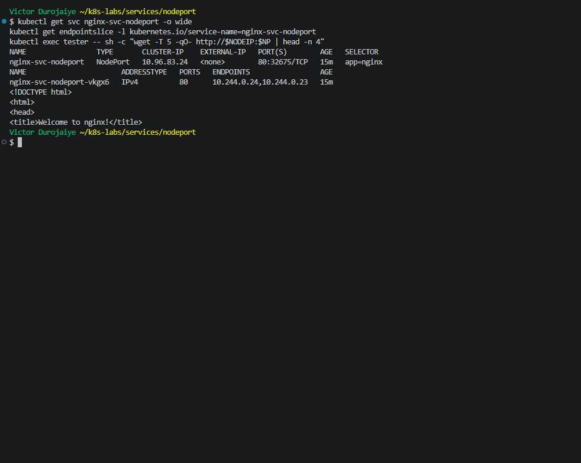

### Notes

**1. Why did the Service endpoints become empty?**

The selector changed to `app: does-not-match`, and no Pod has that label. Both NGINX Pods kept `app=nginx` and stayed `1/1 Running`, but they no longer matched, so the EndpointSlice `nginx-svc-nodeport-vkgx6` went to `<unset>`. The Service was updated in place (`configured`) and kept ClusterIP `10.96.83.24` and NodePort `32675`.

**2. Why is NodePort only useful when matching ready Pods exist?**

The NodePort is only an entry point. The node accepts the connection on `32675`, but it needs a ready endpoint to forward it to. With an empty EndpointSlice, `wget http://172.21.0.4:32675` from `tester` printed `Connecting to 172.21.0.4:32675` and then `Connection refused`. That is the same address and port that worked a minute earlier, so the failure came from the missing backends, not from the network.

**3. How did you restore the backend connectivity?**

I applied the original `01-nginx-svc-nodeport.yaml` again, which set the selector back to `app: nginx`. The EndpointSlice listed `10.244.0.24,10.244.0.23` again, the NodePort request returned the NGINX welcome page, and `kubectl diff -f 01-nginx-svc-nodeport.yaml` returned exit 0. No Pods were restarted. Only the Service changed.

---

# Task 6 — Observe Resilience During Pod Churn

## Goal

Delete one NGINX Pod and observe its replacement while the Service continues routing traffic to available Pods.

### Evidence

#### Screenshot 12 — Output of the Pod deletion command

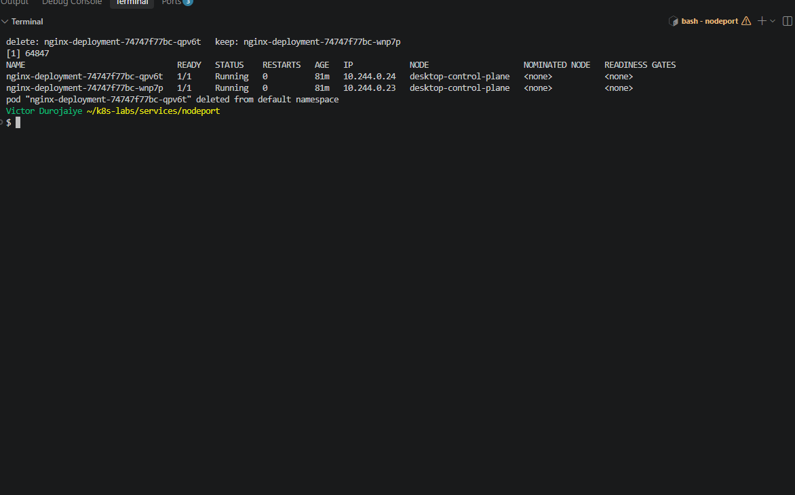

---

#### Screenshot 13 — Output showing the replacement Pod and two running, ready Pods

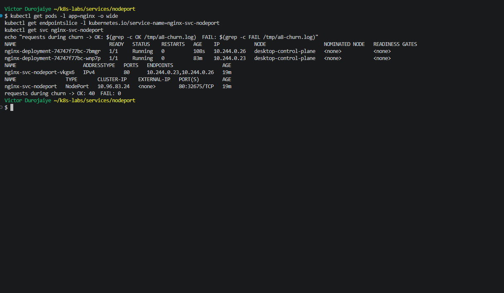

### Notes

**1. What happened after you deleted one Pod?**

I started a loop inside `tester` that sent one request a second to `172.21.0.4:32675`, 40 requests in all, logged to a file. Then I deleted `nginx-deployment-74747f77bc-qpv6t` (`10.244.0.24`). A replacement, `nginx-deployment-74747f77bc-7bmgr`, was created at once with a new IP, `10.244.0.26`, and reached `1/1 Running`. The EndpointSlice dropped `.24` and listed `10.244.0.23` (`wnp7p`, kept) and `10.244.0.26` (`7bmgr`), both `ready=true`. The request log showed **40 OK and 0 FAIL**. Every request during the churn was answered.

**2. Which Kubernetes resource created the replacement Pod?**

The ReplicaSet `nginx-deployment-74747f77bc`, which is owned by `nginx-deployment`. Its events show `SuccessfulCreate ... Created pod: nginx-deployment-74747f77bc-7bmgr`. Just before that, in the same second, there was one `Warning FailedCreate ... Error creating: Unauthorized`. The controller's first create request was rejected by the API server for authentication, and its immediate retry worked. I checked afterwards: `kubectl get events -A --field-selector reason=FailedCreate` showed only that one event, and the controller-manager log had a single `unauthorized` line in the last 2 hours. So it was a one-off, most likely a token refresh in Docker Desktop's cluster, and it did not delay the replacement.

**3. Why can the NodePort Service continue working during Pod churn?**

Clients use the node IP and NodePort (`172.21.0.4:32675`), which never change. The Service sends each request to whichever endpoints are ready at that moment. While `qpv6t` was shutting down, it was removed from the ready endpoints, and `wnp7p` kept serving. The new Pod was only added once its readiness probe passed. The ReplicaSet restored the count to 2, and the EndpointSlice tracked the IP change from `.24` to `.26` on its own. The Service's ClusterIP `10.96.83.24` and port `80:32675/TCP` stayed the same throughout. Cleanup: I deleted `tester`, `nginx-svc-nodeport` and `nginx-deployment`, and confirmed only `service/kubernetes` was left.

---

# Task 7 — Share Your NodePort Learning on LinkedIn

## Goal

Share what you learned about NodePort Services, backend Pods, and network access in your Kubernetes environment.

### Evidence

#### Screenshot 14 — Published LinkedIn post about your NodePort Service lab

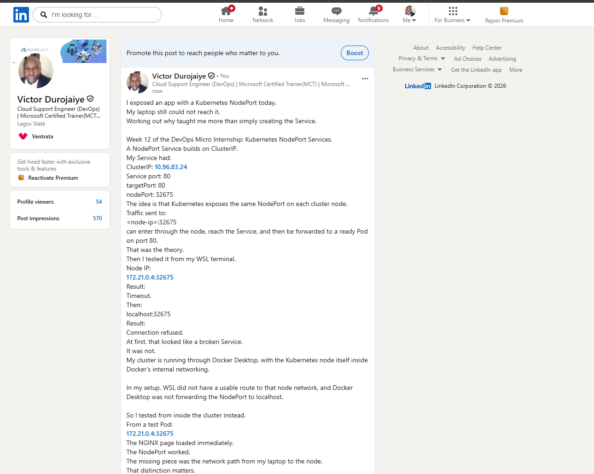

*Victor Durojaiye*

#### Linkedin post link

https://www.linkedin.com/posts/victor-jaiye_devopsmicrointernship-kubernetes-devops-share-7519481769755213824-_wjz/

---

# Submission Instructions

- Include the completed YAML manifests created during the lab.
- Add all required screenshots: Screenshots 1–8 and 12–14.
- Include Screenshots 9–11 only if you attempted optional Task 5.
- Complete the Notes for Tasks 1–4 and Task 6.
- Complete Task 5 Notes only if you attempted that task.
- Use clear, readable screenshots showing the relevant commands and outputs.
- Ensure your full name is visible in the required screenshots.
- If NodePort access is restricted by your environment, include the failed request output, ready endpoint evidence, and an explanation.
- Do not expose passwords, access tokens, private keys, kubeconfig contents, or account IDs.

---

# Completion Checklist

- [x] Created and entered `~/k8s-labs/services/nodeport` (Screenshot 1)
- [x] Created and applied the NGINX Deployment manifest (Screenshot 2)
- [x] Confirmed successful rollout and two ready NGINX Pods (Screenshot 3)
- [x] Created the NodePort Service manifest (Screenshot 4)
- [x] Verified the Service and its endpoints or EndpointSlices (Screenshot 5)
- [x] Recorded the assigned or selected NodePort
- [x] Identified a node IP (Screenshot 6)
- [x] Confirmed that the `tester` Pod is running (Screenshot 7)
- [x] Tested NodePort access, or documented the environment limitation with evidence (Screenshot 8)
- [x] Optional: Tested and restored the Service selector (Screenshots 9–11)
- [x] Deleted one NGINX Pod (Screenshot 12)
- [x] Confirmed the replacement Pod and two running, ready Pods (Screenshot 13)
- [x] Completed all required Notes
- [x] Published the LinkedIn post (Screenshot 14)
- [x] No sensitive data exposed

---

## 📌 About DMI & CloudAdvisory

DevOps Micro Internship (DMI) is a project-based DevOps program run by Pravin Mishra (The CloudAdvisory) focused on real-world execution, systems thinking, and career readiness.

It helps learners build strong DevOps foundations with hands-on experience.

---

## 📌 Resources

- 🌐 DMI Official Website: https://dmi.pravinmishra.com?utm_source=github&utm_medium=readme  
- 🎓 University: https://university.pravinmishra.com?utm_source=github&utm_medium=readme  
- 💬 Discord Community: https://discord.pravinmishra.com?utm_source=github&utm_medium=readme  
- 📝 Blog: https://dmi.pravinmishra.com/blog?utm_source=github&utm_medium=readme  
- ▶️ YouTube Playlist: https://www.youtube.com/playlist?list=PLFeSNDtI4Cho  
- 🔗 Pravin Mishra (LinkedIn): https://www.linkedin.com/in/pravin-mishra-aws-trainer/  
- 🏢 CloudAdvisory (LinkedIn): https://www.linkedin.com/company/thecloudadvisory/

---

*This submission is part of DevOps Micro Internship (DMI) — Agentic AI Track.*
