# Assignment 09 — Kubernetes Services: LoadBalancer on AKS

Part of the DevOps Micro Internship (DMI) with Agentic AI

---

## Purpose

Deploy a healthy NGINX application to Azure Kubernetes Service (AKS), expose it publicly using a LoadBalancer Service, observe readiness behavior, and scale the application behind the same public endpoint.

---

# Task 1 — Create or Connect to an AKS Cluster

## Goal

Create a small AKS cluster for this lab, or connect to an existing approved AKS lab cluster.

### Evidence

#### Screenshot 1 — Output of `kubectl get nodes` showing ready AKS node(s)

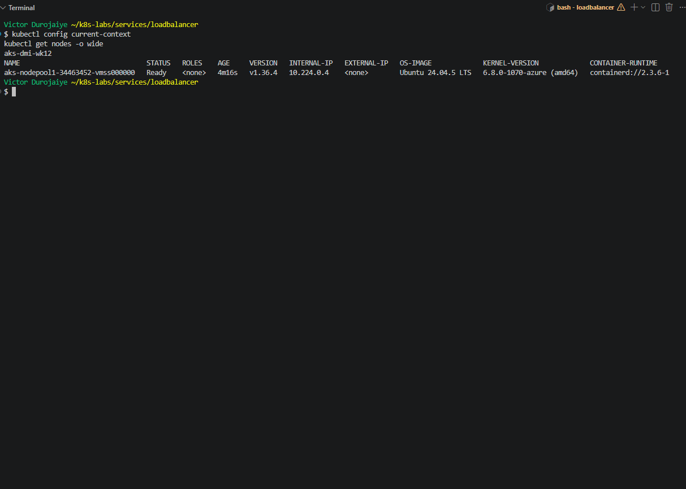

### Notes

**1. Why does this lab use a cloud-capable Kubernetes environment such as AKS for the LoadBalancer Service?**

A LoadBalancer Service only works when something outside Kubernetes can build a real load balancer and give it an address. On AKS, the Azure cloud controller does that. On my local Docker Desktop cluster nothing fills that role. In Assignment 8, even a NodePort was not reachable from my laptop. AKS gives a real public IP that anyone on the internet can reach.

I created the cluster myself in Sweden Central:
- **Cluster:** `aks-dmi-wk12` in resource group `rg-aks-dmi-wk12`, Kubernetes `1.36.4`, the same minor version as my kubectl `v1.36.1`.
- **Plan:** the Free tier control plane and one `Standard_B2ms` node with a 30 GB OS disk.
- **Network:** Azure CNI overlay with the Cilium dataplane and `--network-policy cilium`, so the same cluster can enforce NetworkPolicy in Assignment 10.
- **Pre-checks:** before creating it I confirmed the size had no restrictions in the region and the B-series vCPU quota was free.
- **SSH:** `--no-ssh-key`, so no key was created.
- **Credentials:** written to a separate kubeconfig file with mode 600, so my local `docker-desktop` setup was not touched.

The node `aks-nodepool1-34463452-vmss000000` was `Ready` on `v1.36.4`.

**2. What Azure resources can Kubernetes provision when a LoadBalancer Service is created?**

- A frontend public IP address on the cluster's Azure Standard Load Balancer.
- A load-balancing rule for the Service port (80).
- A health probe that checks the nodes.
- The matching inbound rules on the network security group.

These go in the node resource group AKS manages, `MC_rg-aks-dmi-wk12_aks-dmi-wk12_swedencentral`. The Service events showed `EnsuringLoadBalancer` and then `EnsuredLoadBalancer`.

**3. Why is it important to delete unused AKS resources after the lab?**

They keep costing money while they exist:
- the node VM and its disk
- the load balancer rules
- the public IPs

A public endpoint also stays open to the internet. As soon as I had the evidence, I deleted the Service, which released `57.174.252.113`, and the Deployment. `az network public-ip list` then showed only AKS's own outbound IP. I am keeping the cluster for Assignment 10, which needs NetworkPolicy, and stopping it with `az aks stop` between sessions. After Assignment 10 I will delete the whole resource group, which also removes the `MC_` group, and confirm with `az group list`.

---

# Task 2 — Set Up Your Lab Directory

## Goal

Create and enter a dedicated directory for the LoadBalancer Service manifests.

### Evidence

#### Screenshot 2 — Terminal showing the output of `pwd` confirming that you are working inside `~/k8s-labs/services/loadbalancer`

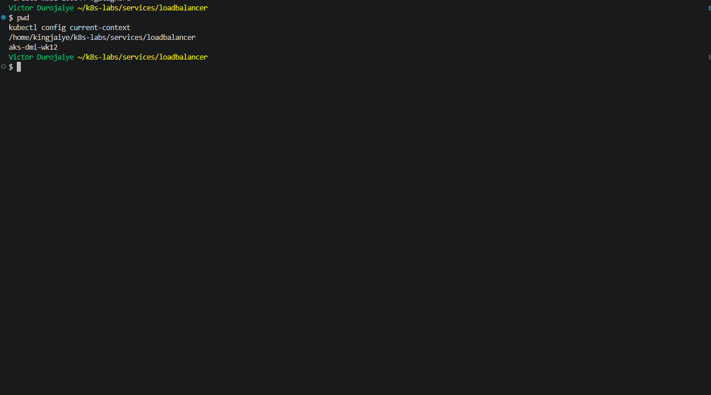

### Notes

**1. Why is it useful to keep Kubernetes manifests organized in dedicated directories?**

Each lab's files stay together, and similar names like `00-nginx-deploy.yaml` in `clusterip/`, `nodeport/` and `loadbalancer/` do not overwrite each other. The number prefixes show the order to apply them in. Because `~/k8s-labs` is a git repo, each folder's history shows what changed in that lab. The cluster settings file (`aks.env`) sits at the repo root and is git-ignored, so it is never committed.

**2. What are the names of the main Deployment and LoadBalancer Service YAML files you will create in this assignment?**

`00-nginx-deploy.yaml` (the Deployment) and `01-nginx-svc-loadbalancer.yaml` (the LoadBalancer Service). There is also `02-readiness-broken.yaml`, the patch used in Task 5.

---

# Task 3 — Deploy a Healthy NGINX Application

## Goal

Create a healthy NGINX Deployment with readiness and liveness probes.

### Evidence

#### Screenshot 3 — Completed `00-nginx-deploy.yaml` manifest

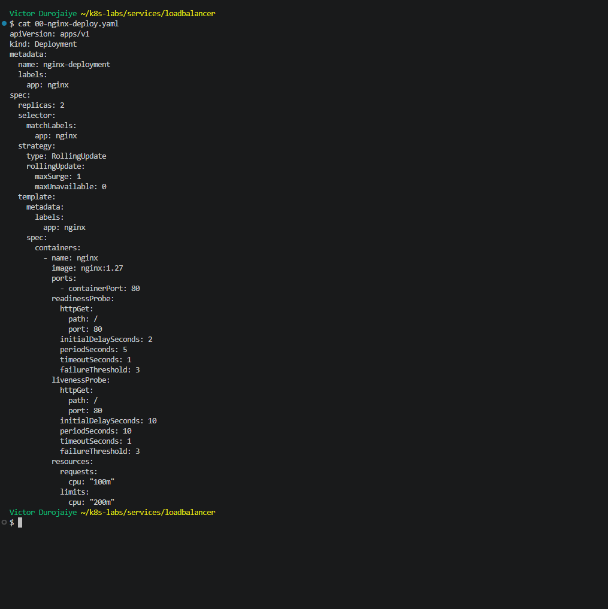

```yaml
apiVersion: apps/v1
kind: Deployment
metadata:
  name: nginx-deployment
  labels:
    app: nginx
spec:
  replicas: 2
  selector:
    matchLabels:
      app: nginx
  strategy:
    type: RollingUpdate
    rollingUpdate:
      maxSurge: 1
      maxUnavailable: 0
  template:
    metadata:
      labels:
        app: nginx
    spec:
      containers:
        - name: nginx
          image: nginx:1.27
          ports:
            - containerPort: 80
          readinessProbe:
            httpGet:
              path: /
              port: 80
            initialDelaySeconds: 2
            periodSeconds: 5
            timeoutSeconds: 1
            failureThreshold: 3
          livenessProbe:
            httpGet:
              path: /
              port: 80
            initialDelaySeconds: 10
            periodSeconds: 10
            timeoutSeconds: 1
            failureThreshold: 3
          resources:
            requests:
              cpu: "100m"
            limits:
              cpu: "200m"
```

---

#### Screenshot 4 — Output showing successful rollout and two ready NGINX Pods

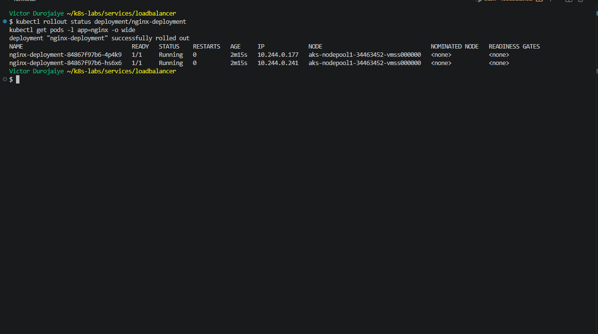

### Notes

**1. Why must Pods be ready before they should receive public traffic?**

The LoadBalancer sends internet users to the Service, and the Service picks a Pod. If a Pod that has started but cannot answer yet were picked, real users would get errors. Kubernetes only puts ready Pods into the Service's ready endpoints, so public traffic only reaches Pods that have passed their checks. Both Pods, `4p4k9` (`10.244.0.177`) and `hs6x6` (`10.244.0.241`), showed `Ready: True` on `nginx:1.27`.

**2. What is the role of the readiness probe in this Deployment?**

It runs `GET /` on port 80 every 5 seconds, starting 2 seconds after the container starts. While it passes, the Pod is marked ready and gets traffic. When it fails 3 times in a row, the Pod is marked NotReady and taken out of the ready endpoints, but the container is not restarted. During a rollout, it also decides when a new Pod counts as available.

**3. What is the role of the liveness probe in this Deployment?**

It runs `GET /` on port 80 every 10 seconds, starting after 10 seconds. If it fails 3 times in a row, the kubelet restarts the container. It is there for a container that hangs or stops answering. Both Pods had `Restart Count: 0`.

---

# Task 4 — Create and Test the LoadBalancer Service

## Goal

Create a public LoadBalancer Service and verify that the NGINX application is reachable from the internet.

### Evidence

#### Screenshot 5 — Completed `01-nginx-svc-loadbalancer.yaml` manifest

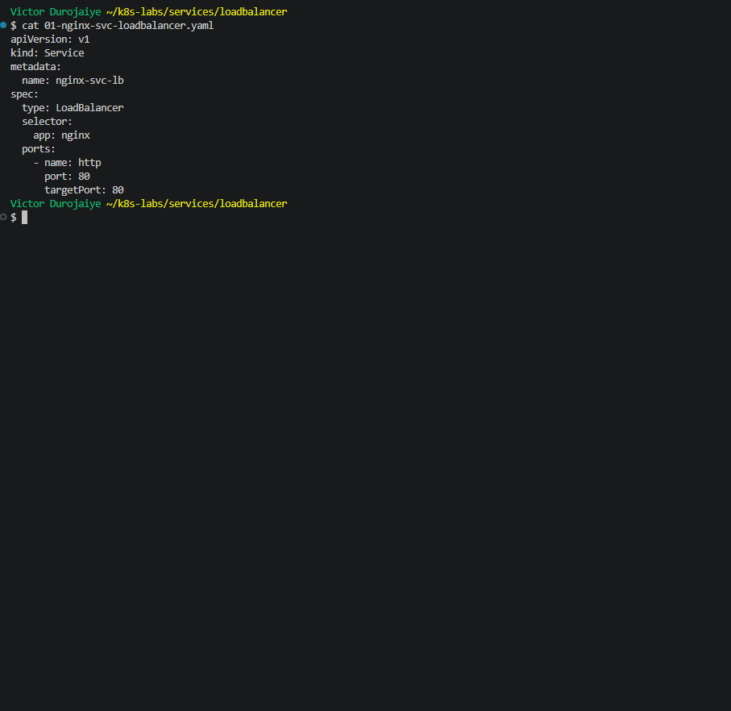

```yaml
apiVersion: v1
kind: Service
metadata:
  name: nginx-svc-lb
spec:
  type: LoadBalancer
  selector:
    app: nginx
  ports:
    - name: http
      port: 80
      targetPort: 80
```

---

#### Screenshot 6 — Output showing the Service with an assigned EXTERNAL-IP

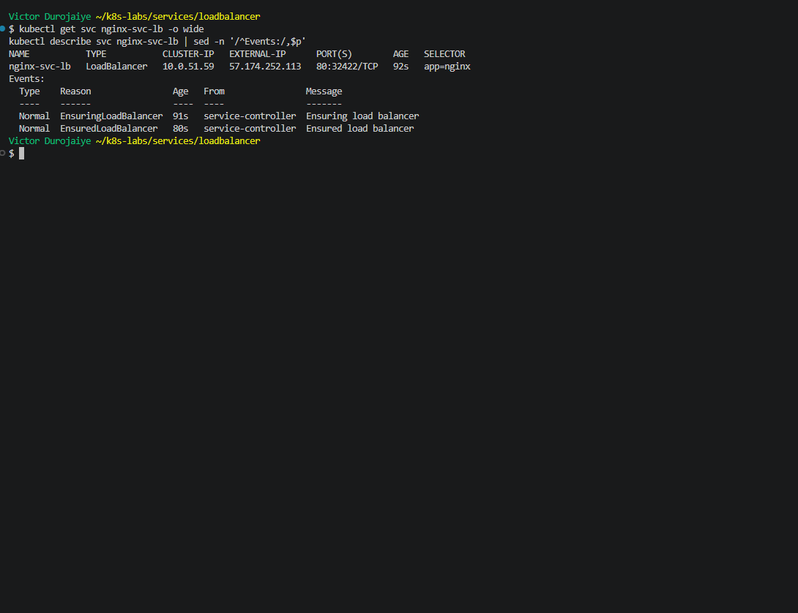

---

#### Screenshot 7 — Successful curl output from the public IP

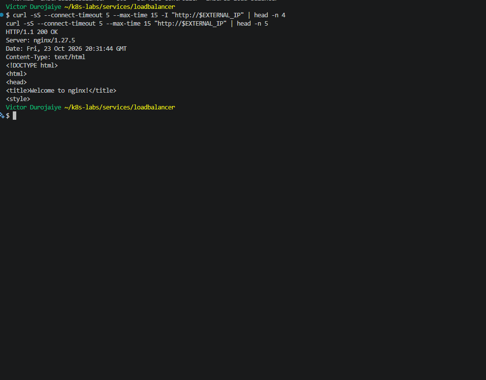

### Notes

**1. What does `type: LoadBalancer` instruct AKS to do?**

It tells the Azure cloud controller to expose the Service through the cluster's Azure Standard Load Balancer:
- add a frontend public IP
- add a rule for port 80
- add a health probe
- open the network security group

Kubernetes also gives the Service a ClusterIP (`10.0.51.59`) and a NodePort (`32422`) underneath, and the Azure load balancer uses that NodePort to reach the nodes.

**2. What public IP was assigned to your Service?**

`57.174.252.113`. It appeared on the first check, about 10 seconds after `EnsuringLoadBalancer`.

**3. How does the public request eventually reach the NGINX Pods?**

`curl` from my laptop → `57.174.252.113:80` on the Azure load balancer → port `32422` on the AKS node → the Service (`nginx-svc-lb`) → one of the ready endpoints in its EndpointSlice (`10.244.0.177` or `10.244.0.241`) on port `80`. NGINX answered `HTTP/1.1 200 OK`, `Server: nginx/1.27.5`, with the welcome page. On this cluster the Cilium dataplane does the Service routing on the node.

**4. Why should you wait for EXTERNAL-IP before testing the Service?**

Until Azure finishes creating the frontend IP and the rule, the column shows `<pending>`, and there is no public address to test. Testing too early only shows a missing address, not a problem with the app. I used a loop that checked `.status.loadBalancer.ingress[0].ip` every 10 seconds and only ran `curl` once it was set.

---

# Task 5 — Observe How Readiness Protects Public Traffic

## Goal

Intentionally break readiness and observe how Kubernetes excludes unready Pods from ready Service backends while existing healthy Pods continue serving public traffic.

### Evidence

#### Screenshot 8 — Completed `02-readiness-broken.yaml` patch file

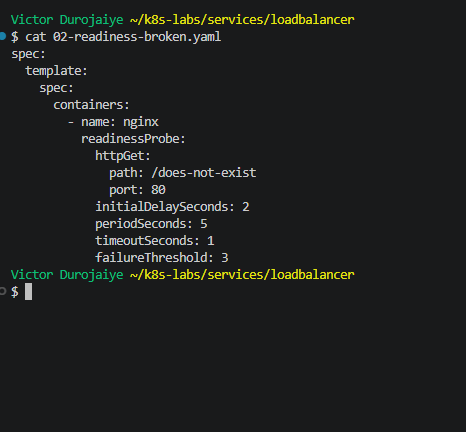

```yaml
spec:
  template:
    spec:
      containers:
        - name: nginx
          readinessProbe:
            httpGet:
              path: /does-not-exist
              port: 80
            initialDelaySeconds: 2
            periodSeconds: 5
            timeoutSeconds: 1
            failureThreshold: 3
```

---

#### Screenshot 9 — Output showing the expected incomplete rollout or readiness failure

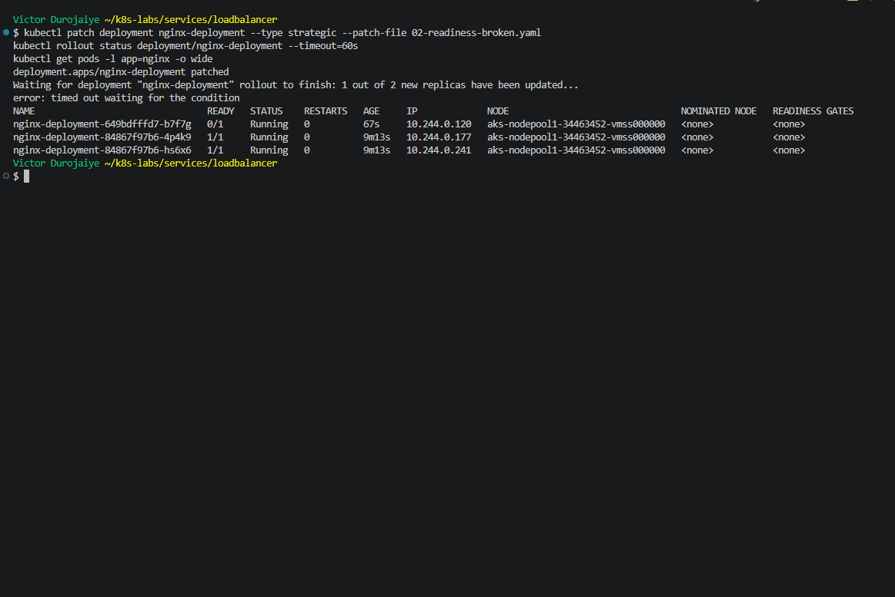

---

#### Screenshot 10 — EndpointSlice output showing ready healthy backends and the effect of the readiness failure

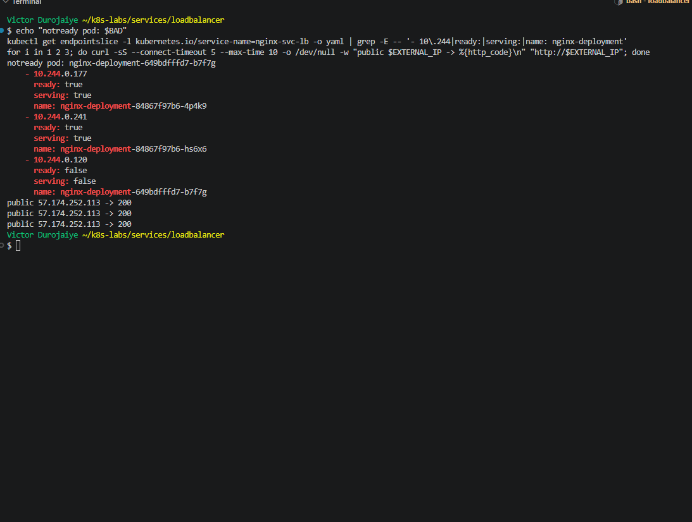

---

#### Screenshot 11 — Successful public curl response after recovery

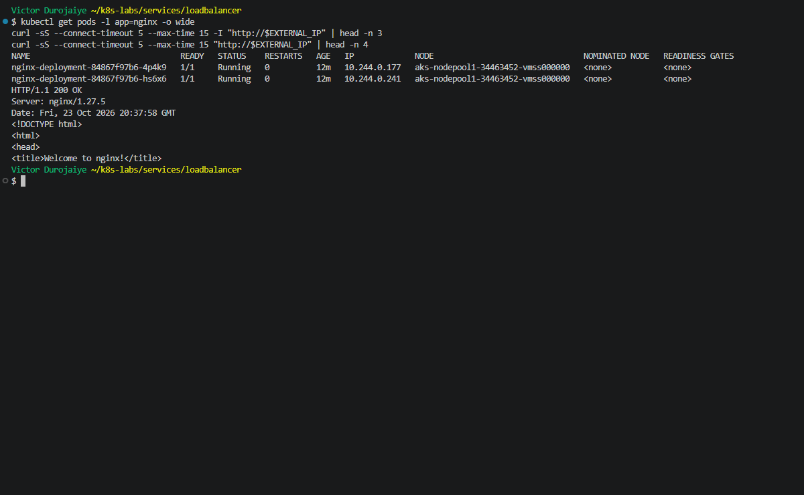

### Notes

**1. Why did the rollout not complete?**

The patch changed the readiness path to `/does-not-exist`. A server dry run confirmed that only readiness changed (`readiness=/does-not-exist liveness=/ image=nginx:1.27`). The new Pod `b7f7g` (`10.244.0.120`, ReplicaSet `649bdfffd7`) got a `404` on every check (`Readiness probe failed: HTTP probe failed with statuscode: 404`, x25) and stayed `0/1`. With `maxUnavailable: 0`, the Deployment would not remove an old Pod until a new one was ready, which never happened. `rollout status` stopped at `1 out of 2 new replicas have been updated` and timed out.

**2. Why can the public endpoint still work while new Pods fail readiness?**

The Service only routes to ready endpoints. The EndpointSlice showed `10.244.0.177` and `10.244.0.241` as `ready=true serving=true`, and the new `10.244.0.120` as `ready=false serving=false`. The two original Pods were never removed, so the load balancer kept reaching them. I sent 8 public requests to `57.174.252.113` during the failure, and all 8 returned `200`.

**3. What would happen if Kubernetes routed traffic to Pods before they were ready?**

Some public requests would land on a Pod that is not serving properly and get errors or timeouts. During a rollout, every bad Pod added would take a share of real user traffic, and if old Pods were removed too, the whole site could go down. Readiness prevents that by letting a Pod into the ready endpoints only after it passes its check.

**4. How did you restore the Deployment successfully?**

I applied `00-nginx-deploy.yaml` again, which put the readiness path back to `/`. The Deployment went back to the original ReplicaSet `84867f97b6` and scaled `649bdfffd7` to 0. The broken Pod was removed, and the two original Pods `4p4k9` and `hs6x6` kept running the whole time. Both endpoints were `ready=true`, `kubectl diff -f 00-nginx-deploy.yaml` returned exit 0, and the public request returned `HTTP/1.1 200 OK` again.

---

# Task 6 — Scale the Deployment Behind the Load Balancer

## Goal

Scale the NGINX Deployment and confirm that more ready Pods become available behind the same public endpoint.

### Evidence

#### Screenshot 12 — Two ready NGINX Pods verified initially; four ready Pods verified after scaling

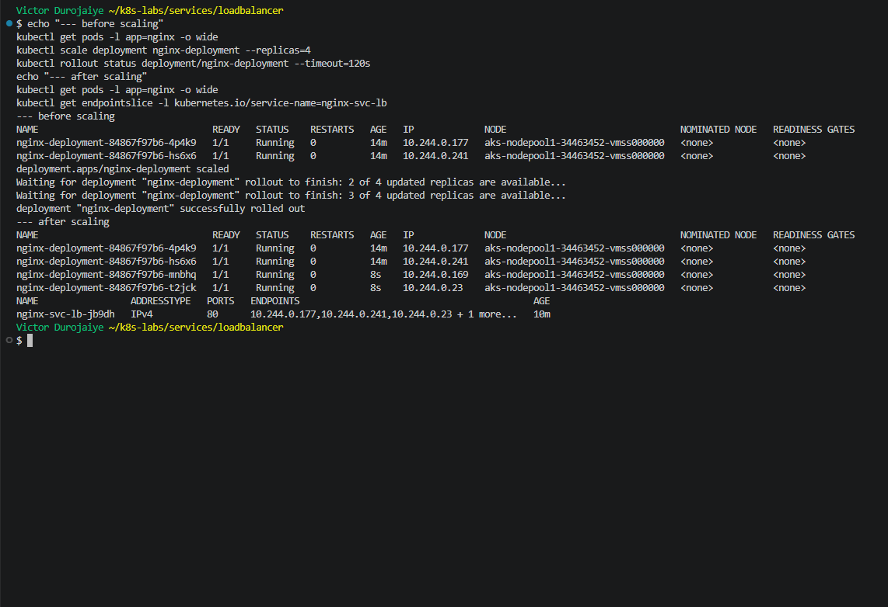

---

#### Screenshot 13 — Successful public curl response after scaling

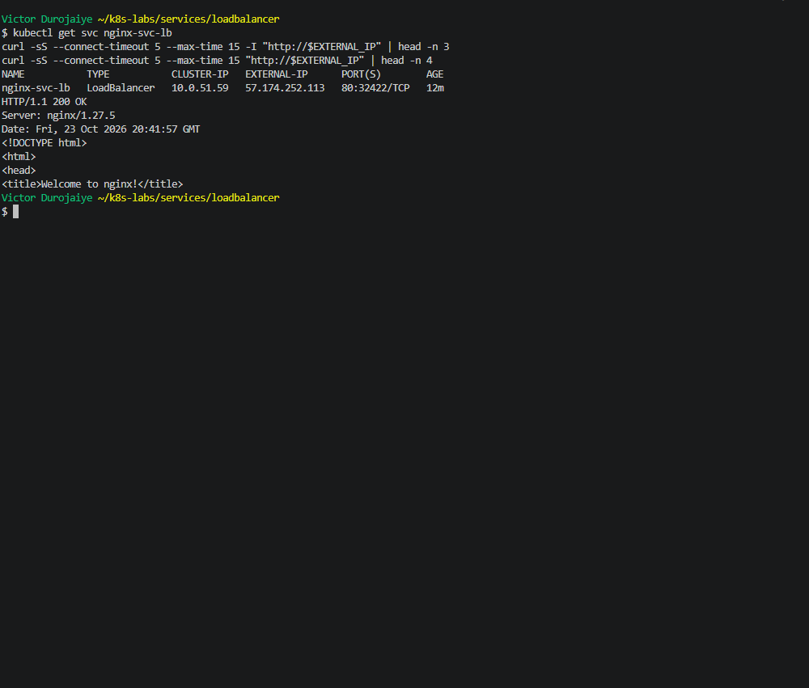

### Notes

**1. What changed after scaling the Deployment from two to four replicas?**

`kubectl scale --replicas=4` made the ReplicaSet `84867f97b6` create two more Pods from the same template: `mnbhq` (`10.244.0.169`) and `t2jck` (`10.244.0.23`). Once they passed readiness, the EndpointSlice listed four ready endpoints, and the Deployment showed `4/4`. Only the Pods behind the Service changed. The node's CPU requests rose to 68% of the `B2ms`, which I will use to size Assignment 10. The manifest still says `replicas: 2`. That did not matter here because the lab resources were deleted straight after.

**2. Did the public IP change after scaling? Explain why or why not.**

No. It was `57.174.252.113` before and after. The public IP belongs to the Service and its Azure load balancer frontend, not to any Pod. Scaling only changes which ready endpoints sit behind that frontend.

**3. Why does scaling behind a LoadBalancer Service not require users to change the URL or IP they use?**

Users only ever see the load balancer's IP. Kubernetes keeps the EndpointSlice up to date as Pods are added or removed, and the node sends traffic to whichever endpoints are ready. Nothing on the client side changes. Five public requests after scaling all returned `200`.

Cleanup: I deleted `nginx-svc-lb` and `nginx-deployment`. Only `service/kubernetes` was left, and the public IP list in the node resource group showed only AKS's own outbound IP, so `57.174.252.113` was released. The cluster is kept, stopped between sessions, for Assignment 10.

---

# Task 7 — Share Your LoadBalancer Lab on LinkedIn

## Goal

Share what you learned about exposing an NGINX application publicly through a LoadBalancer Service on AKS.

### Evidence

#### Screenshot 14 — Published LinkedIn post about your LoadBalancer lab on AKS

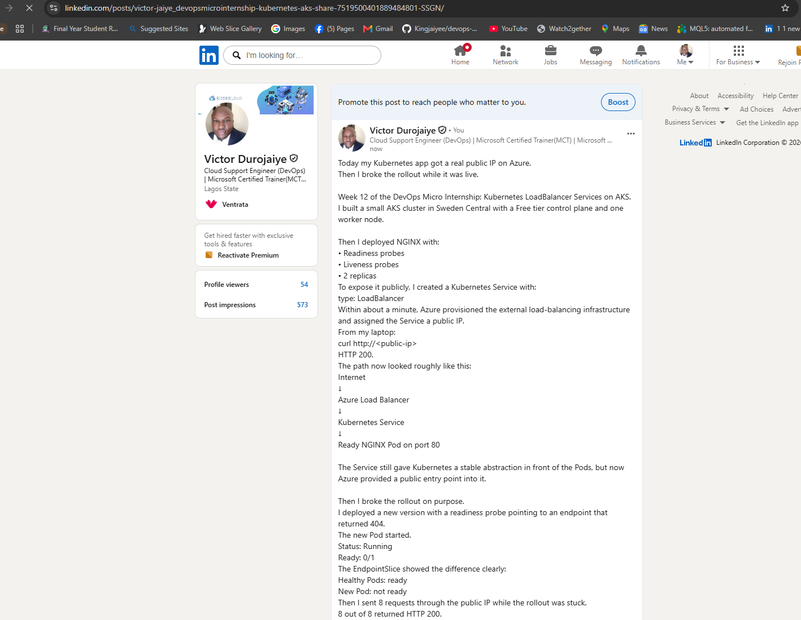

*Victor Durojaiye*

#### LinkedIn post link

https://www.linkedin.com/posts/victor-jaiye_devopsmicrointernship-kubernetes-aks-share-7519500401889484801-SSGN/

---

# Submission Instructions

- Include the completed YAML files:
  - `00-nginx-deploy.yaml`
  - `01-nginx-svc-loadbalancer.yaml`
  - `02-readiness-broken.yaml`
- Add all required screenshots, numbered 1–14, under their corresponding Evidence sections.
- Use clear, readable screenshots showing the relevant commands, configuration, and outputs.
- Ensure your full name is visible in the required screenshots.
- Complete the Notes for Tasks 1–6 in your own words.
- Capture all required evidence before cleaning up Azure resources.
- Plan or complete Azure cleanup according to your lab ownership and reuse arrangements.
- Do not expose passwords, tokens, private keys, cluster credentials, kubeconfig contents, subscription IDs, account IDs, or infrastructure details you are not permitted to share.

---

# Completion Checklist

- [x] Created or connected to an approved AKS lab cluster
- [x] Confirmed ready AKS node(s) (Screenshot 1)
- [x] Created and entered the LoadBalancer lab directory (Screenshot 2)
- [x] Created the NGINX Deployment manifest (Screenshot 3)
- [x] Verified successful rollout and two ready NGINX Pods initially (Screenshot 4)
- [x] Created the LoadBalancer Service manifest (Screenshot 5)
- [x] Verified the assigned external IP (Screenshot 6)
- [x] Verified successful public access using curl (Screenshot 7)
- [x] Created the broken readiness patch (Screenshot 8)
- [x] Observed the expected incomplete rollout or readiness failure (Screenshot 9)
- [x] Inspected EndpointSlices during the readiness failure (Screenshot 10)
- [x] Restored the healthy Deployment and verified public access (Screenshot 11)
- [x] Scaled the Deployment to four ready Pods and verified updated Service backends (Screenshot 12)
- [x] Verified public access after scaling (Screenshot 13)
- [x] Completed the Notes for Tasks 1–6
- [x] Published the LinkedIn post (Screenshot 14)
- [x] Included all required YAML files and screenshots
- [x] Planned or completed Azure cleanup
- [x] No sensitive data exposed

---

## 📌 About DMI & CloudAdvisory

DevOps Micro Internship (DMI) is a project-based DevOps program run by Pravin Mishra (The CloudAdvisory) focused on real-world execution, systems thinking, and career readiness.

It helps learners build strong DevOps foundations with hands-on experience.

---

## 📌 Resources

- 🌐 DMI Official Website: https://dmi.pravinmishra.com?utm_source=github&utm_medium=readme  
- 🎓 University: https://university.pravinmishra.com?utm_source=github&utm_medium=readme  
- 💬 Discord Community: https://discord.pravinmishra.com?utm_source=github&utm_medium=readme  
- 📝 Blog: https://dmi.pravinmishra.com/blog?utm_source=github&utm_medium=readme  
- ▶️ YouTube Playlist: https://www.youtube.com/playlist?list=PLFeSNDtI4Cho  
- 🔗 Pravin Mishra (LinkedIn): https://www.linkedin.com/in/pravin-mishra-aws-trainer/  
- 🏢 CloudAdvisory (LinkedIn): https://www.linkedin.com/company/thecloudadvisory/

---

*This submission is part of DevOps Micro Internship (DMI) — Agentic AI Track.*
