# Assignment 10 — Capstone: Deploy the Book Review App to Kubernetes

Part of the DevOps Micro Internship (DMI) with Agentic AI

---

## Purpose

Deploy the Book Review App as a production-style three-tier application using Kubernetes manifests or Helm charts, with an accessible frontend, an internal backend, and a managed or persistent MySQL database.

---

## Submission Details

**Full Name:** Victor Durojaiye

**Kubernetes Platform:** Azure Kubernetes Service (AKS). Free tier control plane, Kubernetes 1.36.4, Sweden Central, 1 × Standard_B2ms node, Azure CNI overlay with the Cilium dataplane (NetworkPolicy enforced).

**Namespace:** book-review

**Frontend URL or IP:** http://57.174.98.245 (removed with the cluster after the evidence was captured)

**Access Method:** Public LoadBalancer

**GitHub Manifests or Helm Chart URL:** https://github.com/Kingjaiyee/book-review-app/tree/k8s/aks/k8s

**Architecture Diagram:** [screenshots/a10-s03-architecture.png](./screenshots/a10-s03-architecture.png). The source is also in the repo at https://github.com/Kingjaiyee/book-review-app/tree/k8s/aks/k8s/docs

---

# Task 1 — Prepare the Kubernetes Cluster and Project

## Goal

Prepare the cluster, application source, container images, and tooling needed for the deployment.

### Evidence

#### Screenshot 1 — Active Kubernetes context and Ready nodes

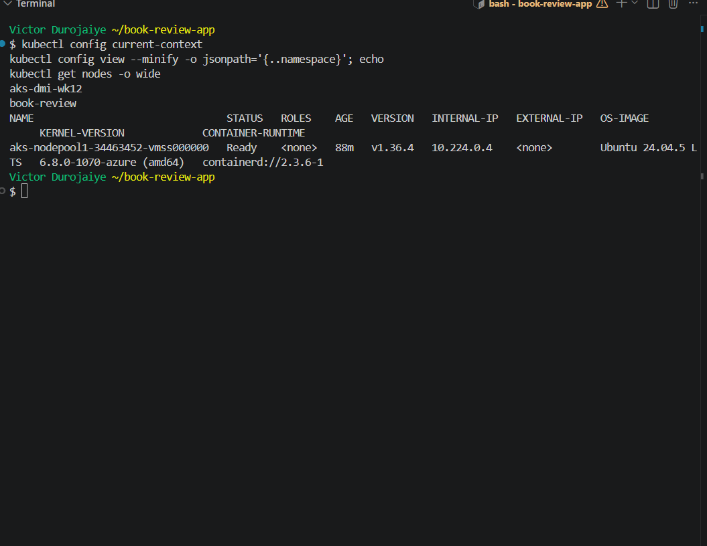

**Notes:**
- **Cluster:** I reused the AKS cluster `aks-dmi-wk12` from Assignment 9. It was created with `--network-policy cilium` so NetworkPolicies are enforced, and its credentials are in a separate kubeconfig file (mode 600). The active context was `aks-dmi-wk12` with namespace `book-review`, and the node `aks-nodepool1-34463452-vmss000000` was `Ready` on `v1.36.4`.
- **Source:** I built from my fork `Kingjaiyee/book-review-app` at `9cc5a24`, which has my Week 11 `/api` fix and production Dockerfiles, not from the upstream repo. The manifests are on a new branch, `k8s/aks`, in a `k8s/` folder.
- **Images:** built from the fork's own Dockerfiles. Node 22 Alpine, multi-stage for the frontend, both running as the non-root `node` user. The frontend was built with `NEXT_PUBLIC_API_URL=/api` so the browser only calls its own origin.
  - I pushed `kingjaiye/book-review-backend:k8s-9cc5a24` and `kingjaiye/book-review-frontend:k8s-9cc5a24` to Docker Hub as public images, logging in with an access token through `--password-stdin`.
  - The local and Docker Hub digests matched (`sha256:0eb39b28…` and `sha256:92a9e860…`).
  - Neither image contains a `.env` file, and the browser bundle contains no internal Service names.
  - The manifests pin both images by digest.

---

#### Screenshot 2 — If using Helm: Output of `helm version`

Required only if you choose Helm. Skip this screenshot if using YAML manifests.

Not applicable — using YAML manifests.

---

# Task 2 — Design the Three-Tier Kubernetes Architecture

## Goal

Document the workloads, networking, configuration, storage, and permitted communication paths before deployment.

### Evidence

#### Screenshot 3 — Completed Kubernetes architecture diagram

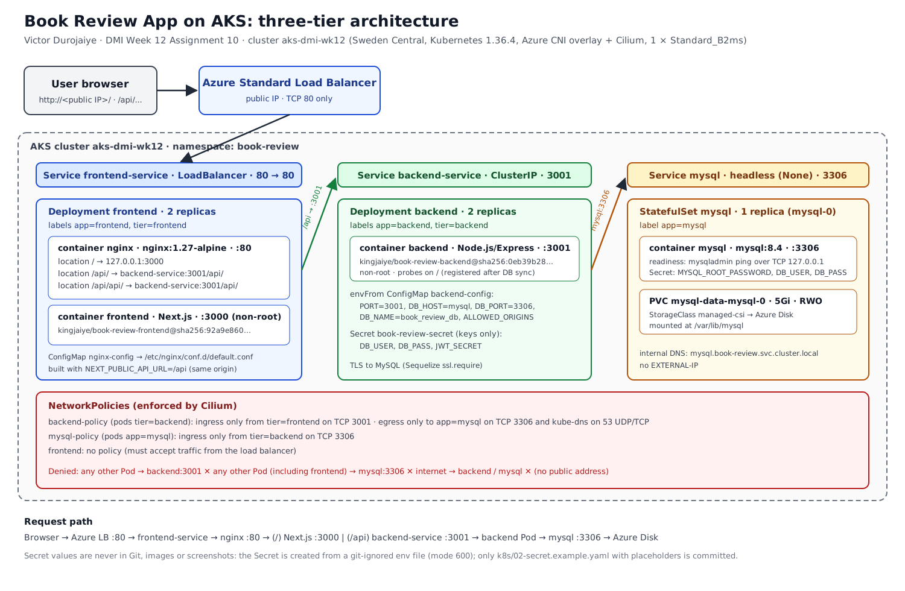

**Notes:** Request path: Browser → Azure Load Balancer `:80` → `frontend-service` → Nginx `:80` in the frontend Pod. From there `/` goes to Next.js on `127.0.0.1:3000`, and `/api` goes to `backend-service:3001`, then a backend Pod, then `mysql:3306`, then the Azure Disk. Only `frontend-service` is public. The backend and MySQL are internal only, and NetworkPolicies limit who can talk to them.

---

# Task 3 — Create ConfigMaps and Secrets

## Goal

Provide application configuration and credentials without embedding sensitive values in images or committing them to Git.

### Evidence

#### Screenshot 4 — ConfigMap configuration or describe output showing non-sensitive values

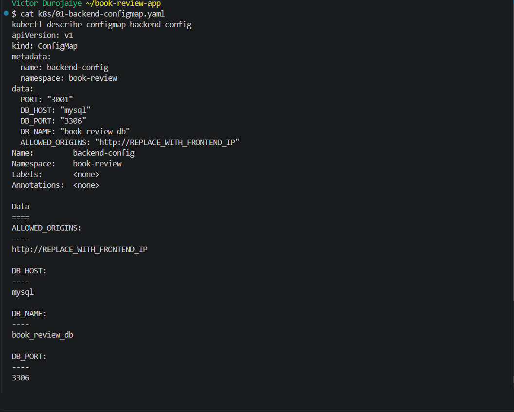

---

#### Screenshot 5 — Secret references or describe output showing names and keys without sensitive values

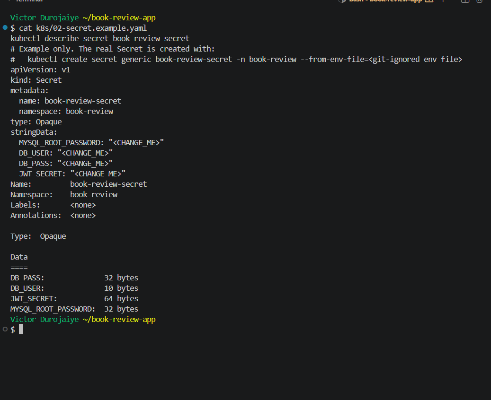

**Notes:**
- **ConfigMap `backend-config`:** holds only non-secret values: `PORT=3001`, `DB_HOST=mysql`, `DB_PORT=3306`, `DB_NAME=book_review_db` and `ALLOWED_ORIGINS`. `PORT` matters because the backend defaults to 5000. `ALLOWED_ORIGINS` started as a placeholder and was set to the LoadBalancer IP in Task 7.
- **Secret `book-review-secret`:** has 4 keys: `MYSQL_ROOT_PASSWORD`, `DB_USER`, `DB_PASS` and `JWT_SECRET`.
  - The values were generated with `openssl rand` straight into a git-ignored env file (mode 600) under `~/.config`, so they never appeared on screen.
  - The Secret was created with `kubectl create secret generic --from-env-file`. That leaves no `last-applied-configuration` annotation holding the plain values, and `kubectl describe` shows only byte counts.
- **In Git:** only [`k8s/examples/secret.example.yaml`](https://github.com/Kingjaiyee/book-review-app/blob/k8s/aks/k8s/examples/secret.example.yaml) with `<CHANGE_ME>` placeholders. `.gitignore` blocks any other `*secret*.yaml` under `k8s/`.

---

# Task 4 — Deploy and Configure the MySQL Data Tier

## Goal

Provide persistent MySQL storage and allow the backend to connect without exposing the database publicly.

### Evidence

#### Screenshot 6 — Managed MySQL status or MySQL StatefulSet and PVC status

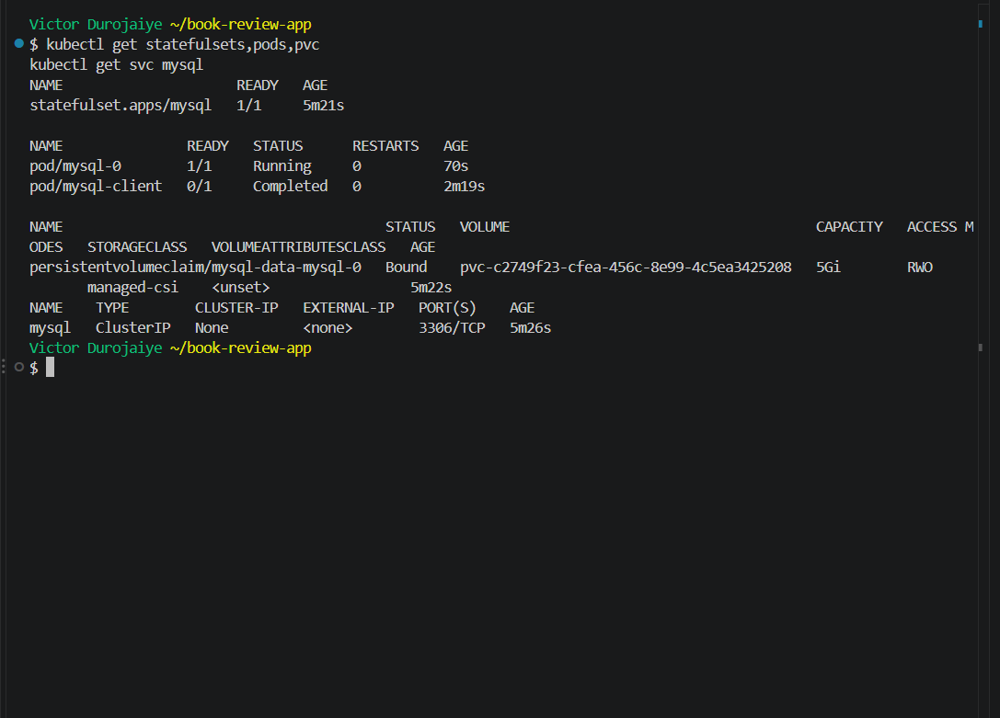

---

#### Screenshot 7 — Successful database connectivity or schema verification with credentials hidden

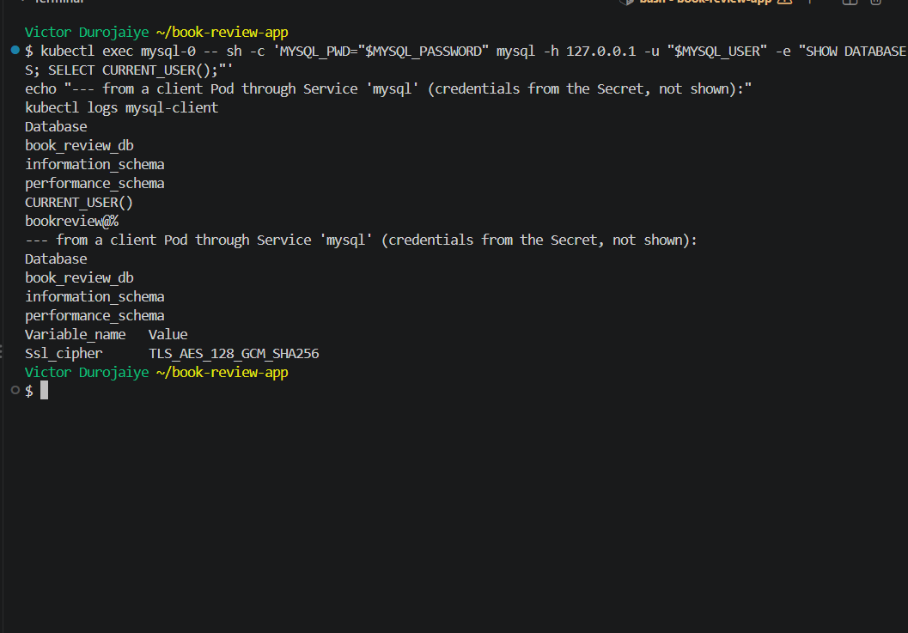

**Notes:**
- **StatefulSet `mysql`:** `mysql:8.4` (8.4.13) rather than the guide's 8.0, which reached end of life in April 2026. It has a 5Gi PVC `mysql-data-mysql-0` on AKS's built-in `managed-csi` StorageClass (Azure Disk, `Bound`), mounted at `/var/lib/mysql`.
- **Service `mysql`:** headless (`ClusterIP None`) on port 3306, with no EXTERNAL-IP.
- **Probes:**
  - A **startup probe** gives the first initialisation up to 5 minutes.
  - **Readiness** runs `mysqladmin ping` over TCP to `127.0.0.1`, so MySQL's temporary init server, which has networking off, can't pass it.
  - **Liveness** checks TCP 3306.
- **Connectivity:** as `bookreview@%` I could see `book_review_db`, both inside the Pod and from a separate client Pod through the Service name `mysql`. That client Pod took its credentials from the Secret, so nothing was printed. TLS was in use (`Ssl_cipher TLS_AES_128_GCM_SHA256`), which the backend needs because its `db.js` requires SSL.
- **Persistence:** I wrote a test row, deleted `mysql-0`, and the new Pod (new UID) read the same row back from the same PVC. Then I dropped the test table.

---

# Task 5 — Deploy the Backend Application Tier

## Goal

Run one or two Node.js/Express backend replicas on port 3001 and expose them through an internal ClusterIP Service.

### Evidence

#### Screenshot 8 — Backend Deployment, ready Pods, and internal Service

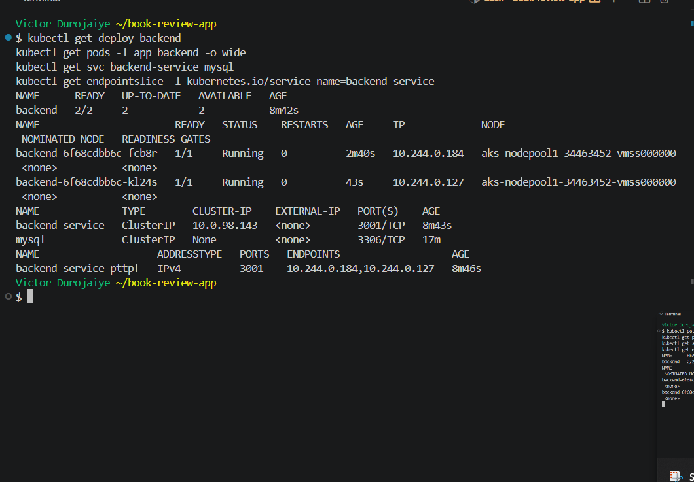

---

#### Screenshot 9 — Backend startup logs and database connectivity evidence

If the application does not log successful database connections, provide a successful database-backed request alongside the startup logs.

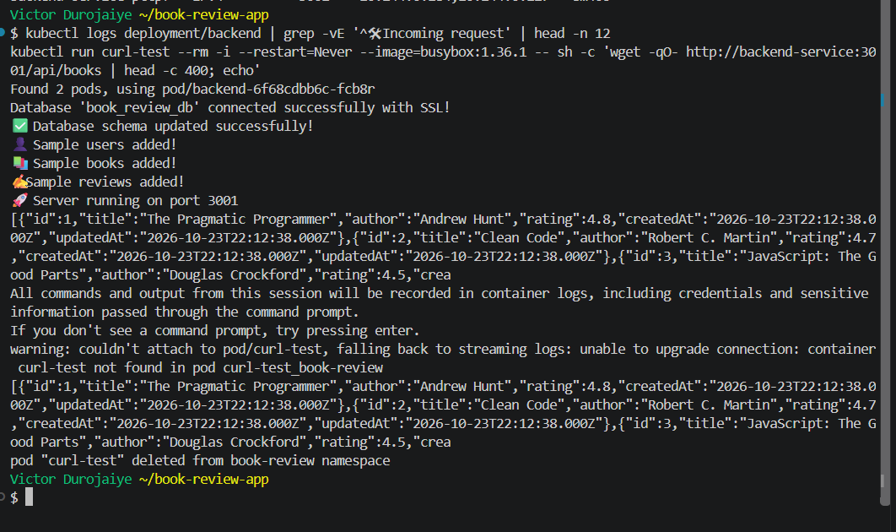

**Notes:**
- **Deployment `backend`:** 2 replicas, the image pinned by digest, and `envFrom` the ConfigMap. `DB_USER`, `DB_PASS` and `JWT_SECRET` are taken one by one from the Secret, so the backend never sees the MySQL root password.
- **Security context:** `runAsNonRoot`, `runAsUser: 1000`, no privilege escalation, and all capabilities dropped.
- **Probes:** readiness and liveness on `/`. In this app, `/` is only registered after the database connects and syncs, so "ready" also means "connected to MySQL".
- **Seeding:** I started with 1 replica because the backend creates the tables and sample data on first start. Then I scaled to 2 in the file. The logs show the samples were added once, and both Pods report `Server running on port 3001`.
- **Logs and data:** the logs show `Database 'book_review_db' connected successfully with SSL!`, the schema update and the samples. `/api/books` through `backend-service:3001` returned the 3 books from MySQL. The `Books`, `Users` and `Reviews` tables were created by the app.
- **Service `backend-service`:** `ClusterIP 10.0.98.143:3001`, with both Pod IPs in its EndpointSlice.

---

# Task 6 — Deploy the Frontend and Configure Nginx

## Goal

Run the Next.js frontend behind Nginx on port 80 and proxy API requests to the internal backend Service.

### Evidence

#### Screenshot 10 — Frontend Deployment and Ready Pods

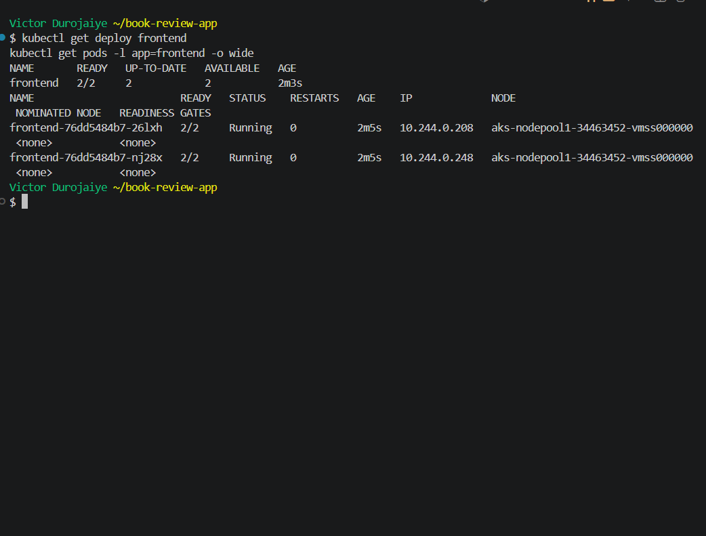

---

#### Screenshot 11 — Nginx reverse-proxy configuration showing the internal backend Service name and port 3001

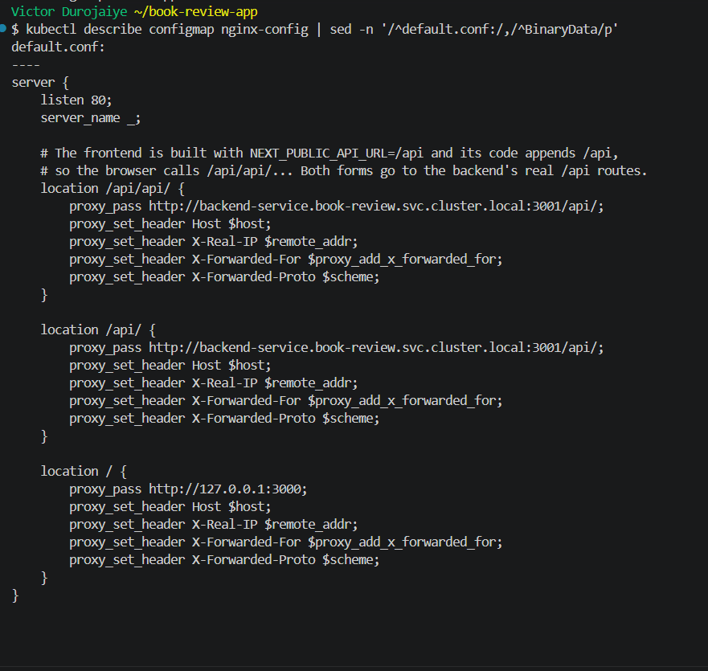

**Notes:**
- **Deployment `frontend`:** 2 replicas. Each Pod runs two containers, which is why the Pods show `2/2`:
  - Next.js (non-root, `uid=1000`) on port 3000
  - `nginx:1.27-alpine` on port 80
- **Nginx config:** the ConfigMap `nginx-config` is mounted as `/etc/nginx/conf.d/default.conf`.
  - `/` goes to `127.0.0.1:3000`, because containers in one Pod share the network.
  - `/api/` and `/api/api/` go to `backend-service.book-review.svc.cluster.local:3001/api/`.
- **Why `/api/api/` exists:** the frontend code adds `/api` to its base URL (`${API_URL}/api/books`), and the Dockerfile refuses an empty `NEXT_PUBLIC_API_URL`. So a same-origin build with `/api` makes the browser call `/api/api/...`, and Nginx maps both forms to the backend's real routes.
- **Proof:** `nginx -t` passed. Nginx listened on `0.0.0.0:80` and Next.js on `:::3000`. `/`, `/api/api/books` and `/api/books` all returned `200` through Nginx.

---

# Task 7 — Configure External and Internal Networking

## Goal

Expose the frontend and enforce the intended communication path between application tiers.

### Evidence

#### Screenshot 12 — Frontend LoadBalancer or Ingress configuration and assigned endpoint, or documented local access method

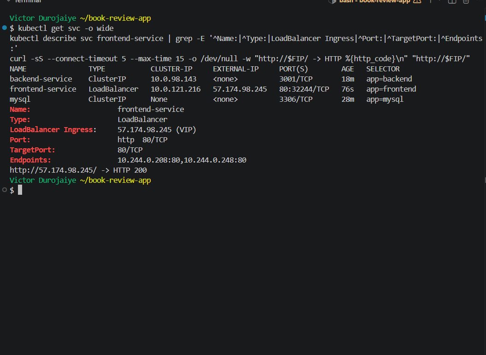

---

#### Screenshot 13 — Internal backend Service and NetworkPolicy or equivalent restriction, with access-test evidence

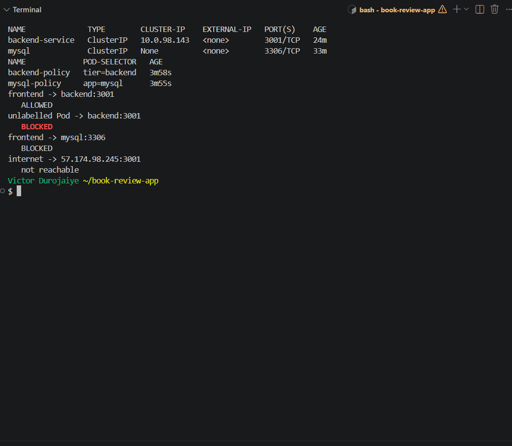

**Notes:**
- **`frontend-service`:** a LoadBalancer on port 80 that got `57.174.98.245`. Its endpoints were both frontend Pods on `:80`. It was the only Service with an EXTERNAL-IP: `backend-service` and `mysql` showed `<none>`.
- **CORS:** I then set `ALLOWED_ORIGINS` to `http://57.174.98.245` and restarted the backend, because its CORS check rejects a browser POST from any origin not in that list.
- **NetworkPolicies, enforced by Cilium:**
  - `backend-policy` (`tier=backend`): ingress only from `tier=frontend` on TCP 3001. Egress only to `app=mysql` on TCP 3306 and to `kube-dns` on port 53.
  - `mysql-policy` (`app=mysql`): ingress only from `tier=backend` on TCP 3306.
- **Access tests:**

| Test | Result |
|---|---|
| frontend → backend:3001 | ALLOWED |
| internet → `/api/api/books` | HTTP 200 |
| unlabelled Pod → backend:3001 | BLOCKED |
| `tier=frontend` test Pod → backend:3001 | ALLOWED (the rule is by label) |
| frontend → mysql:3306 | BLOCKED |
| unlabelled Pod → mysql:3306 | BLOCKED |
| backend → internet | BLOCKED |
| internet → `57.174.98.245:3001` | not reachable |

The backend and the database are not publicly exposed. Blocked connections timed out, because a NetworkPolicy drops packets silently.

---

# Task 8 — Validate the Application End to End

## Goal

Prove that the frontend, backend, and MySQL database work together and collect operational evidence.

### Evidence

#### Screenshot 14 — `kubectl get all` output for the book-review namespace

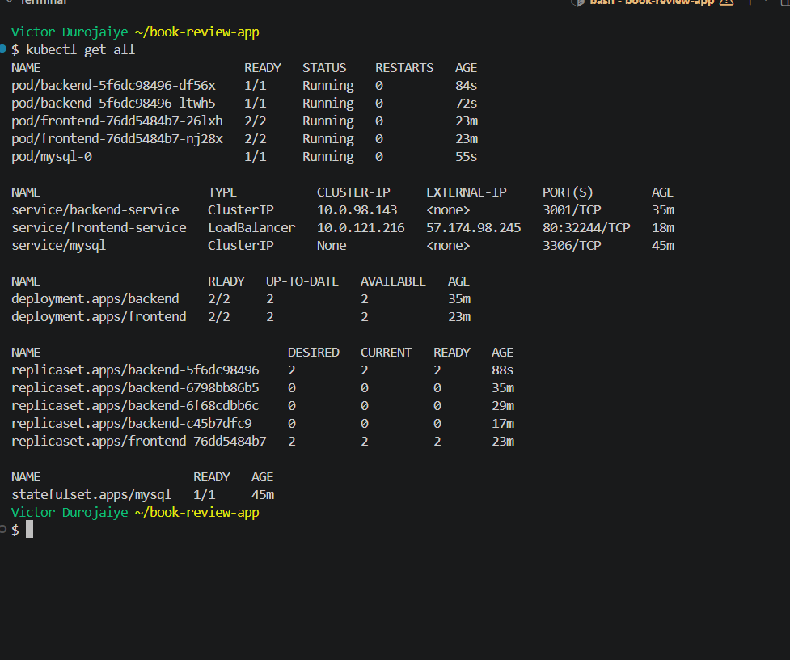

---

#### Screenshot 15 — Functional Book Review App in the browser with the URL visible, including evidence of a successful user flow

Home page with the book list:

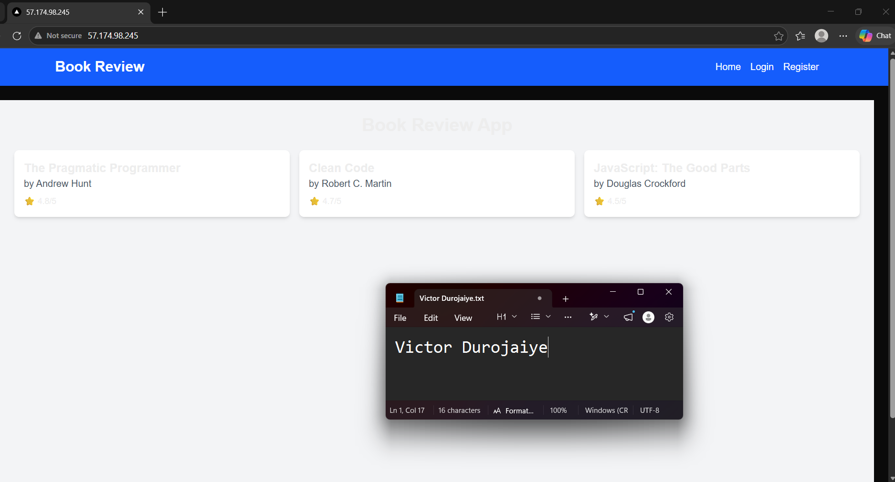

*Victor Durojaiye*

Registering a test user:

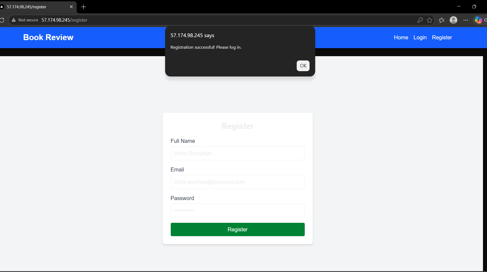

*Victor Durojaiye*

Logged in:

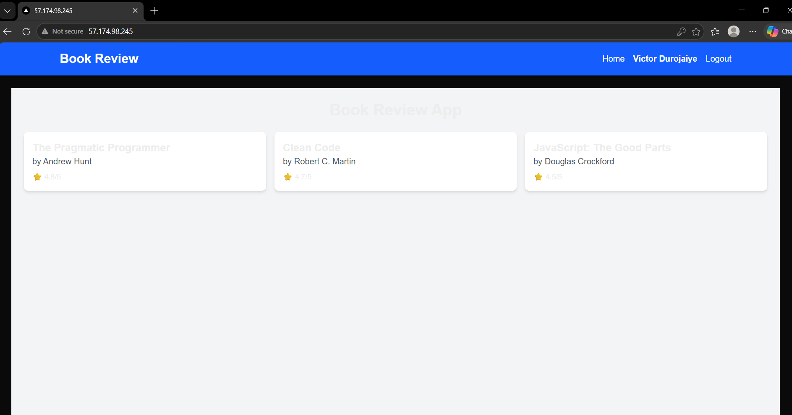

*Victor Durojaiye*

Review added on a book page:

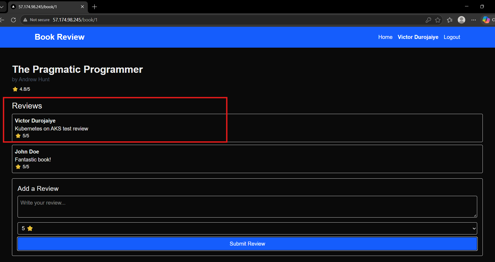

*Victor Durojaiye*

The review still shown after the backend restart and the MySQL Pod deletion:

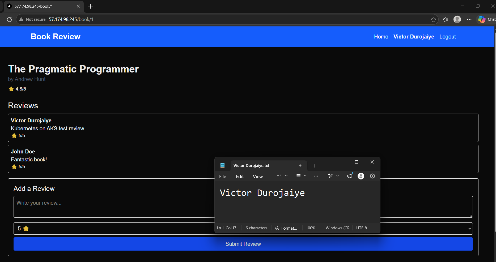

*Victor Durojaiye*

---

#### Screenshot 16 — Frontend or Nginx container logs

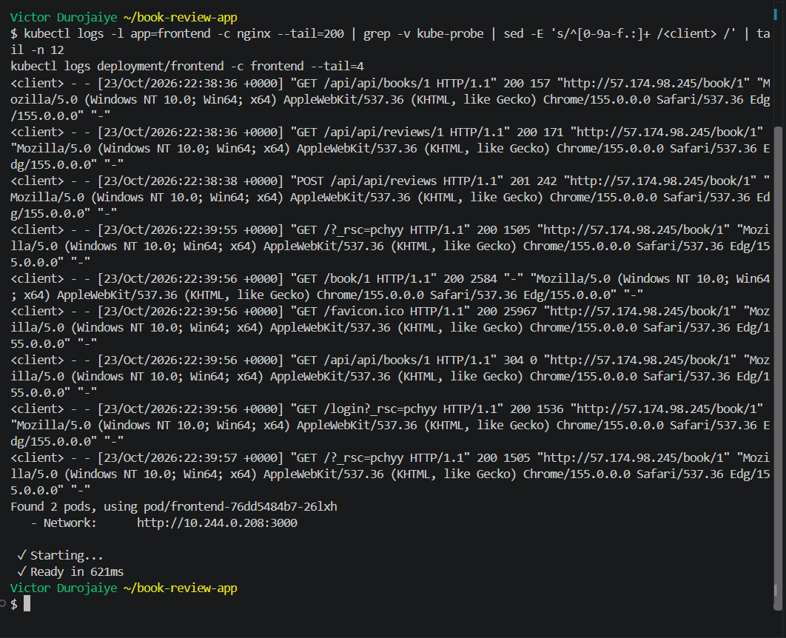

---

#### Screenshot 17 — Backend logs and evidence of a successful database-backed operation

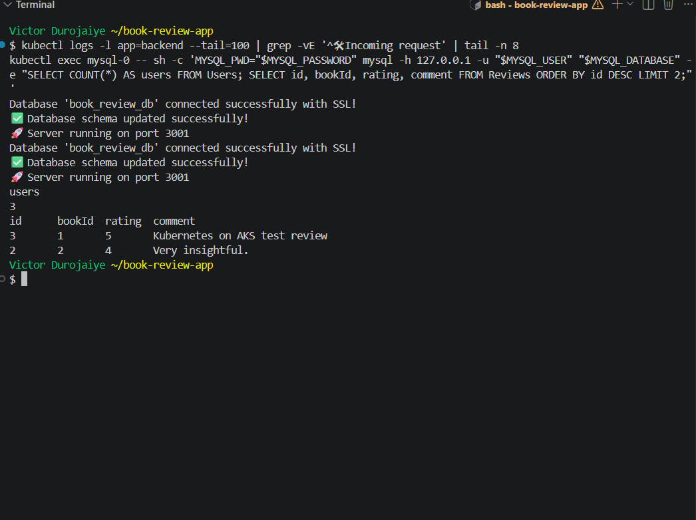

---

#### Screenshot 18 — Optional: Kubernetes dashboard

Not attempted.

Multiple images may be included under a screenshot number when needed to demonstrate the complete user flow.

**Notes:**
- **User flow:** at `http://57.174.98.245` I registered, logged in, and added a 5-star review, `Kubernetes on AKS test review`, to book 1. The Nginx log, with client IPs masked, recorded `POST /api/api/users/register 201`, `POST /api/api/users/login 200` and `POST /api/api/reviews 201`.
- **Same origin:** the browser's Network tab showed every call going to `http://57.174.98.245` itself, with no internal names.
- **Data in MySQL:** `Users` went to 3 rows (the new user is id 3). `Reviews` had the new review as id 3, linked to book 1.
- **Restart test:**
  - I ran `kubectl rollout restart deployment/backend`. The new Pods logged `connected successfully with SSL!` again.
  - Then I deleted `mysql-0`. The new Pod (new UID) attached the same PVC.
  - The review was still in MySQL, still returned by the public API `/api/api/reviews/1`, and still shown in the browser.

---

# Task 9 — Optional: Implement Production Improvements

## Goal

Add selected improvements without breaking the required three-tier architecture.

### Evidence

#### Screenshot 19 — Optional: Evidence of selected Helm, HPA, probe, or TLS improvements

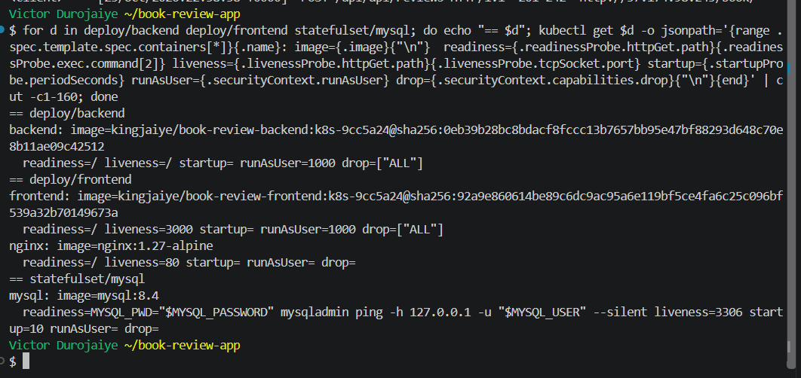

**Notes:** These were built in from the start rather than added afterwards:
- **Probes:** readiness and liveness on every container, plus a startup probe on MySQL.
- **Pinned images:** the backend and frontend images are pinned by digest.
- **Non-root:** the backend and Next.js containers run as `uid=1000`, with all capabilities dropped and no privilege escalation.
- **TLS:** traffic between the backend and MySQL is encrypted.
- **Rollouts:** `maxSurge: 1` / `maxUnavailable: 0` on both Deployments.

The Nginx and MySQL containers use their official images' defaults. Nginx's master process runs as root, and MySQL's entrypoint drops to the `mysql` user. Running Nginx unprivileged would be the next step.

---

# Task 10 — Publish Your Book Review App Deployment on LinkedIn

## Goal

Explain your three-tier architecture, demonstrate the working application, and share what you learned.

### Evidence

#### Screenshot 20 — Published LinkedIn post about your Book Review App deployment on Kubernetes

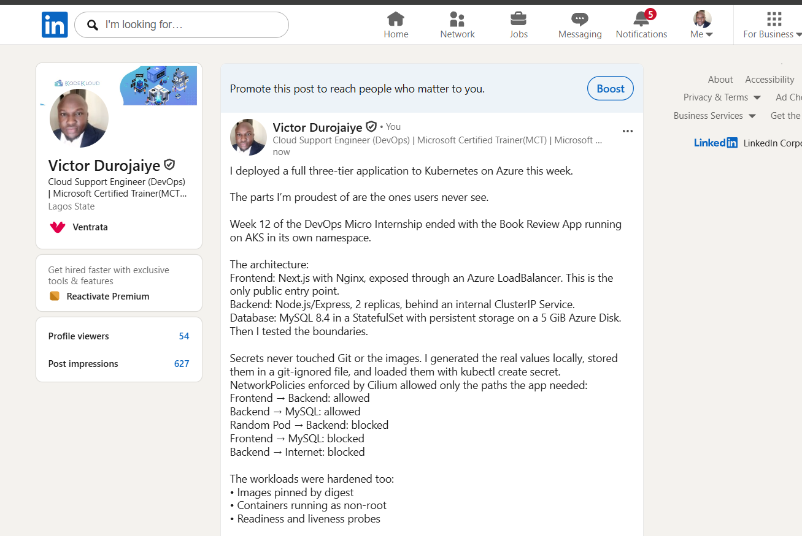

*Victor Durojaiye*

### LinkedIn Post URL

https://www.linkedin.com/posts/victor-jaiye_devopsmicrointernship-kubernetes-aks-ugcPost-7519532101717725184-jYXg/

---

# Final Summary

## What Worked

Describe the application components and user flows you successfully deployed and tested.

The full three-tier app ran on AKS in the `book-review` namespace:
- **Frontend:** Next.js behind an Nginx sidecar, 2 Pods, public through an Azure LoadBalancer at `57.174.98.245`.
- **Backend:** Node.js/Express, 2 Pods, internal only through `backend-service:3001`.
- **Database:** MySQL 8.4 in a StatefulSet on a 5Gi Azure Disk, internal only through the headless `mysql` Service.

Configuration came from ConfigMaps, and credentials came from a Secret that was never written to Git or an image. NetworkPolicies, enforced by Cilium, allowed only frontend → backend and backend → MySQL, and I tested both the allowed and the blocked paths. In the browser, registration, login, reading books and posting a review all worked, and the new rows were in MySQL. The data survived a backend restart and a MySQL Pod deletion.

## Issues and Fixes

Describe the main issues encountered, their causes, and how you resolved them.

- **The solution guide was written for EKS.** It used eksctl, IAM OIDC, the EBS CSI add-on, turning on the VPC CNI policy agent, and `.hostname`. On AKS none of that applies: I used the built-in Azure Disk CSI `managed-csi` StorageClass, Cilium was already enforcing NetworkPolicy because I created the cluster with it, and the LoadBalancer gives `.ip`.
- **The guide's images.** It rebuilt from upstream with a new root `node:20-slim` Dockerfile. I built from my fork instead, which already had the `/api` fix and non-root multi-stage Node 22 Dockerfiles.
- **`CreateContainerConfigError: container has runAsNonRoot and image has non-numeric user (node)`.** Kubernetes can't prove a named user isn't root. I added `runAsUser: 1000` and `runAsGroup: 1000` (the image's `node` UID) to the backend, and wrote it into the frontend from the start.
- **The double `/api` prefix.** The frontend code appends `/api`, and its Dockerfile requires a non-empty base URL, so a same-origin build makes the browser call `/api/api/...`. Nginx routes both `/api/api/` and `/api/` to the backend's `/api/`.
- **CORS.** `ALLOWED_ORIGINS` can only be set once the LoadBalancer IP exists. I updated the ConfigMap and ran `kubectl rollout restart deployment/backend`, because env values are only read when the container starts.
- **Seeding the sample data twice.** The backend seeds its tables on first start. I started it with 1 replica and scaled to 2 afterwards, so the samples were inserted once.
- **The placeholder Secret in the applied folder.** `kubectl diff -f k8s/` showed that the placeholder Secret example would overwrite the real Secret if the whole folder were applied. I moved it to `k8s/examples/`, which `-f k8s/` doesn't read, and `kubectl diff -f k8s/` then returned exit 0.
- **WSL restarted mid-task**, which cleared `KUBECONFIG` and my image tag variable, so kubectl fell back to the `docker-desktop` context. Re-sourcing my cluster env file fixed it. Keeping the AKS kubeconfig in its own file meant the local cluster was never touched.
- **Long terminal pastes sometimes got garbled.** In one case this committed an empty manifest. I checked each step with `git show HEAD:<file> | wc -l` and `kubectl diff`, and the repo, the files and the cluster ended up matching.

## Tools and Sources Used

List the documentation and tools that helped you complete the assignment.

- kubectl v1.36.1, Azure CLI 2.90.0, Docker Desktop 29.8.2 (WSL2 Ubuntu 24.04), Git and GitHub, Docker Hub
- [Kubernetes: Network Policies](https://kubernetes.io/docs/concepts/services-networking/network-policies/)
- [Kubernetes: Configure a Security Context for a Pod or Container](https://kubernetes.io/docs/tasks/configure-pod-container/security-context/)
- [Kubernetes: StatefulSets](https://kubernetes.io/docs/concepts/workloads/controllers/statefulset/)
- [Kubernetes: Secrets](https://kubernetes.io/docs/concepts/configuration/secret/)
- [AKS: Azure CNI powered by Cilium](https://learn.microsoft.com/azure/aks/azure-cni-powered-by-cilium)
- [AKS: Azure Disk CSI driver](https://learn.microsoft.com/azure/aks/azure-disk-csi)
- [MySQL official Docker image](https://hub.docker.com/_/mysql)
- The DMI solution walkthrough (EKS-based), adapted to AKS
- Claude as an assistant for planning, checks and troubleshooting. I ran and verified every command myself.

## Optional Improvements

Describe any optional improvements implemented, or write “Not attempted.”

I added probes on every container (plus a startup probe for MySQL), digest-pinned images, non-root containers with all capabilities dropped, TLS between the backend and MySQL, and zero-downtime rolling update settings (Screenshot 19). Helm, an HPA, Ingress with TLS and the dashboard were not attempted.

## Cleanup or Reuse Plan

State which resources were removed or why the environment is being retained.

- **Azure:** after all the evidence and the LinkedIn post, I deleted the resource group `rg-aks-dmi-wk12`. That removed the AKS cluster, its node, the Azure Disk, the load balancer and the public IPs.
  - `az group exists` returned `false` for both `rg-aks-dmi-wk12` and `MC_rg-aks-dmi-wk12_aks-dmi-wk12_swedencentral`.
  - Neither IP (`57.174.98.245` or Assignment 9's `57.174.252.113`) was in `az network public-ip list`, and `http://57.174.98.245` no longer answers.
  - My other resource groups were not touched.
- **Local:**
  - I shredded the Secret env file and deleted the AKS kubeconfig file and the cluster env file. No leftovers were found, and the kubectl context is back to `docker-desktop`.
  - I logged out of Docker Hub. I'll delete the access token in Docker Hub.
- **Kept on purpose:**
  - The two `kingjaiye/book-review-*` images on Docker Hub, because the manifests reference them by digest.
  - The `k8s/aks` branch on GitHub.

---

# Submission Instructions

- Include your Kubernetes manifests or Helm chart in the linked repository.
- Submit Secret examples containing placeholders only.
- Include Screenshot 1, Screenshots 3–17, and Screenshot 20.
- Include Screenshot 2 only if using Helm.
- Screenshots 18–19 are optional.
- Keep screenshot numbering consistent with the guidelines.
- Use clear, readable screenshots showing relevant configuration, commands, and outputs.
- Make your full name visible in required screenshots.
- Complete the submission details and Final Summary.
- Include your published LinkedIn post URL.
- Capture required evidence before cleanup.
- Do not expose passwords, tokens, JWT secrets, actual Secret values, kubeconfig contents, cloud credentials, or confidential account information.

---

# Completion Checklist

- [x] Selected and configured a supported Kubernetes platform
- [x] Confirmed the context and Ready nodes (Screenshot 1)
- [x] Created and selected the book-review namespace
- [x] Inspected the application repository
- [x] Prepared images accessible to the cluster
- [x] Confirmed Helm if using charts (Screenshot 2, conditional)
- [x] Created the architecture diagram (Screenshot 3)
- [x] Created ConfigMaps and Secrets (Screenshots 4–5)
- [x] Excluded actual Secret values from Git and screenshots
- [x] Provisioned private managed MySQL or persistent Kubernetes MySQL (Screenshot 6)
- [x] Initialized the required database and schema
- [x] Verified database connectivity or schema (Screenshot 7)
- [x] Deployed one or two backend replicas listening on port 3001
- [x] Created the backend ClusterIP Service (Screenshot 8)
- [x] Verified backend-to-database connectivity (Screenshot 9)
- [x] Deployed one or two frontend replicas behind Nginx (Screenshot 10)
- [x] Configured API proxying through the internal backend Service (Screenshot 11)
- [x] Configured and documented frontend access (Screenshot 12)
- [x] Enforced backend access restrictions (Screenshot 13)
- [x] Confirmed that the backend and database are not publicly exposed
- [x] Captured resource status for book-review (Screenshot 14)
- [x] Tested application functionality and database writes (Screenshots 15 and 17)
- [x] Verified saved data after application restart
- [x] Captured frontend and backend logs (Screenshots 16–17)
- [x] Included optional dashboard or improvement evidence if attempted (Screenshots 18–19)
- [x] Published the LinkedIn post (Screenshot 20)
- [x] Included the LinkedIn post URL
- [x] Documented issues, fixes, and useful sources
- [x] Recorded cleanup status or reuse plans
- [x] No sensitive data exposed

---

## 📌 About DMI & CloudAdvisory

DevOps Micro Internship (DMI) is a project-based DevOps program run by Pravin Mishra (The CloudAdvisory) focused on real-world execution, systems thinking, and career readiness.

It helps learners build strong DevOps foundations with hands-on experience.

---

## 📌 Resources

- 🌐 DMI Official Website: https://dmi.pravinmishra.com?utm_source=github&utm_medium=readme  
- 🎓 University: https://university.pravinmishra.com?utm_source=github&utm_medium=readme  
- 💬 Discord Community: https://discord.pravinmishra.com?utm_source=github&utm_medium=readme  
- 📝 Blog: https://dmi.pravinmishra.com/blog?utm_source=github&utm_medium=readme  
- ▶️ YouTube Playlist: https://www.youtube.com/playlist?list=PLFeSNDtI4Cho  
- 🔗 Pravin Mishra (LinkedIn): https://www.linkedin.com/in/pravin-mishra-aws-trainer/  
- 🏢 CloudAdvisory (LinkedIn): https://www.linkedin.com/company/thecloudadvisory/

---

*This submission is part of DevOps Micro Internship (DMI) — Agentic AI Track.*
