# Assignment 11 — AI-Assisted Kubernetes Incident Triage

Part of the DevOps Micro Internship (DMI) with Agentic AI

---

## Purpose

Configure a read-only Bash triage script for your Book Review App, connect it to Claude Code through `/k8s-triage`, simulate one controlled failure, recover the application manually, and verify recovery.

**Workflow: Gather → Analyze → Human Act → Verify**

---

## Submission Details

**Full Name:** Victor Durojaiye

**Kubernetes Platform:** Docker Desktop Kubernetes (kind mode, single node `desktop-control-plane`), context `docker-desktop`. This is my personal lab cluster. The Book Review App from Assignment 10 was redeployed here from my `k8s/aks` manifests, changing only the StorageClass (`managed-csi` to `standard`).

**Selected Workload:** backend (container `backend`, selector `app=backend`, Service `backend-service`)

**Namespace:** book-review

**GitHub Repository URL:** https://github.com/Kingjaiyee/week-12-agentic-k8s

**Simulated Incident:** Invalid image. The backend image was set to the tag `kingjaiye/book-review-backend:does-not-exist`.

**Baseline Status:** HEALTHY (PASS 6, WARN 0, FAIL 0, exit code 0)

**Recovery Status:** Explained WARN, with no FAIL (PASS 5, WARN 1, FAIL 0, exit code 1). The WARN comes from historical image-pull events of the deleted incident Pod.

---

# Task 1 — Discover the Application and Capture a Healthy Baseline

## Goal

Identify the actual application configuration and prove that the selected workload is healthy before incident simulation.

### Evidence

#### Screenshot 1 — Healthy Pods and ready Service backends

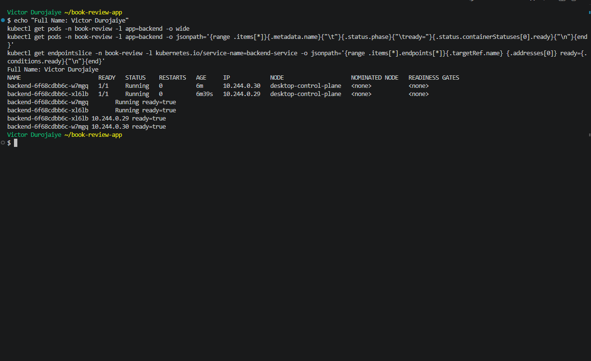

---

#### Screenshot 2 — Workspace directory structure

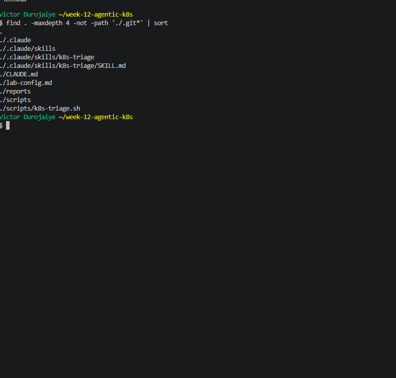

### Notes

**1. What proves the selected Pods are ready, not merely running?**

The `READY` column shows `1/1` for both backend Pods, and each container status reports `ready=true`. `Running` only means the container process has started. `1/1` means the readiness probe on `/` is passing, so Kubernetes considers the Pod able to take traffic.

**2. What proves the Service has ready backends?**

The `backend-service` EndpointSlice lists both backend Pods, `backend-6f68cdbb6c-xl6lb` (10.244.0.29) and `backend-6f68cdbb6c-w7mgq` (10.244.0.30), with `ready=true`. The EndpointSlice is what the Service actually routes to, so this proves the Service can reach working backends. A request through the frontend Nginx to `/api/api/books` also returned the book list.

**3. Why must the original image be recorded before incident simulation?**

Recovery means returning to a known good state, and after the image is broken the Deployment no longer shows what that state was. I read the exact image from the cluster and saved it in `lab-config.md` and `CLAUDE.md`: `kingjaiye/book-review-backend:k8s-9cc5a24@sha256:0eb39b28bc8bdacf8fccc13b7657bb95e47bf88293d648c70e8b11ae09c42512`. Because it is pinned by digest, the recovery restores the same image bytes, not whatever the tag points to later.

---

# Task 2 — Configure CLAUDE.md

## Goal

Define the project configuration, incident workflow, and safety boundary for Claude Code.

### Evidence

#### Screenshot 3 — CLAUDE.md showing application configuration, workflow, safety rules, and output rules

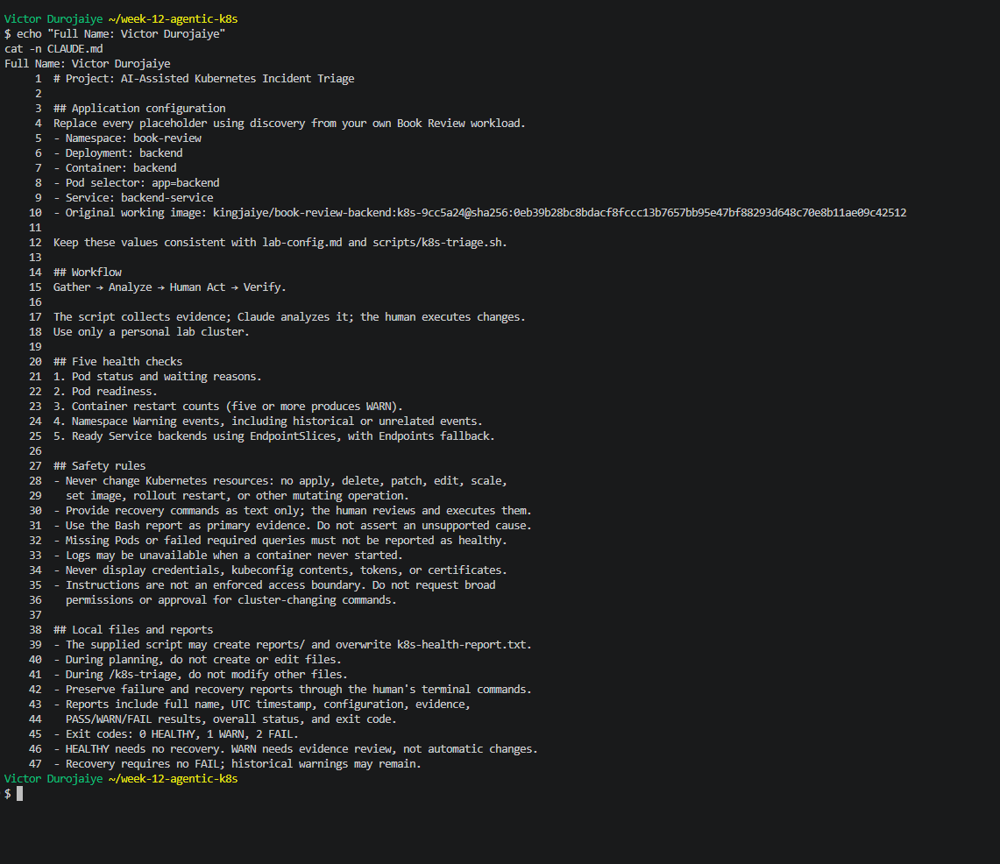

**Notes:**
- I committed the supplied `CLAUDE.md`, `k8s-triage.sh` and `SKILL.md` untouched first (`979d904`), after checking their sha256 hashes. Then I changed only the placeholders, so `git diff` shows exactly 6 changed lines in `CLAUDE.md` (`b88ed72`).
- The same commit added `.claude/settings.json`, which enforces the read-only boundary. It has 9 allow rules for read-only kubectl (`get`, `describe`, `logs`, `events`, `top`, `explain`, `auth can-i`, `rollout status`, `rollout history`). It also has deny rules for:
  - file edits (`Edit`, `Write`, `NotebookEdit`)
  - reading `~/.kube`, `~/.ssh`, `~/.aws`, `~/.azure`, `~/.config`, `~/.docker` and `.env`
  - every state-changing kubectl command (`apply`, `create`, `delete`, `edit`, `patch`, `replace`, `scale`, `set`, `label`, `annotate`, `exec`, `cp`, `port-forward`, `drain`, `cordon`, `taint`, `rollout restart`/`undo` and more), plus `kubectl config`
  - reading Secrets (`kubectl get secret`, `describe secret`)
  - `helm install`/`upgrade`/`uninstall`
  - `git commit`, `git push`, `rm`, `sed -i`, `env` and `printenv`

### Notes

**1. Why does Claude need project-specific cluster rules?**

Without them Claude would have to guess the namespace, workload, labels and Service, and it could inspect or advise on the wrong thing. `CLAUDE.md` pins it to `book-review`, `backend`, `app=backend` and `backend-service`, and it records the original image, so every check and every suggested fix refers to my real workload. It also sets the workflow and the output format, so each analysis is the same shape and easy to compare.

**2. Why must a human execute recovery commands?**

A recovery command changes a live system, and the person running it is accountable for the result. Claude only sees the evidence in the report. It does not know about other traffic, a change freeze, or whether the image it suggests is still the right one. The human checks the suggestion against the recorded configuration and the wider situation before running it. In this lab I did exactly that, in a separate terminal.

**3. Which rule prevents an unsupported diagnosis?**

The rule that every finding must be backed by evidence from the report, and that Claude must say when the evidence is not enough to name a cause. In the healthy baseline Claude wrote "There are no WARN or FAIL results, so I can't name a likely cause and no recovery action is needed", which is that rule in action.

---

# Task 3 — Plan the Read-Only Triage Workflow

## Goal

Ask Claude Code to explain the five health checks before running the supplied script.

### Evidence

#### Screenshot 4 — Claude Code showing the five-check read-only plan

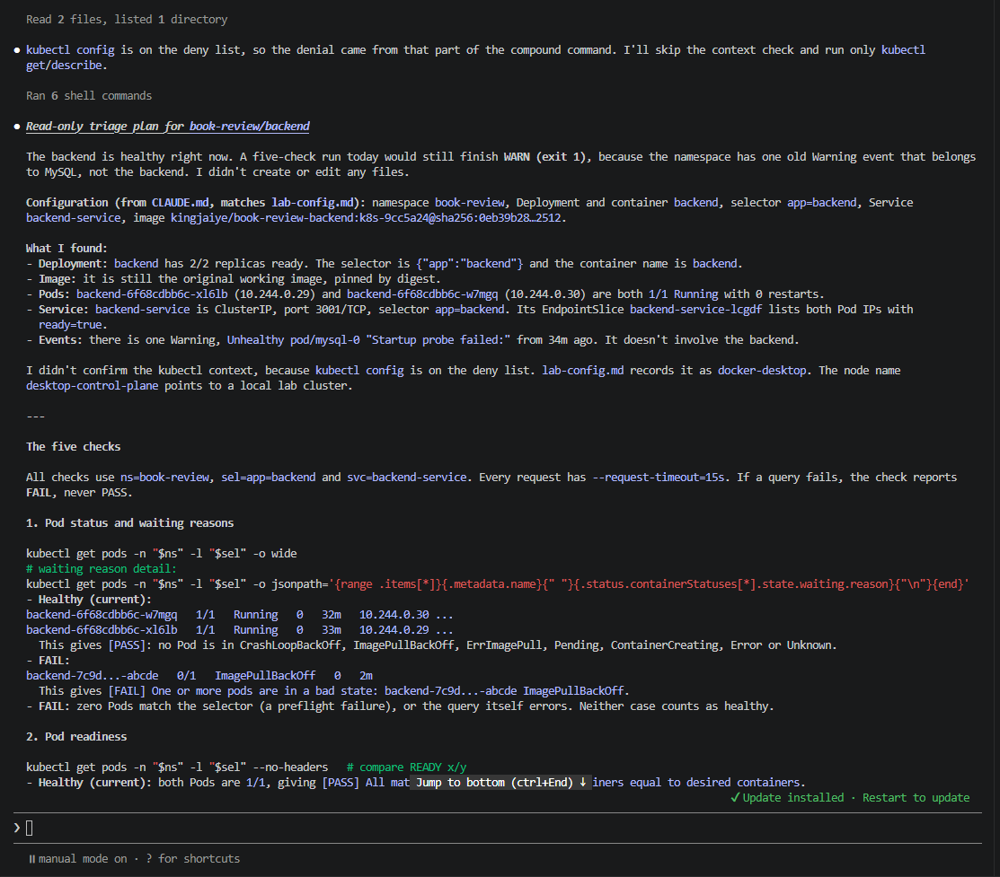

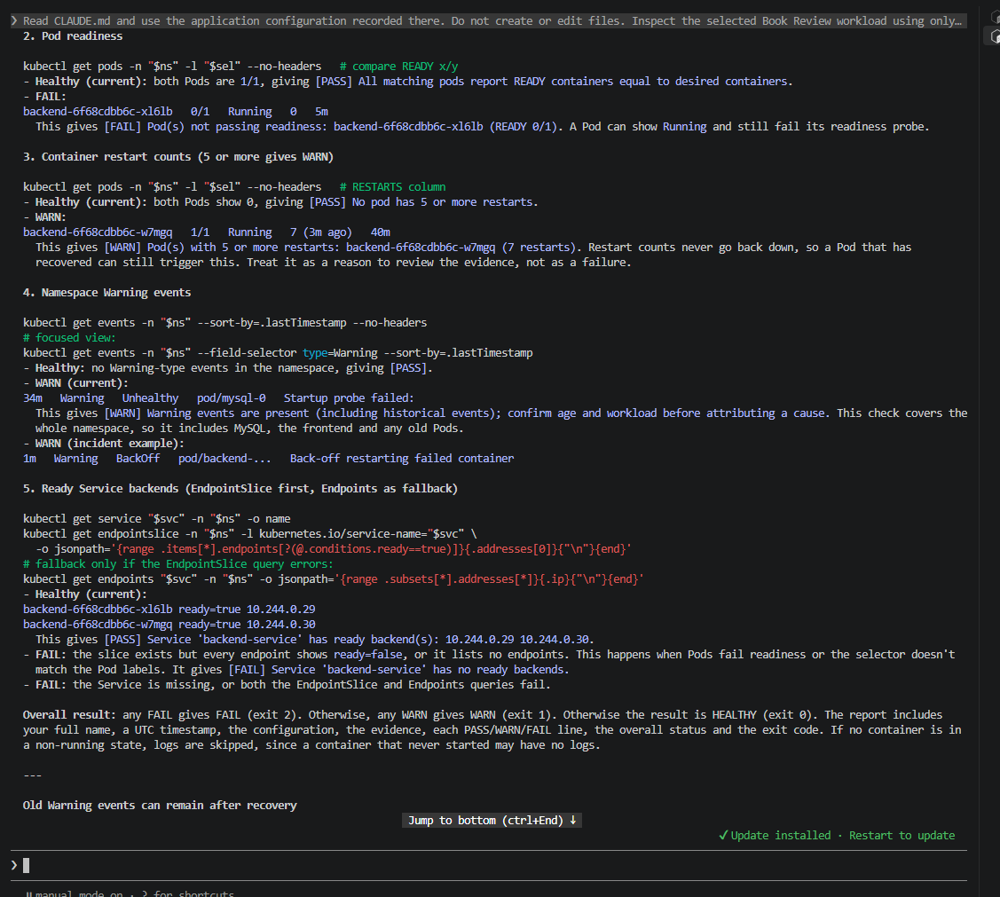

**Notes:**
- Claude Code ran in **manual mode**, with auto mode off.
- **A deny rule fired during this task.** Claude tried a compound command that included `kubectl config`. Claude Code blocked it because `kubectl config` is on the deny list. Claude read `settings.json`, saw the rule, and carried on with single read-only `kubectl get` and `describe` calls.

### Notes

**1. Which part represents the Gather phase?**

The read-only commands that collect facts: `kubectl get pods` for status and restarts, readiness from the `READY` column and container status, `kubectl get events --field-selector type=Warning`, and the `backend-service` EndpointSlice. In the final workflow the `k8s-triage.sh` script runs these and writes them into `reports/k8s-health-report.txt`. That script is the Gather phase.

**2. How did you verify that Claude did not change anything?**

Before starting Claude, I saved each Deployment's `generation` and `resourceVersion`, plus every Pod name in the namespace, to `/tmp/a11-before.txt`. I recorded the same values after the session and compared them with `diff`, which printed `cluster unchanged`. Any change Claude made would have altered at least one of those values. `git status --short` was also empty, so no files were changed.

**3. Why is planning before coding useful for incident triage?**

It settles what "healthy", "warning" and "failure" mean for each check before an incident happens, so the script and its exit codes are agreed in advance and not invented under pressure. It also let me check the commands were read-only before anything ran. The plan also spotted two things early: the script's placeholders were not filled yet, and an old MySQL startup-probe Warning would turn the baseline into WARN.

---

# Task 4 — Configure and Validate the Bash Script

## Goal

Configure the supplied triage script for the selected workload and validate its syntax.

### Evidence

#### Screenshot 5 — Script configuration variables and checks array

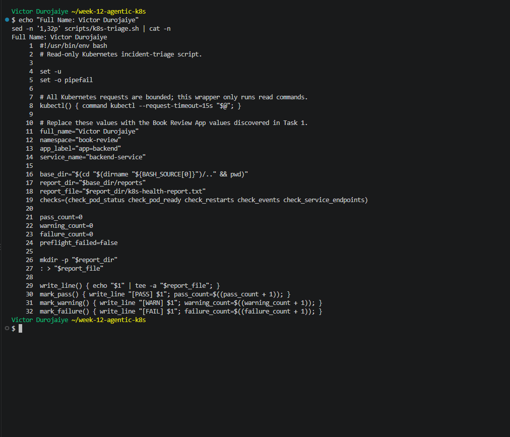

---

#### Screenshot 6 — Functions for status, readiness, restarts, events, and Service backends

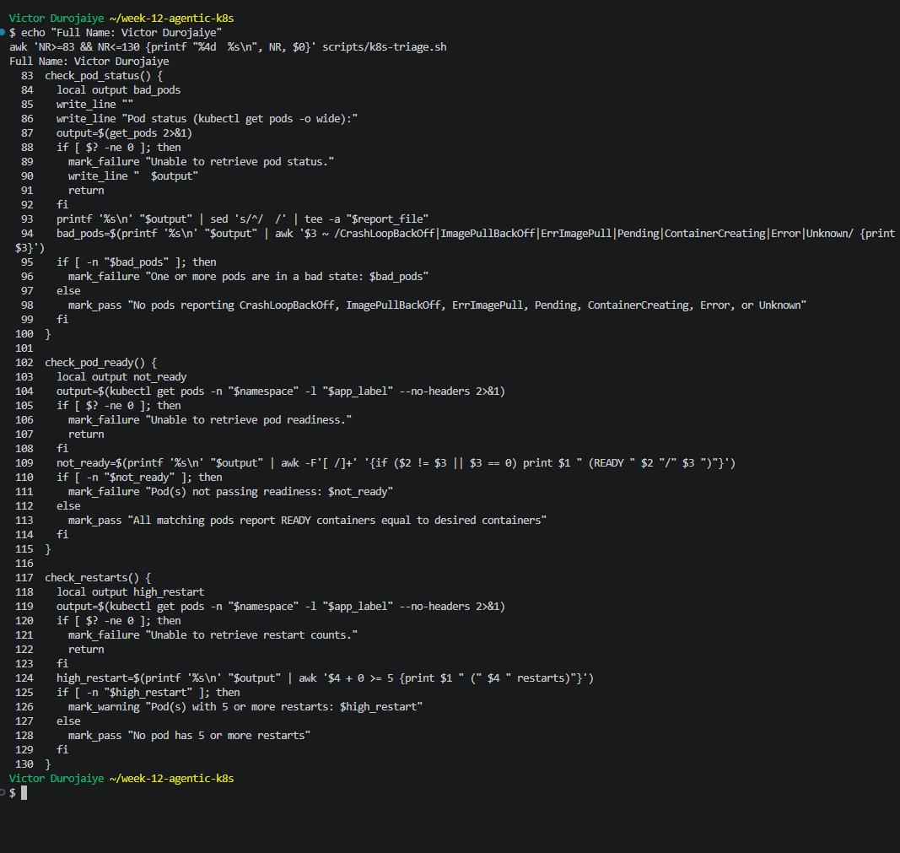

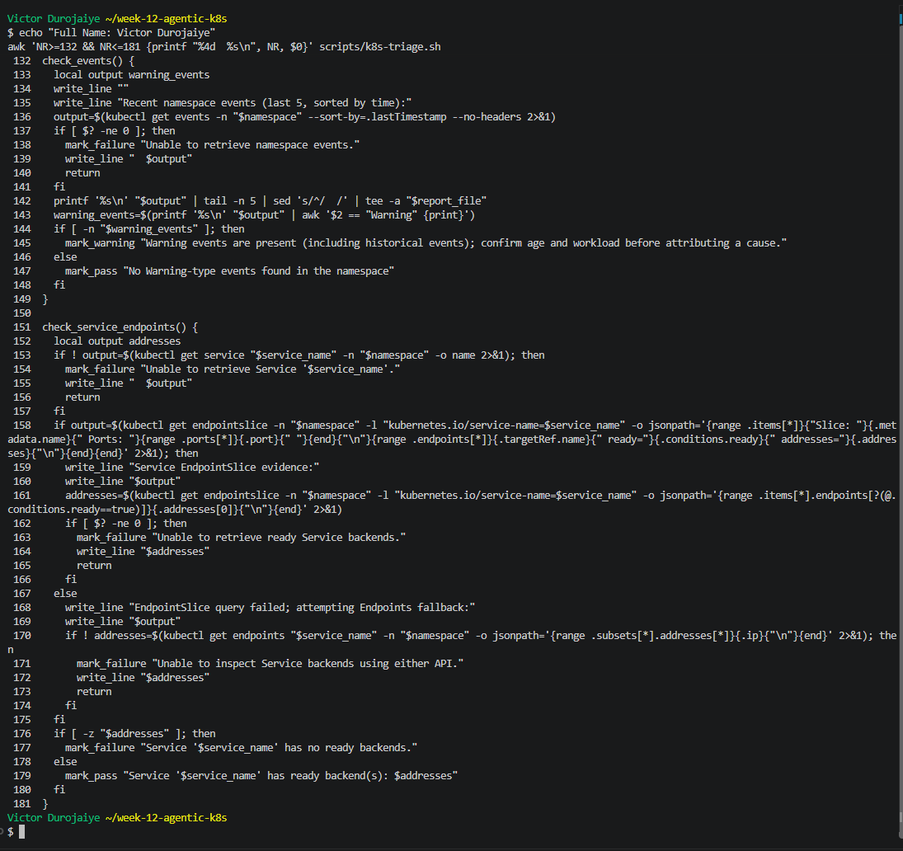

---

#### Screenshot 7 — Preflight, summary, and exit-code logic

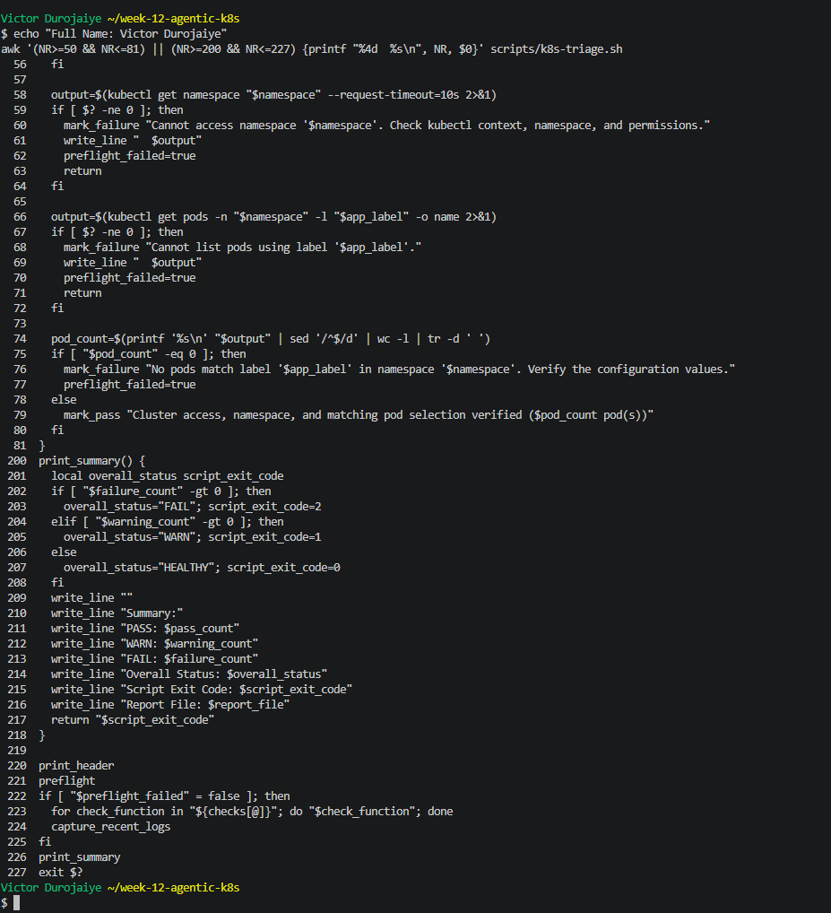

---

#### Screenshot 8 — Successful syntax validation and executable permission

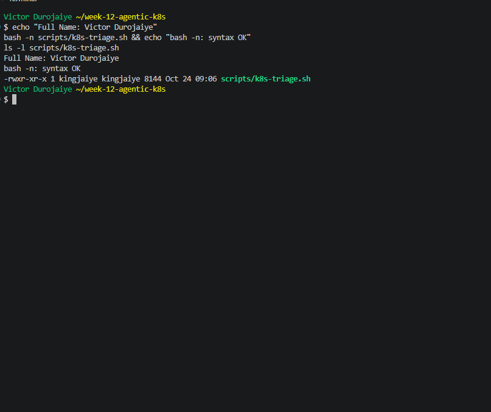

**Notes:**
- Only lines 11 to 14 changed (`full_name`, `namespace`, `app_label`, `service_name`), committed as `ec6bbe6` with the file mode `100755`.
- `bash -n` printed `syntax OK`, and the permissions are `-rwxr-xr-x`.
- The remaining `<Your Full Name>` on line 52 is the preflight guard that compares against it, so it is kept on purpose.
- I noticed that the bad-state pattern in the pod status check does not include `CreateContainerConfigError` or `InvalidImageName`. Those states would still be caught by the readiness check, so I left the supplied script unchanged.

### Notes

**1. Why must the script fail when no Pods match the configured selector?**

If the selector is wrong, or the workload is gone, every other check would find nothing to complain about and the report would look healthy while it inspected nothing. Failing in preflight when zero Pods match turns "no evidence" into a FAIL, not a false HEALTHY.

**2. How does the readiness check detect a running but unready Pod?**

It reads the `READY` column, ready containers over total containers, for every matching Pod, and fails any Pod where the two numbers differ, whatever its STATUS says. In the incident, `backend-6b58644cd8-5l7xk` showed `READY 0/1` and the check reported `Pod(s) not passing readiness`.

**3. Why are Service backends checked separately from Pod health?**

Healthy Pods do not guarantee a working Service. The Service selector could be wrong, the port could not match, or no Pod could be listed as ready in the EndpointSlice. Users reach the app through the Service, so the script checks the EndpointSlice directly for `ready=true` addresses. The reverse also holds: in my incident one Pod was failing, but the Service still had two ready backends, and only this check showed that.

**4. What do exit codes 0, 1, and 2 represent?**

`0` is HEALTHY (every check passed), `1` is WARN (no failures, but something needs a look, such as Warning events), and `2` is FAIL (at least one check failed). Any FAIL makes the overall result FAIL, so automation can act on the exit code without parsing the report.

---

# Task 5 — Run the Healthy Baseline Report

## Goal

Run the script on the healthy application and confirm that it contains no failed checks.

### Evidence

#### Screenshot 9 — Baseline report showing your full name and all checks

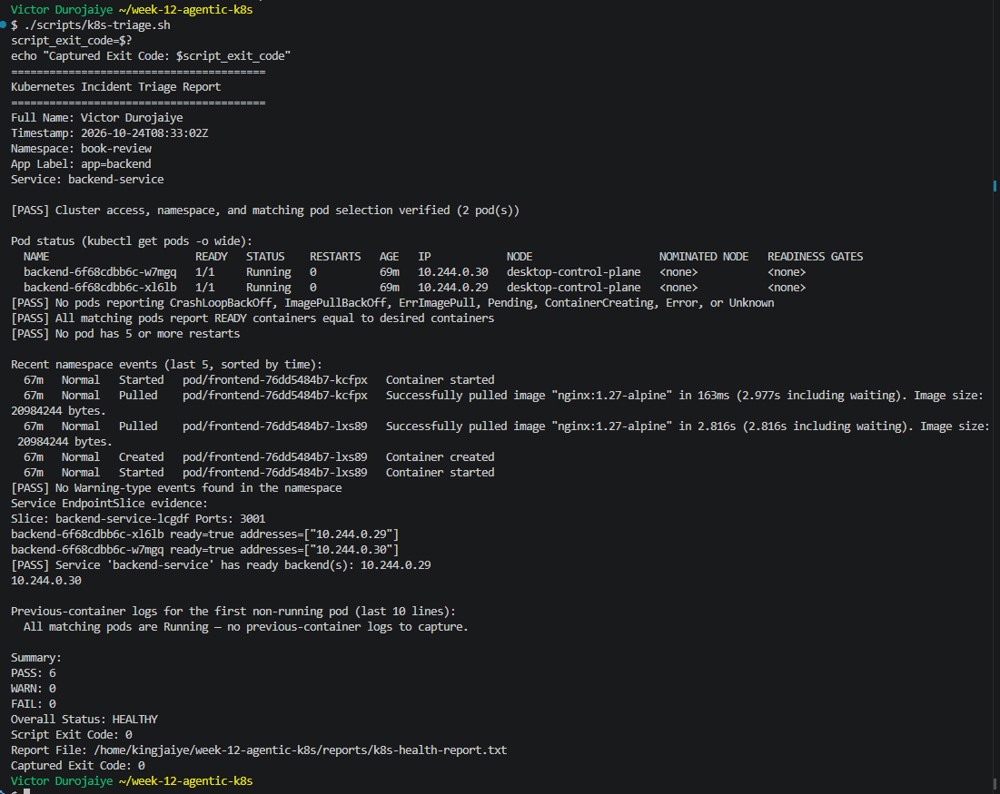

---

#### Screenshot 10 — Captured exit code and final summary

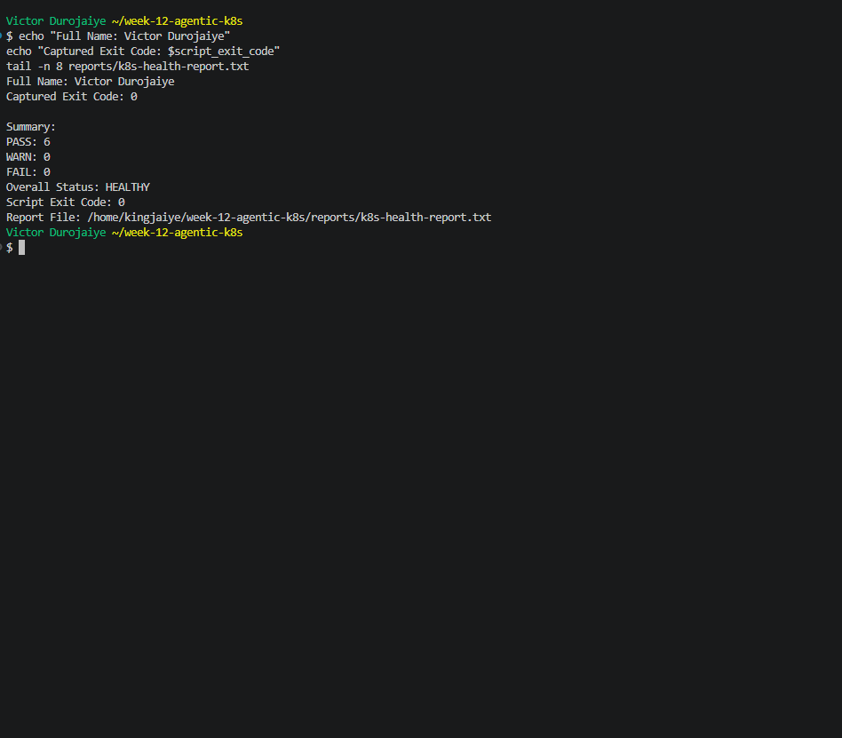

**Notes:**
- Before the baseline, an old `Startup probe failed` Warning event from `mysql-0` was still in the namespace. MySQL's startup probe fails on purpose while the database initialises. I waited for it to expire (events last about an hour) so the baseline would be a clean HEALTHY, and not a WARN caused by an unrelated, expected event.
- The baseline was saved as `reports/baseline-report.txt` (timestamp `2026-10-24T08:33:02Z`) and committed as `b57b6dc`.

### Notes

**1. What is the baseline status?**

`Overall Status: HEALTHY`, with PASS 6, WARN 0 and FAIL 0. The script's exit code was `0`, and the value captured with `script_exit_code=$?` straight after the run was also `0`.

**2. Which evidence proves the Service has a ready backend?**

The line `[PASS] Service 'backend-service' has ready backend(s): 10.244.0.29 10.244.0.30`, backed by the EndpointSlice `backend-service-lcgdf` on port 3001. It lists `backend-6f68cdbb6c-xl6lb` and `backend-6f68cdbb6c-w7mgq`, both `ready=true`.

**3. What is the difference between a warning and a failure?**

A failure is a current problem that breaks the workload's health: a Pod in a bad state, an unready Pod, too many restarts, or no ready Service backends. A warning is a signal worth checking that may not be a current fault, such as Warning events, which can be historical or come from another workload. A warning needs to be explained. A failure needs to be fixed.

---

# Task 6 — Configure and Run the Claude Code Skill

## Goal

Connect the Bash script to a manually invoked Claude Code evidence-analysis workflow.

### Evidence

#### Screenshot 11 — SKILL.md showing frontmatter and safety rules

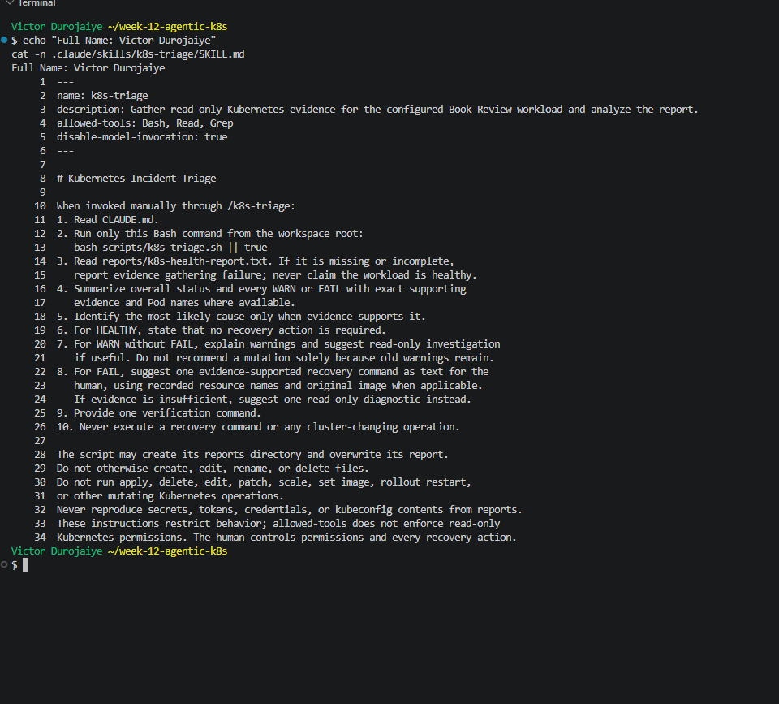

---

#### Screenshot 12 — Baseline `/k8s-triage` analysis

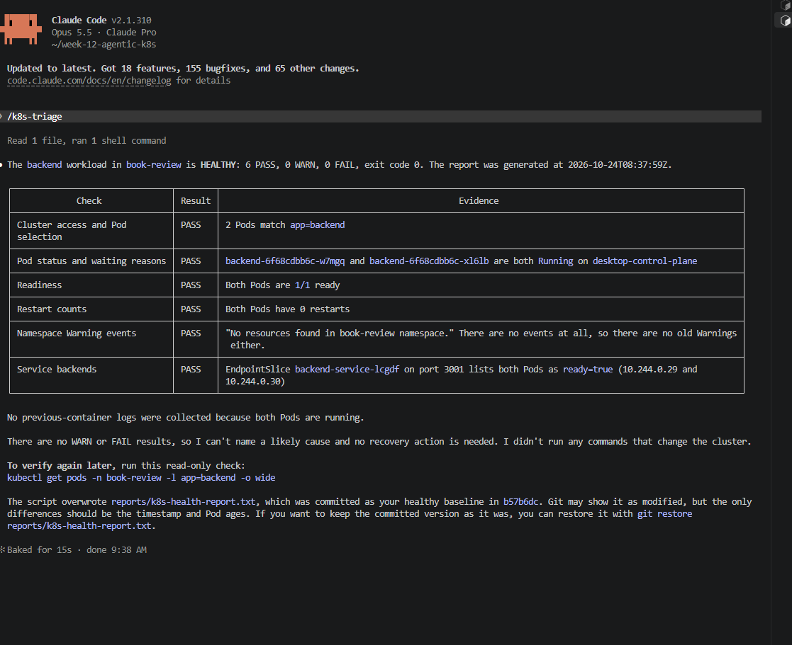

**Notes:**
- `SKILL.md` is the supplied file, unchanged (sha256 `79ed97fc...` matches). Its frontmatter is `name: k8s-triage`, `allowed-tools: Bash, Read, Grep` and `disable-model-invocation: true`, so the skill only runs when I type `/k8s-triage`.
- I ran it in a fresh Claude Code session in manual mode, and it read 1 file and ran 1 shell command, the triage script. Before and after the run, `diff` of Deployment generation, resource version and Pod names printed `cluster unchanged`, and `git status` was empty.
- Claude made one wrong claim. It said `reports/k8s-health-report.txt` was committed in `b57b6dc`. That commit added `baseline-report.txt`, and `k8s-health-report.txt` is git-ignored. I checked the claim against git and did not act on it.

### Notes

**1. What does Bash do in this workflow?**

Bash does the Gather work. `k8s-triage.sh` runs a fixed set of read-only kubectl commands, scores each check as PASS, WARN or FAIL, writes the evidence to `reports/k8s-health-report.txt`, and returns exit code 0, 1 or 2. It does the same thing every time, so two reports can be compared fairly.

**2. What does Claude do in this workflow?**

Claude does the Analyze work. Through the skill it runs the script, reads the report, explains each result with the evidence, names the most likely cause when the evidence supports one, and suggests a recovery command as text. It does not change the cluster or the files.

**3. Why are instructions alone insufficient to guarantee read-only access?**

Instructions in `CLAUDE.md` and `SKILL.md` are text the model is asked to follow, not a control that stops it. A skill's `allowed-tools` only pre-approves tools, it blocks nothing. The real controls are the deny rules in `.claude/settings.json` and manual approval of every tool call. I saw both matter:
- **A deny rule fired.** In Task 3, Claude tried a compound command with `kubectl config`, and the deny rule blocked it.
- **The deny rules have a gap.** They match command prefixes, so a reordered command such as `kubectl -n book-review set image ...` (which is how Claude wrote its own suggestion) would not match `kubectl set`. Manual mode covers that gap, because I still have to approve each command.

A further layer would be running Claude with a Kubernetes identity that only has read RBAC.

---

# Task 7 — Simulate One Controlled Incident

## Goal

Create one controlled failure, save its evidence, and let Claude analyze it without executing recovery.

### Evidence

#### Screenshot 13 — Failed or unready Pod evidence and current Service backends

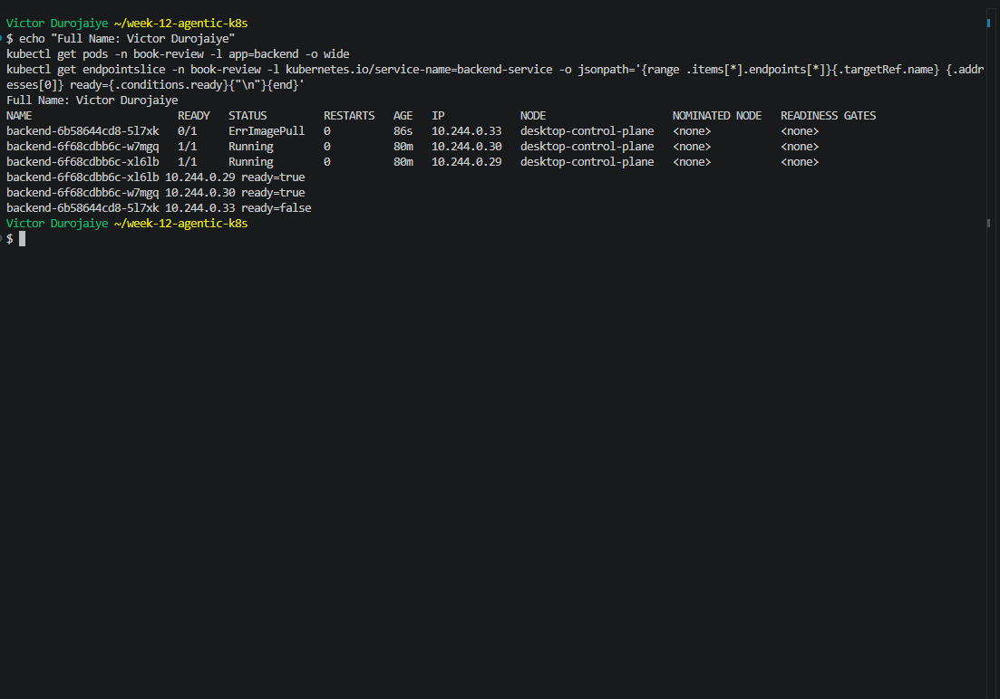

---

#### Screenshot 14 — Failed `/k8s-triage` analysis with evidence and a suggested manual recovery command

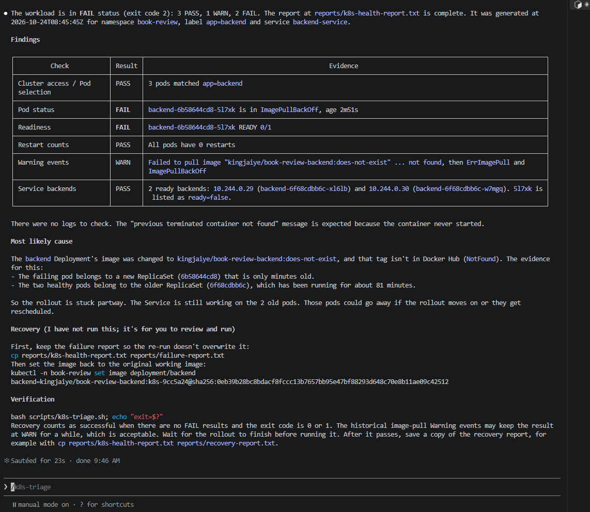

---

#### Screenshot 15 — Saved `incident-failure-report.txt`

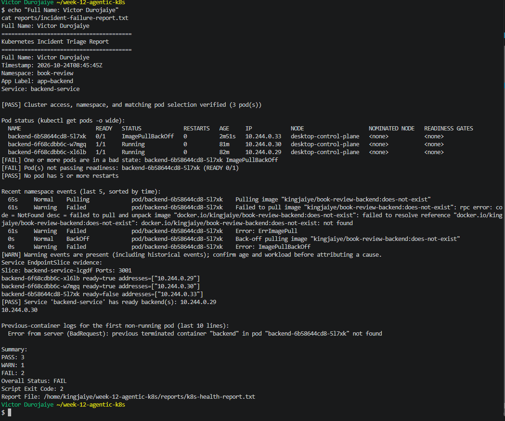

**Notes:**
- I applied the failure myself in a regular WSL terminal, not in Claude Code, after confirming the context was `docker-desktop`:
  `kubectl set image deployment/backend backend=kingjaiye/book-review-backend:does-not-exist -n book-review`
- I copied the report to `reports/incident-failure-report.txt` straight after Claude's run (timestamp `2026-10-24T08:45:45Z`), before anything else could overwrite it.
- Claude suggested saving it as `reports/failure-report.txt`. The assignment requires `incident-failure-report.txt`, so I kept the required name.

### Notes

**1. Which failure did you choose?**

Option A, an invalid image. I pointed the backend container at `kingjaiye/book-review-backend:does-not-exist`, a tag that does not exist on Docker Hub.

**2. Which checks failed, and what evidence proved it?**

The report was `Overall Status: FAIL` with exit code 2 (PASS 3, WARN 1, FAIL 2):
- **Pod status FAIL:** `backend-6b58644cd8-5l7xk ImagePullBackOff`.
- **Readiness FAIL:** `backend-6b58644cd8-5l7xk (READY 0/1)`.
- **Events WARN:** `Failed to pull image "kingjaiye/book-review-backend:does-not-exist": ... not found`, followed by `Error: ErrImagePull` and `Error: ImagePullBackOff`.

The restart and Service checks passed. Restarts were 0 because the container never started, and the previous-container log lookup returned "not found" for the same reason.

**3. Did Claude execute recovery? Why is that important?**

No. Claude named the missing tag as the likely cause, using the evidence that the failing Pod belonged to a ReplicaSet only minutes old while the healthy Pods belonged to the older one. It then wrote the restore command under "I have not run this; it's for you to review and run". That matters because the change stays with the person who is accountable for the cluster and can see the wider impact. If an AI acts automatically on a wrong diagnosis, it can turn one problem into a bigger one.

**4. Why might the Service retain ready backends during the incident?**

My backend Deployment uses a rolling update with `maxSurge: 1` and `maxUnavailable: 0`. Kubernetes added one new Pod and kept both old Pods until it was ready. The new Pod never became ready, so the rollout stalled and the old Pods kept serving. The EndpointSlice still showed `xl6lb` (10.244.0.29) and `w7mgq` (10.244.0.30) as `ready=true`, and the new Pod as `ready=false`, so users were not affected. The rollout was still stuck, and those old Pods would be at risk if they were rescheduled.

---

# Task 8 — Recover Manually and Verify

## Goal

Restore the healthy configuration yourself and verify recovery using a second triage report.

### Evidence

#### Screenshot 16 — Recovered Pods and ready Service backends

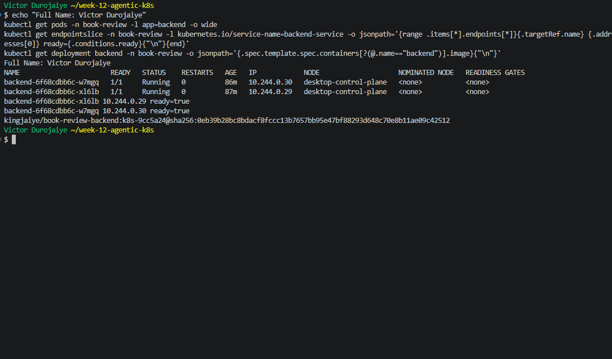

---

#### Screenshot 17 — Recovered `/k8s-triage` analysis

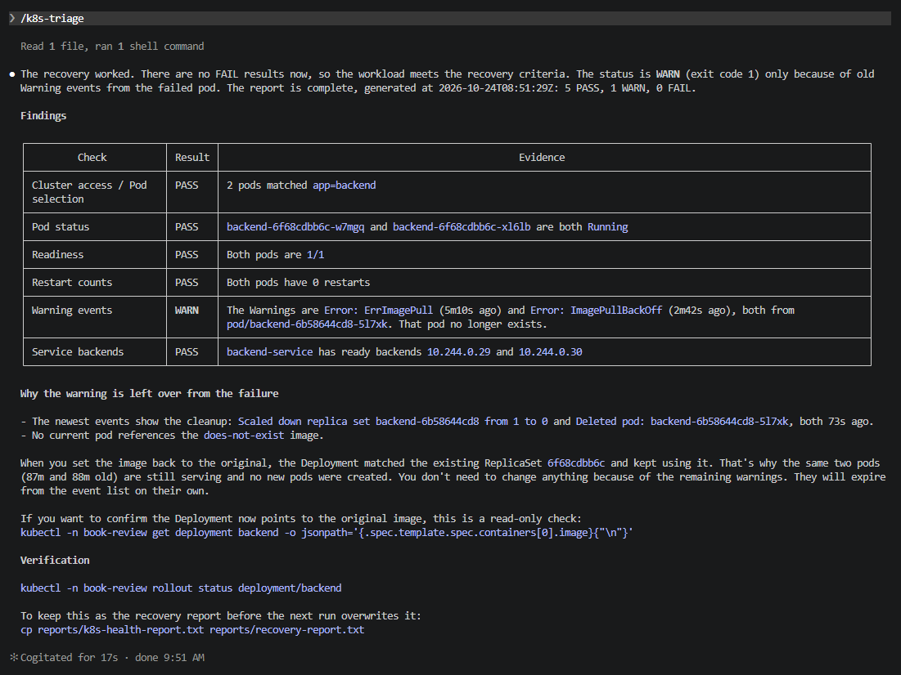

---

#### Screenshot 18 — Reports directory showing failure and recovery reports

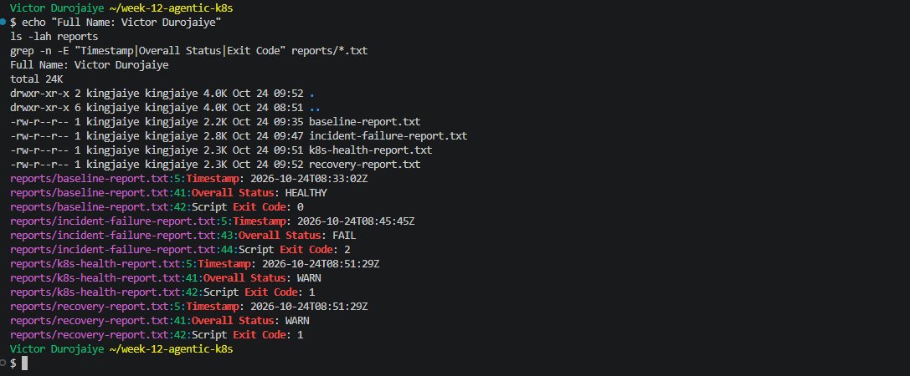

---

#### Screenshot 19 — `incident-summary.md` with all required sections

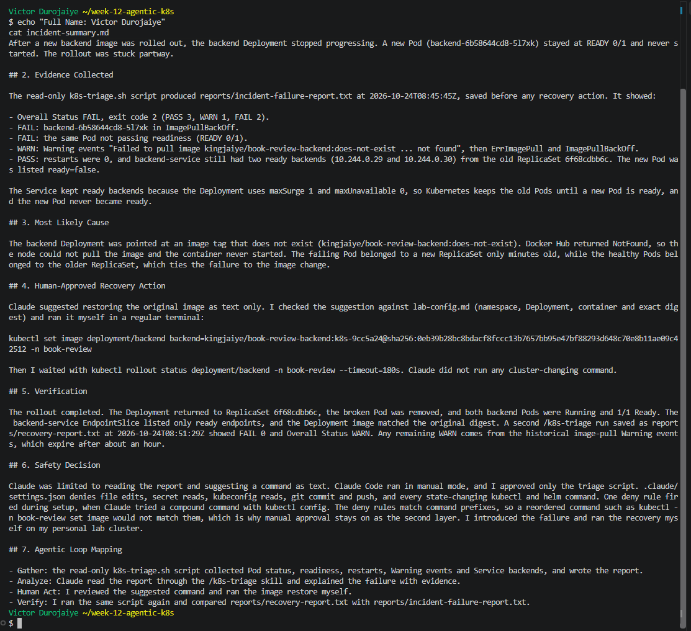

**Notes:**
- The reports, `incident-summary.md` and all project files are committed and pushed to https://github.com/Kingjaiyee/week-12-agentic-k8s (`0117064`).

### Notes

**1. What manual recovery action did you execute?**

First I asked Claude to show the recovery command again as plain text only. Then I checked it against `lab-config.md` and ran it myself in the regular terminal:

```bash
kubectl set image deployment/backend backend=kingjaiye/book-review-backend:k8s-9cc5a24@sha256:0eb39b28bc8bdacf8fccc13b7657bb95e47bf88293d648c70e8b11ae09c42512 -n book-review
kubectl rollout status deployment/backend -n book-review --timeout=180s
```

The rollout printed `deployment "backend" successfully rolled out`.

**2. What proves the workload recovered?**

- **Pods:** both backend Pods are `1/1 Running` with 0 restarts, and the incident Pod `5l7xk` is gone.
- **ReplicaSets:** `backend-6f68cdbb6c` is back at 2/2/2, and `backend-6b58644cd8` is at 0. Restoring the exact original template matched the existing ReplicaSet, so no new Pods were needed.
- **Service:** the EndpointSlice lists only ready endpoints, 10.244.0.29 and 10.244.0.30.
- **Image:** the Deployment image is the original digest again.
- **Recovery report:** `reports/recovery-report.txt` (`2026-10-24T08:51:29Z`) shows FAIL 0.

**3. Why is the second triage run necessary?**

A Pod listing alone can look fine while something else is still wrong, for example no ready endpoints behind the Service, a rising restart count, or new Warning events. The second run repeats the same five checks in the same way, so the recovery report can be compared line by line with the failure report. It is the Verify step that proves the fix worked, not just that the command ran.

**4. Why should AI not automatically restart every failing production workload?**

A restart treats the symptom and can hide or worsen the cause. In this incident, restarting would have done nothing, because the image tag did not exist and every new Pod would fail the same way. In other cases, restarts can lose in-memory state, overload a database as many Pods reconnect at once, interrupt users, or erase the evidence needed for a diagnosis. Production changes also need someone accountable who understands the impact. The safe split is that the AI explains and recommends, and the human decides and acts.

### Remaining WARN Results

The recovery report has one WARN: `Warning events are present (including historical events)`. The events are `Error: ErrImagePull` and `Error: ImagePullBackOff` from `pod/backend-6b58644cd8-5l7xk`, the incident Pod, which no longer exists. The newest events show the cleanup (`Scaled down replica set backend-6b58644cd8 from 1 to 0` and `Deleted pod: backend-6b58644cd8-5l7xk`). No current Pod uses the `does-not-exist` image. These are historical events that expire on their own after about an hour, so no action is needed. Every other check passed.

---

# Task 9 — Publish Your Kubernetes Incident-Triage Workflow on LinkedIn

## Goal

Share the incident-triage workflow you completed and explain the role of human control.

### Evidence

#### Screenshot 20 — Published LinkedIn post about your Kubernetes incident-triage workflow

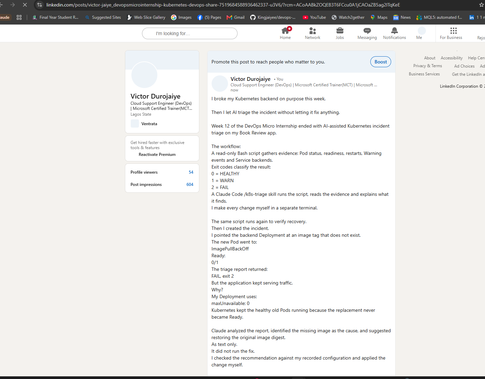

*Victor Durojaiye*

### LinkedIn Post URL

https://www.linkedin.com/posts/victor-jaiye_devopsmicrointernship-kubernetes-devops-share-7519684588936462337-u3V6/

---

# Required Project Files

All of these are in https://github.com/Kingjaiyee/week-12-agentic-k8s:

- [`CLAUDE.md`](https://github.com/Kingjaiyee/week-12-agentic-k8s/blob/main/CLAUDE.md)
- [`lab-config.md`](https://github.com/Kingjaiyee/week-12-agentic-k8s/blob/main/lab-config.md)
- [`scripts/k8s-triage.sh`](https://github.com/Kingjaiyee/week-12-agentic-k8s/blob/main/scripts/k8s-triage.sh)
- [`.claude/skills/k8s-triage/SKILL.md`](https://github.com/Kingjaiyee/week-12-agentic-k8s/blob/main/.claude/skills/k8s-triage/SKILL.md)
- [`reports/incident-failure-report.txt`](https://github.com/Kingjaiyee/week-12-agentic-k8s/blob/main/reports/incident-failure-report.txt)
- [`reports/recovery-report.txt`](https://github.com/Kingjaiyee/week-12-agentic-k8s/blob/main/reports/recovery-report.txt)
- [`incident-summary.md`](https://github.com/Kingjaiyee/week-12-agentic-k8s/blob/main/incident-summary.md)

The repo also has `.claude/settings.json` (the deny rules), `reports/baseline-report.txt`, and a `.gitignore` for the working report `reports/k8s-health-report.txt`.

My `incident-summary.md` contains all seven sections:

1. Reported Symptom
2. Evidence Collected
3. Most Likely Cause
4. Human-Approved Recovery Action
5. Verification
6. Safety Decision
7. Agentic Loop Mapping

---

# Final Summary

## Evidence and Cause

The failure report (`2026-10-24T08:45:45Z`) was FAIL with exit code 2. It showed the new backend Pod `backend-6b58644cd8-5l7xk` in `ImagePullBackOff` at `READY 0/1`, and image-pull Warning events saying `kingjaiye/book-review-backend:does-not-exist` was not found on Docker Hub. The supported cause is an image tag that does not exist, so the container could never start. The two old Pods kept the Service working because the rollout uses `maxUnavailable: 0`.

## Manual Recovery

In a regular terminal, outside Claude Code, I ran `kubectl set image deployment/backend backend=kingjaiye/book-review-backend:k8s-9cc5a24@sha256:0eb39b28bc8bdacf8fccc13b7657bb95e47bf88293d648c70e8b11ae09c42512 -n book-review`. I had checked Claude's suggestion against the image recorded in `lab-config.md` first. Then I waited with `kubectl rollout status --timeout=180s`.

## Verification

The rollout completed, the Deployment returned to ReplicaSet `6f68cdbb6c`, and both backend Pods were `1/1 Running`. The incident Pod was gone, the EndpointSlice listed only ready endpoints, and the image matched the original digest. The second `/k8s-triage` run, saved as `reports/recovery-report.txt`, showed FAIL 0 and an explained WARN from historical events of the deleted Pod.

## Safety Decision

Claude's role was limited to running the read-only script and explaining the report, in three ways:
- **Manual mode:** Claude Code stayed in manual mode, and I approved only `bash scripts/k8s-triage.sh || true`.
- **Deny rules:** `.claude/settings.json` denies file edits, reading kubeconfig, credentials and Secrets, git commit and push, and every state-changing kubectl and helm command. One of them blocked a `kubectl config` call in Task 3.
- **Checking the AI:** I compared the cluster state before and after Claude's runs to prove nothing changed, and I checked Claude's claims, catching a wrong git claim and a non-standard report name.

The failure and the recovery were both run by me, on my personal lab cluster.

---

# Submission Instructions

- Include all 20 required screenshots under their corresponding Evidence sections.
- Complete all Notes questions in your own words.
- Include the required project files in your linked repository.
- Include your published LinkedIn post URL.
- Use clear, readable screenshots showing relevant commands, configuration, and outputs.
- Display your full name before taking required terminal screenshots.
- Preserve the failure report before recovery.
- Ensure the baseline and recovery reports contain no FAIL results.
- Explain any WARN results remaining after recovery.
- Review reports, logs, configuration records, and screenshots before publishing.
- Do not expose credentials, kubeconfig contents, tokens, certificates, JWT secrets, or confidential account information.

---

# Completion Checklist

- [x] Confirmed the personal lab context
- [x] Discovered and recorded application configuration
- [x] Recorded the original working image
- [x] Captured healthy Pods and ready Service backends (Screenshot 1)
- [x] Created the workspace (Screenshot 2)
- [x] Configured CLAUDE.md (Screenshot 3)
- [x] Reviewed the five-check triage plan (Screenshot 4)
- [x] Configured and reviewed the supplied script (Screenshots 5–7)
- [x] Passed Bash syntax validation and set executable permission (Screenshot 8)
- [x] Captured a baseline report with no FAIL (Screenshot 9)
- [x] Captured the correct exit code (Screenshot 10)
- [x] Configured and invoked `/k8s-triage` (Screenshots 11–12)
- [x] Simulated one controlled incident manually (Screenshot 13)
- [x] Reviewed Claude’s failed-state analysis (Screenshot 14)
- [x] Saved failure evidence before recovery (Screenshot 15)
- [x] Executed recovery manually and waited for rollout completion
- [x] Confirmed recovered Pods and ready Service backends (Screenshot 16)
- [x] Captured recovery analysis with no FAIL (Screenshot 17)
- [x] Explained any remaining warnings
- [x] Saved failure and recovery reports (Screenshot 18)
- [x] Completed the seven-section incident summary (Screenshot 19)
- [x] Answered all Notes questions
- [x] Published the LinkedIn post (Screenshot 20)
- [x] Included the LinkedIn post URL
- [x] Included all required project files
- [x] Checked that no sensitive information is exposed

---

## 📌 About DMI & CloudAdvisory

DevOps Micro Internship (DMI) is a project-based DevOps program run by Pravin Mishra (The CloudAdvisory) focused on real-world execution, systems thinking, and career readiness.

It helps learners build strong DevOps foundations with hands-on experience.

---

## 📌 Resources

- 🌐 DMI Official Website: https://dmi.pravinmishra.com?utm_source=github&utm_medium=readme  
- 🎓 University: https://university.pravinmishra.com?utm_source=github&utm_medium=readme  
- 💬 Discord Community: https://discord.pravinmishra.com?utm_source=github&utm_medium=readme  
- 📝 Blog: https://dmi.pravinmishra.com/blog?utm_source=github&utm_medium=readme  
- ▶️ YouTube Playlist: https://www.youtube.com/playlist?list=PLFeSNDtI4Cho  
- 🔗 Pravin Mishra (LinkedIn): https://www.linkedin.com/in/pravin-mishra-aws-trainer/  
- 🏢 CloudAdvisory (LinkedIn): https://www.linkedin.com/company/thecloudadvisory/

---

*This submission is part of DevOps Micro Internship (DMI) — Agentic AI Track.*